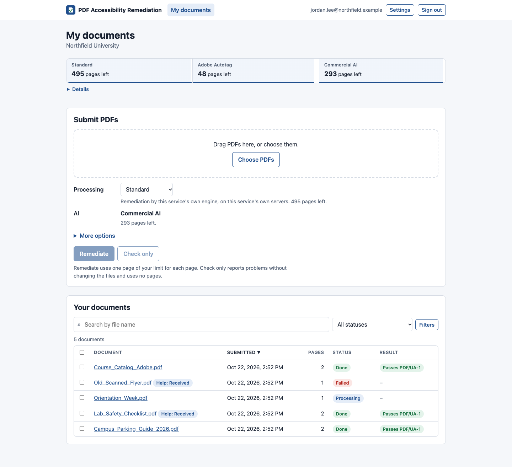
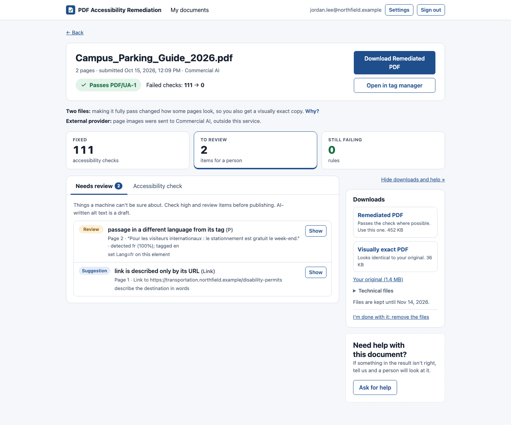
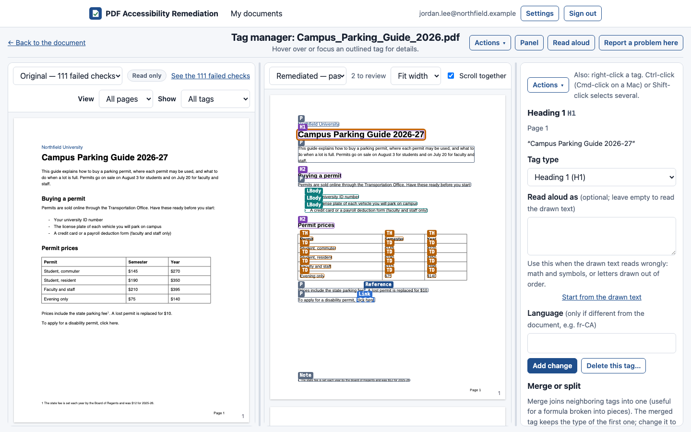
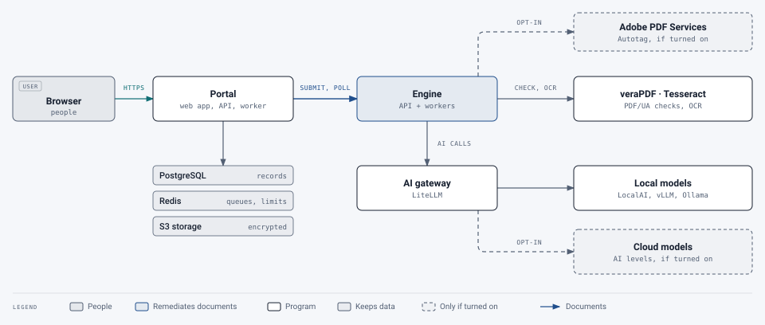

# PDF Accessibility Remediation

**Turns inaccessible PDFs into tagged, screen-reader-ready documents aimed at PDF/UA-1, without changing how they
look, and shows people exactly what still needs a human eye.**

[](https://github.com/buffcleb/pdf-accessibility-remediation/actions/workflows/ci.yml)
[](LICENSE)
[](https://www.python.org/)
[](https://www.iso.org/standard/64599.html)



A self-hosted service with a web portal. People upload PDFs; the engine adds the structure assistive technology needs
(headings, lists, tables, figures with alt text, reading order, language detected from the text), checks the result
with veraPDF and its own independent verification, and returns the file with a report and a review list. Every page
of the main output is **pixel-identical** to the original. AI helps where rules can't decide, through a gateway that
runs local or cloud models, and everything it writes is checked or flagged for review.

> **Status:** a proof of concept, in use on a test deployment. See [known limitations](docs/evaluation/README.md#known-limitations).

## Highlights

> **Changed 22 October 2026:** the portal's security alerts, SIEM export and API tokens for scripts are named.

- **Never changes how a document looks.** Tags are added around the existing drawing operators, and every job proves
  the pages render byte-for-byte the same. When a document can't pass without a visible change (usually fonts), you get
  a second file and choose.
- **Real results on real documents:** 13 of 13 real-world documents (431 pages: LaTeX papers, a dissertation,
  catalogs, policies, sheet music) pass veraPDF PDF/UA-1, from up to 29,770 failed checks to 0.
  ([Evaluation](docs/evaluation/README.md))
- **Checks its own work three ways:** a structural integrity check written independently of the tagger (failures
  block the job), semantic checks with a different PDF parser, and an AI review by a model from a different family.
- **AI where it adds value, never unchecked:** alt text, table structure, reading order, math and specialist notation
  (chemistry, dosages, engineering units), and OCR correction on scans. Notation readings must match the characters on
  the page; everything AI wrote is in the review list. Formulas also come as MathML, read by rule with MathCAT
  (speech, Nemeth and UEB braille) as a cross-check, and inside the PDF in a PDF 2.0 file (judged as PDF/UA-2).
- **Scans included:** OCR with per-word confidence, AI correction of unsure words, and figures printed on the scan
  found and tagged, all without changing a pixel.
- **Keeps what's good:** existing tags are audited and kept, repaired or rebuilt, element by element, unless you ask
  for them to be ignored.
- **Local or cloud, per group:** AI levels from local models on your own GPU to commercial models, with kinds of
  document (*Math and science*, *Forms*…), an optional classifier that picks the kind, and **local-only** groups that
  never send anything outside.
- **A complete portal:** emailed-code sign-in, groups and approval, page quotas per service with a ledger, a
  side-by-side **tag manager and editor** with versions, help requests, live reports with charts, scheduled email
  summaries, queues, an audit log (with security alerts, and an export to a SIEM), and personal API tokens for
  scripts. It aims at WCAG 2.2 AA itself.
- **Optional Adobe route:** send documents to Adobe PDF Services instead, and get Adobe's file checked the same way,
  plus a copy with AI alt text.





More in the [tag manager guide](docs/user-guide/people/tag-manager/README.md).

## How it works

<picture>
  <source media="(prefers-color-scheme: dark)" srcset="docs/images/diagrams/how-it-works-dark.svg">
  
</picture>

One document through the engine: **validate** the original → **analyze** the layout (text, scripts and fractions,
headings, lists, tables, images, columns; OCR for scans) → **AI** for alt text, tables, reading order and notation →
**tag** without changing pixels → fix fonts where that's lossless (or make a second, modified file if needed) →
**verify** every output in three layers → **report**: before-and-after veraPDF results, a review list, and an
accessible PDF report. Details: [the engine pipeline](docs/architecture/engine-pipeline.md).

## Quick start

On one machine with Docker:

```bash
cp .env.example .env
docker compose up -d --build
```

```bash
cp .env.portal.example .env.portal      # fill in the keys and passwords (see the guide)
docker compose -p portal -f docker-compose.portal.yml --env-file .env.portal up -d --build
```

Open http://localhost:8088 and sign in; the code arrives in Mailpit at http://localhost:8025. The full walkthrough:
[local Docker or Podman](docs/deployment/local-docker.md). For servers, Kubernetes, Cloudflare and AWS, see
[Deployment](docs/deployment/README.md).

## Documentation

> **Changed 22 October 2026:** Operations now includes the runbooks, the SIEM export and malware scanning; the API
> reference covers the portal's API for scripts.

| | |
|---|---|
| **[User guide](docs/user-guide/README.md)** | For [people submitting documents](docs/user-guide/people/README.md), [group admins](docs/user-guide/group-admins/README.md) and [super admins](docs/user-guide/super-admins/README.md) |
| **[Deployment](docs/deployment/README.md)** | Local, server, Kubernetes, the reference RKE2 deployment, Cloudflare, AWS |
| **[Operations](docs/operations/README.md)** | Configuration, AI models, email, Adobe, backups, monitoring, limits, runbooks (incidents, secrets, rolling back), the SIEM export, malware scanning |
| **[Architecture](docs/architecture/README.md)** | The parts, the pipeline, verification, security and design decisions |
| **[API reference](docs/api/README.md)** | The engine's API, for integrations; the portal's API for scripts with a personal token |
| **[Evaluation](docs/evaluation/README.md)** | Test method, results, cost model, test reports |
| **[Design notes](docs/design/README.md)** | The original portal specification and the build log |

Everything, indexed: [docs/README.md](docs/README.md).

## Built with

| Layer | |
|---|---|
| Engine | Python 3.12, FastAPI, Celery, Redis, PyMuPDF, pikepdf, pdfplumber, veraPDF, Tesseract, WeasyPrint |
| Portal | FastAPI, SQLAlchemy 2, Alembic, PostgreSQL 16, S3-compatible storage |
| Web app | React, TypeScript, Vite, pdf.js |
| AI | LiteLLM as the gateway; LocalAI, vLLM or Ollama for local models; any provider LiteLLM supports for cloud |
| Deployment | Docker Compose, Kubernetes manifests, an optional Cloudflare Worker front end |

## Development

```bash
python3.12 -m venv .venv && .venv/bin/pip install -r requirements-dev.txt
```

```bash
.venv/bin/python -m pytest -q -n auto tests/engine
```

The portal's tests need a throwaway PostgreSQL; see [tests/README.md](tests/README.md). GitHub Actions runs both
suites, plus the web app's type-check, build and unit tests (`npm test` in `web/`), on pull requests and pushes to
main, each job only when files it tests have changed. Batch testing against folders of PDFs:
[harness/README.md](harness/README.md).

## License

> **Changed 22 October 2026:** the optional ClamAV and Squid are named.

[GNU Affero General Public License v3.0](LICENSE). If you run a modified version as a network service, you must offer
its source to the people using it.

It builds on, among others, PyMuPDF (AGPL-3.0), veraPDF (GPL-3.0+ or MPL-2.0), Tesseract (Apache-2.0), pikepdf
(MPL-2.0), pdfplumber (MIT), WeasyPrint (BSD), LiteLLM (MIT) and pdf.js (Apache-2.0).
The optional music reading service is [Audiveris](https://github.com/Audiveris/audiveris) (AGPL-3.0), run as a
separate program. Formulas are read by rule with [MathCAT](https://github.com/daisy/MathCAT) (MIT), and the optional
formula reader is RapidLaTeXOCR (Apache-2.0) with pix2tex's model (MIT). The optional malware scanner is
[ClamAV](https://www.clamav.net/) (GPL-2.0) and the optional egress proxy [Squid](https://www.squid-cache.org/)
(GPL-2.0), each run from its own image.
