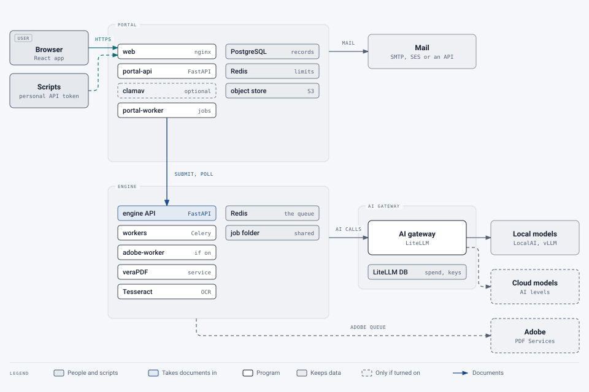

# Architecture

How the service is built: its parts, how a document moves through them, and why it's designed this way.

## Contents

1. [Services, AI levels and pages](services-and-quotas.md): what a service is, who can use it, how pages are
   counted, one document's path
2. [The engine pipeline](engine-pipeline.md): how a PDF is analyzed, tagged and checked, step by step
3. [Verification](verification.md): the three layers that check every output
4. [The Adobe route](adobe-route.md): sending documents to Adobe PDF Services, and what's done with the result
5. [The tag manager and editor](tag-editor.md): human review in the browser
6. [Security and privacy](security-and-privacy.md), and the [design decisions](design-decisions.md) behind it all
7. [Source map](source-map.md): where everything is in the code

## The parts

- **The web portal:** sign-in, groups, services and page quotas, uploads, results, reports, help requests and the
  tag manager and editor. It's the only part people use directly.
- **The remediation engine:** a headless service that tags a PDF for accessibility (PDF/UA-1, or PDF/UA-2 for a
  PDF 2.0 file), validates it, checks its own work and returns the files with reports. Only the portal can reach it.
- **The AI gateway (LiteLLM):** one endpoint in front of every AI model the engine may use, local or cloud, with
  spend tracking and a budget backstop.

A second processing service, **Adobe Autotag**, sends documents to Adobe PDF Services for tagging and returns
Adobe's file as it is, checked by the engine. It's off until a super admin switches it on.

## System context

> **Changed 22 October 2026:** the optional malware scanner (ClamAV) and egress proxy are drawn and listed, the
> portal's Redis is its own, and scripts can call the portal with a personal API token.

<picture>
  <source media="(prefers-color-scheme: dark)" srcset="../images/diagrams/system-context-dark.svg">
  
</picture>

With `EGRESS_PROXY` on, the portal, the gateway, the Adobe worker and ClamAV reach the internet only through an egress
proxy in the cluster, which can let through only the hosts the deployment uses; the engine's own pods never reach it.

| Component | Technology | Role |
|---|---|---|
| Web app | React + Vite, served by nginx | All screens, including the tag manager and editor (pdf.js). nginx also proxies `/api` to the portal API |
| Portal API | FastAPI, SQLAlchemy 2, Alembic | Accounts, groups, services, quotas, uploads, versions, help requests, reports, audit; personal API tokens for scripts |
| Portal worker | Python loop | Sends queued jobs, edits and reviews to the engine, polls them, copies results into storage, settles quotas, sends email, applies retention, raises alerts to super admins |
| Database | PostgreSQL 16 | Everything the portal knows. The quota ledger is append-only (a trigger refuses updates); row-level security checks group boundaries a second time |
| Rate limits | Redis, the portal's own (`redis-portal` on Kubernetes) | Sign-in and per-person limits, apart from the engine's queue (on Kubernetes, with its own password and nothing kept on disk) |
| Object store | S3 API (SeaweedFS locally; AWS S3, Cloudflare R2 and so on elsewhere) | Input and output files under `groups/{group}/users/{user}/jobs/{job}/…`, encrypted at rest |
| Engine API and workers | FastAPI, Celery, Redis | The remediation pipeline, tag edits, re-reviews and the kind-of-document classifier. Never exposed to the internet |
| AI gateway | LiteLLM + its own PostgreSQL | Routes each call to the model behind an AI level; reports cost per call; budget backstop; admin UI |
| Validator | veraPDF 1.30, as a service kept running (its REST server) | PDF/UA-1 (and informational PDF/UA-2) before and after; PDF/UA-2 for a PDF 2.0 document, which can only be that. A check that the service doesn't answer runs from the command line in the worker ([details](../operations/configuration.md#verapdf-service)) |
| Scaling (Kubernetes) | KEDA, the Horizontal Pod Autoscaler | Workers follow the portal's queue; the music and formula readers start from nothing when their Redis list has work; veraPDF and the AI gateway follow their CPU use. Services and AI levels can limit their documents at once ([details](../../deploy/k8s/README.md#scaling-with-the-queue)) |
| OCR | Tesseract 5 | Text of scanned pages, with a confidence per word |
| Report PDF | WeasyPrint | The accessible PDF report (PDF/UA-1) |
| Adobe worker | Celery on the `adobe` queue | Adobe Autotag jobs: split, send, poll, merge, then the same checks as every output |
| Math | latex2mathml, MathCAT (`mathcat-cli` in the engine image) | Each formula as MathML; speech and Nemeth and UEB braille read by rule, to check the AI's reading |
| Music and formula readers (optional) | Audiveris; RapidLaTeXOCR | Services asked over Redis lists: MusicXML for music examples, a second reading of each formula from its picture |
| Monitoring (optional) | Prometheus, Grafana, kube-state-metrics, Redis and Postgres exporters | Metrics of every part; alerts reach super admins through the portal; Administration › System shows figures and every workload's pods; Grafana for super admins at `/grafana` |
| Malware scanning (optional) | ClamAV (clamd and freshclam) | Every upload and help-desk attachment scanned before it's stored ([details](../operations/malware-scanning.md)) |
| Egress proxy (optional, Kubernetes) | Squid | Outbound traffic from the portal, gateway, Adobe worker and ClamAV, recorded or limited to an allow-list ([details](../../deploy/k8s/README.md#outbound-traffic-the-egress-proxy)) |
| Backups (optional) | A nightly Kubernetes job onto an NFS share | Both databases and the stored files, in the folders `scripts/restore.sh` reads |

## Where to go next

- To run it: [Deployment](../deployment/README.md) and [Operations](../operations/README.md).
- To call the engine directly: [API reference](../api/README.md).
- How it was designed and built, phase by phase: [Design notes](../design/README.md).
