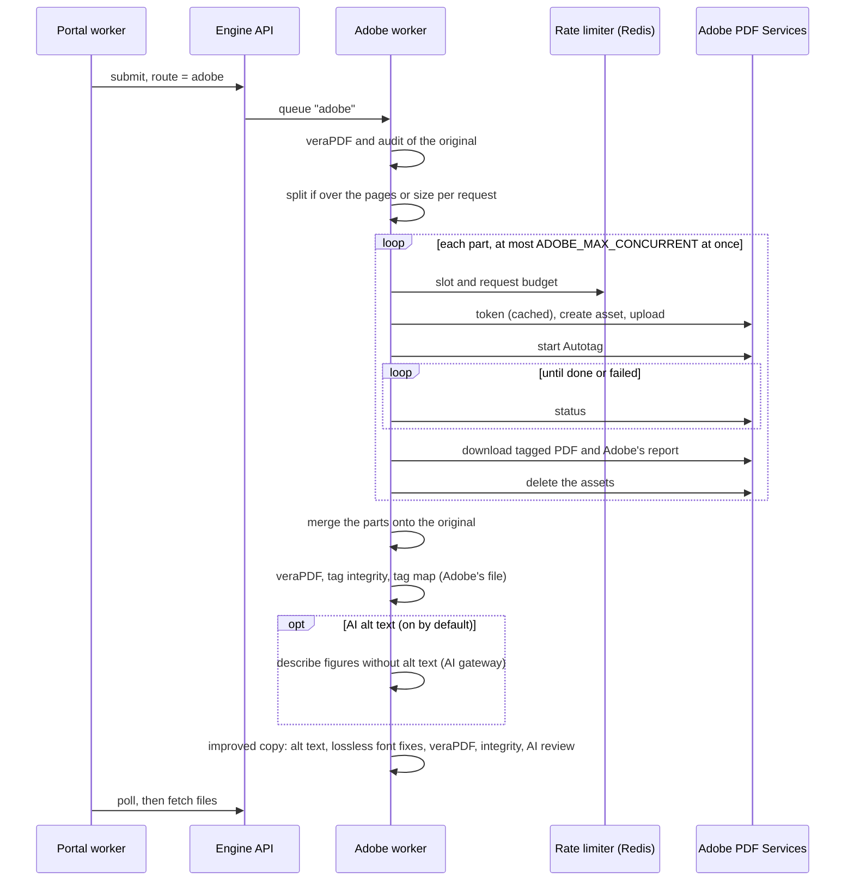

# The Adobe route

[Architecture](README.md) › The Adobe route

The "Adobe Autotag" service uses the engine's `adobe` route: Adobe PDF Services tags the document instead of this
engine's tagger. Adobe's file is always kept exactly as Adobe returned it. Improvements go into a **separate copy**,
named after what was done ("Adobe + AI alt text", "Adobe + fixes", or both), which must render identically to
Adobe's file:

- **AI alt text** (on by default; people can untick it at upload): an AI level describes every figure Adobe left
  without alt text, applied with the same tag edits as the tag editor. If no figure needed describing, the AI level's
  pages are given back.
- **Font fixes that never change rendering:** missing ToUnicode maps, incomplete glyph lists in font descriptors
  (7.21.4.2), and glyph width mismatches (7.21.5, only if the pages stay pixel-identical). These are the same fixes
  the standard route applies to its visually exact file.

- **Its own queue.** Jobs run on the Celery queue `adobe` (the `adobe-worker` service), so Adobe's pace never holds up
  the standard route.
- **Rate limits.** Adobe doesn't publish its limits, so they're settings: requests per minute and documents at Adobe
  at once, shared across workers through Redis. A "too many requests" answer pauses every Adobe worker for Adobe's
  `Retry-After`; running out of transactions fails the job at once (the portal gives the pages back) rather than
  retrying.
- **Large documents** over `ADOBE_MAX_PAGES_PER_CALL` pages or `ADOBE_MAX_MB_PER_CALL` are split. Each part is the
  original with the other pages removed. The tagged parts are grafted back onto the original: each page takes its
  part's content and tags, while bookmarks, links, form fields and metadata stay the original's. Each part's tag tree
  goes under one Document element, with its parent-tree keys shifted so they don't collide. In tests, merging gives
  the same tags and rendering as tagging the whole file at once.
- **What's checked:** the same checks as every output, plus Adobe's own report (an Excel file). Problems in Adobe's
  tags are reported, not fatal: the file is Adobe's.
- **Cost guards** are the portal's, as for any service: off until switched on, most pages per document, most pages
  per day, and confirm before sending (on by default for Adobe).
- **Testing without Adobe.** `app/adobe/fake.py` speaks Adobe's REST protocol and tags with this engine's own tagger
  (it can also throttle, run out of transactions or fail on request). The tests use it in-process; `docker compose
  --profile fake-adobe` runs it as a server.

Not yet on this route: AI readings of specialist notation (Adobe's tags don't come from this engine's layout
analysis), and further fixes on top of Adobe's tags beyond alt text and fonts.

Setting it up: [Operations → Adobe Autotag](../operations/adobe-autotag.md).
