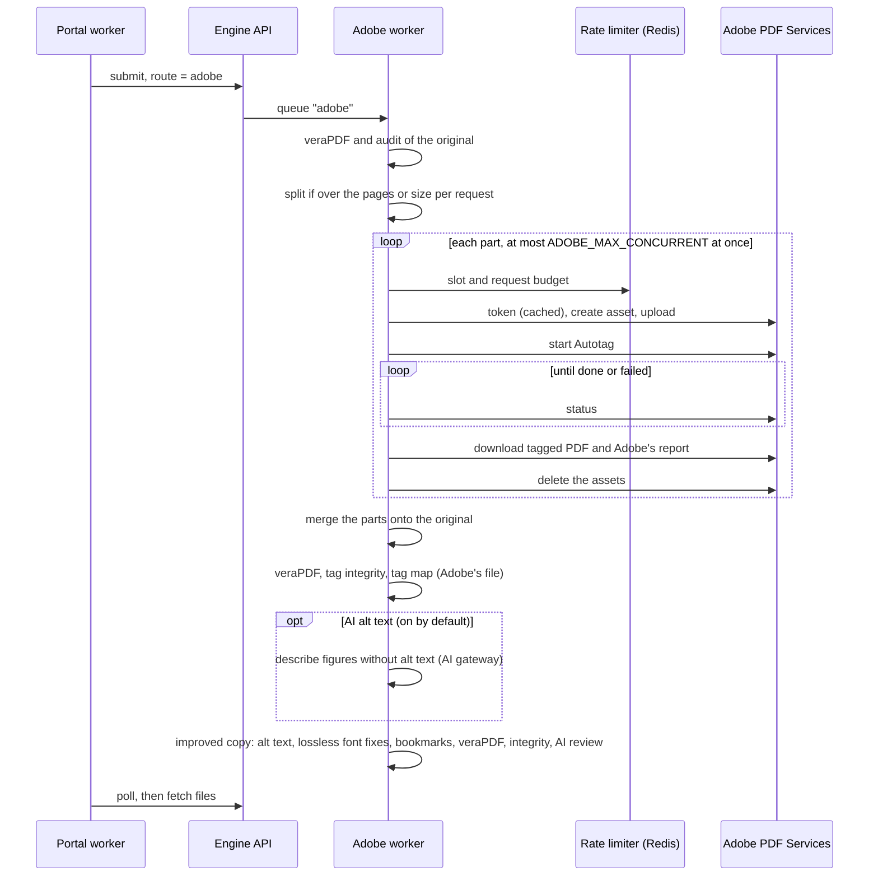

# The Adobe route

[Architecture](README.md) › The Adobe route

The "Adobe Autotag" service uses the engine's `adobe` route: Adobe PDF Services tags the document instead of this
engine's tagger. Adobe's file is always kept exactly as Adobe returned it. Improvements go into a **separate copy**,
named after what was done ("Adobe + AI alt text", "Adobe + fixes", or both), which must render identically to
Adobe's file:

- **AI alt text** (on by default; people can untick it at upload): an AI level describes every figure Adobe left
  without alt text, applied with the same tag edits as the tag editor. If the AI wasn't needed, the AI level's pages
  are given back.
- **Specialist notation** (with the same AI): the engine's own layout analysis of the original finds what the PDF's
  text can't voice (math, chemistry, unreadable symbols), and the AI reads it with the same checks as the standard
  route; doses are put in words by rule. (The original, not Adobe's file: the pages are the same, but text extracted
  from a tagged file can carry its tags' ActualText instead of what is drawn, and readings are checked against what is
  drawn.) Each accepted reading goes onto the Adobe tag that holds exactly that text, with overlapping boxes: as
  ActualText on a text tag, or as the alt text of a Formula (as the standard route writes formulas, and as PDF/UA asks).
  Only a tag with nothing of its own to say takes one: no Alt or ActualText, no link or field, only plain Spans inside
  (a list item: its label and body). A reading whose text Adobe divided differently stays out, and the report says how
  many. The AI's readings are listed for review on the improved copy. Readings with LaTeX get their MathML, MathCAT's
  check and the math downloads, as on the standard route (#403).
- **Font fixes that never change rendering:** missing ToUnicode maps, incomplete glyph lists in font descriptors
  (7.21.4.2), and glyph width mismatches (7.21.5, only if the pages stay pixel-identical). These are the same fixes
  the standard route applies to its visually exact file.

- **Its own queue.** Jobs run on the Celery queue `adobe` (the `adobe-worker` service), so Adobe's pace never holds up
  the standard route.
- **Rate limits.** Adobe doesn't publish its limits, so they're settings: requests per minute and documents at Adobe
  at once, shared across workers through Redis. A "too many requests" answer pauses every Adobe worker for Adobe's
  `Retry-After`; running out of transactions fails the job at once (the portal gives the pages back) rather than
  retrying.
- **Large documents** over `ADOBE_MAX_PAGES_PER_CALL` pages or `ADOBE_MAX_MB_PER_CALL` are split. Each part is the
  original with the other pages removed. The tagged parts are grafted back onto the original: each page takes its
  part's content and tags, while bookmarks, links, form fields and metadata stay the original's. Each part's tag tree
  goes under one Document element, with its parent-tree keys shifted so they don't collide. In tests, merging gives
  the same tags and rendering as tagging the whole file at once.
- **What's checked:** the same checks as every output, plus Adobe's own report (an Excel file). Problems in Adobe's
  tags are reported, not fatal: the file is Adobe's.
- **Signed and restricted PDFs** are handled as on the standard route (#339): a restricted file's restrictions are put
  back on every output after veraPDF has checked it, and the report notes a signature the copy no longer carries.
- **Egress.** Unlike the engine's other pods, the Adobe worker keeps its internet access, for Adobe's API;
  its AI calls still go through the gateway.
- **Cost guards** are the portal's, as for any service: off until switched on, most pages per document, most pages
  per day, and confirm before sending (on by default for Adobe).
- **Testing without Adobe.** `app/adobe/fake.py` speaks Adobe's REST protocol and tags with this engine's own tagger
  (it can also throttle, run out of transactions or fail on request). The tests use it in-process; `docker compose
  --profile fake-adobe` runs it as a server.

Not yet on this route: further fixes on top of Adobe's tags beyond alt text, notation and fonts.

Setting it up: [Operations → Adobe Autotag](../operations/adobe-autotag.md).
