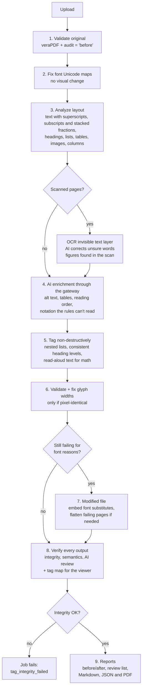

# The engine pipeline

[Architecture](README.md) › The engine pipeline

What happens to one document inside the engine, step by step, and the rules each step follows.

## Contents

- [Overview](#overview)
- [The steps](#the-steps)
- [Non-destructive tagging](#non-destructive-tagging)
- [Existing tags](#existing-tags)
- [Math and specialist notation](#math-and-specialist-notation)
- [Music notation](#music-notation)
- [Fonts, and the two-file case](#fonts-and-the-two-file-case)
- [Scanned pages](#scanned-pages)
- [How AI is used](#how-ai-is-used)

## Overview

## The steps

1. **Validate the original.** veraPDF and an internal audit record the "before" state.
2. **Fix font Unicode maps.** Fonts whose glyphs have no Unicode value (common in LaTeX output) get their map
   completed from glyph names. Rendering is unchanged.
3. **Analyze layout** (PyMuPDF), in visual page space, character by character:
   - **text:** superscripts and subscripts attach to their line. Stacked fractions are found from their drawn bars,
     and math gets read-aloud text ("10 to the power of 4", "fraction, …, over …, end fraction").
     A rule isn't a fraction bar when it's part of a box or a grid (a table cell's border), when it's the underline
     of the text over it (a link that wraps onto a second line), or when it has words over or under it and nothing
     beside it ("rise over run" after "slope =" is still a fraction).
   - **tables:** rebuilt from cell geometry.
   - **images and vector drawings;** icons repeated or set beside headings are decorative.
   - **graphs drawn piece by piece:** a curve plotted as hundreds of dots (each a picture a fraction of a point
     across), or as one path of short segments, is one figure with the rules through it and the short labels on
     and around it (`app/pipeline/plots.py`). A caption or a sentence beside it stays text; a dotted rule isn't a
     graph. The labels go to the AI with the rendering it describes.
   - **chemical structures and reaction schemes:** a molecule drawn with bond strokes is one figure, with the atom
     and group labels written on it ("O", "OH", "OAc") inside it instead of read as loose text
     (`app/pipeline/schemes.py`). Structures joined in a row by a reaction arrow or a plus sign are one figure
     together, the scheme, with the reagents on the arrow and a compound's name under it; structures with nothing
     drawn between them (a row of compounds, each named) stay one figure each. An arrow is a shaft with a head,
     also when its shaft is drawn as a hairline rectangle or it sits so close to a structure that it is gathered
     with it; a lone rule is not one. Bonds are told from other line
     art by being short strokes of one length at slants, in a drawing that has a ring of five to seven of them or
     an atom other than carbon written on it (not counting the symbols that are words or numerals on their own:
     I, B, P, K): a chart, a flow diagram or a circuit has neither. A sentence, a
     heading or a caption beside a scheme stays text, and structures inside a table are left to the table. The AI
     is told the picture is a structure or a scheme, and the labels go with it.
   - **headings:** leveled by style, consistently. The same style gets the same level, section numbers set depth,
     and no level is skipped.
   - **running headers and footers,** including "Page N of M" lines, become artifacts.
   - **list items:** several items on one line are split into separate items.
   - **columns and reading order:** top to bottom in bands, columns left to right inside a band. Columns can sit
     under a title or a row of buttons narrower than the page, and a column can hold columns. What lines up row
     by row either side of a gap (labels beside values, a grid of exercise items) is read across instead. A
     heading that starts below where the other column ends, near the end of its own, is read after both, and so is
     anything that sits across the bottom of the columns (the next section, a barcode).
4. **AI enrichment.** One alt-text call per unique image, table structure for detected tables, reading order for
   complex pages, and readings of notation the rules can't read, through the gateway models of the job's AI level
   (or kind). Every call is validated; a failure falls back to heuristics and is reported.
5. **Tag without changing pixels** (below). Lists nest by label kind and indent ("3." › "(a)" › "(i)"). Existing tags
   are kept, repaired or rebuilt.
6. **Validate and correct font widths**, kept only if the pages stay pixel-identical.
7. **Modified file (only if needed)**, from least to most destructive: embed metric-identical substitutes for
   unembedded fonts; then flatten only the pages that still fail.
8. **Verify** every output in [three layers](verification.md), and write a **tag map** (every tag's role, boxes,
   text and pieces) for the tag manager. Integrity failures fail the job.
9. **Report.** veraPDF before and after, a comparison, a "Needs human review" list, metrics including AI cost,
   Markdown and JSON reports, and the same report for people as an accessible PDF (PDF/UA-1, written by WeasyPrint
   from semantic HTML and checked with veraPDF; `app/reports/pdf.py`).

**Where the time goes.** Each job records the seconds spent in every stage (`metrics.stage_seconds`, from one
progress mark to the next), with the time spent waiting for the validator and on music counted inside them
(`of_which`). The report has a "Time by stage" table, and the worker logs one line per job with the same numbers.

## Non-destructive tagging

The tagger walks each content stream, tracking the transformation and text matrices and rectangle clips. It works out
where every text-showing operator, image and painted path lands on the page, then wraps it in `BDC … EMC` with an
MCID, or marks it as an `/Artifact`. **Only marked-content operators are added**, so every page renders
pixel-identical; this is checked on every job (`comparison.visual_fidelity`). A text run that crosses into another tag
is split into two operators with the same glyphs at the same positions.

It produces:

- headings (by font-size rank, with no skipped levels), paragraphs, and nested `Sect` elements grouping each heading
  with the content that follows it, even across page breaks;
- lists (`L/LI/LBody`, with `ListNumbering`), tables (`TR/TH/TD` with `Scope`, spans and summary), and figures with
  `Alt` (or `Formula`). A table `Scope` can't describe (more than one header row or column, or a header cell that
  spans) also links each cell to its headers: `ID` on every header cell named, `Headers` on each cell, chosen as the
  HTML table model does (`app/tagging/table_headers.py`), and the `IDTree` PDF requires once any element has an ID.
  `Scope` stays for readers that don't follow `Headers`. The header rows, columns and spans come from the AI's table
  analysis, so without AI tables keep `Scope` only;
- footnotes (`structure.py`, `_mark_footnotes`): small print (at most 0.9 of the body size) in the lower 45% of a
  page, at least four words and mostly letters, starting with a mark (up to three digits, or `*`, `†`, `‡`, `§`, `¶`)
  that is raised after a word, not after a digit (a power), in larger text above it on the same page (`marks` and
  `lead_mark`, recorded by the analyzer). It becomes a `Note` with an `ID`. In a paragraph or heading, each mark
  that has a footnote is a resolver target of its own (`targets.mark_key`, from the mark's box), so the content
  marker draws its glyphs in a marked section apart (same operators, same positions), and the builder tags it as a
  `Reference` inside the paragraph, in drawing order, naming the note in `/Ref` (PDF 2.0). The Reference says
  "footnote 1" (`ActualText`) when the paragraph needs no read-aloud text of its own; otherwise the paragraph's
  text says it ("soils (footnote 1)"), as it does for list items and wherever a mark couldn't be drawn apart (then
  the paragraph names the note). Every `Note` in the tree, a kept
  document's own included, gets an `ID` if it has none (PDF/UA-1 7.9). Notes under a table
  (`_mark_table_notes`): a block within about 120 points below a table, across its width, that starts with a symbol
  (`*`, `†`, `‡`, `§`, `¶`) the table's cells carry, whatever its size (on a 332-page guideline fewer than half were
  smaller). It becomes a `Note`; each cell with the symbol says it ("500 (footnote asterisk)") and names the note in
  `/Ref`. Letters (a, b) aren't taken. On a document whose own tags are kept, the notes and cells are its tags, and
  only the ones the engine adds are changed. PDF/UA-2 has no `Note` (it would be `FENote`);
  the engine declares part 1;
- captions ("Figure 1: …", "Table 2 …") tagged with what they describe, when they sit right next to it and are read
  next to it: a table's `Caption` is its first or last child; a figure and its `Caption` are grouped in a `Sect`.
  The caption stays outside the `Figure`, because screen readers read a figure's alt text in place of everything
  inside it. Other captions stay paragraphs;
- `Pagination` artifacts for running headers, footers and page numbers, and `Layout` artifacts for rules, borders
  and backgrounds;
- `Link`, `Form` and `Annot` elements for annotations, with `OBJR`, `StructParent` and `Contents`/`TU`.

The ParentTree is always regenerated. The document also gets `MarkInfo`, `Lang`, a title with `DisplayDocTitle`, the
XMP `pdfuaid:part` and `/Tabs /S`.

Bookmarks (`app/tagging/bookmarks.py`) are made from the headings once each output's tag map exists, so the text of
a long document isn't read again for them: H1–H6 nest by level, and each item is a GoTo action with the page and
position (`/D`) and the heading's tag (`/SD`, the structure destination PDF/UA-2 requires). A document's own working
outline is kept; one that goes nowhere is replaced. The engine's outline carries `/RemediationBookmarks`, so a save
from the tag manager (`edit_job.py`) rebuilds it to follow edited headings. They go in after veraPDF has run; with
structure destinations veraPDF finds the same with and without them. The Adobe route adds them to the improved
copy only.

## Existing tags

When the input already has a structure tree, each element is audited:

- **retained:** valid as it is.
- **repaired** in place: unknown roles mapped through the RoleMap, missing figure `Alt` filled by the AI, table header
  `Scope` added, heading levels renumbered, dangling references removed.
- **replaced:** the element is removed, and any real content it pointed to is re-tagged from the layout analysis. A
  malformed table, for example, is rebuilt from the detected grid.

Content that's already validly marked is never re-wrapped. If the tree is unusable overall (most references dangling,
or empty), it's discarded and rebuilt, and the report says why.

Producers' tags often need more than repairs, especially slides:

- **Order:** on slide-like (landscape) pages, the kept elements of a page are put in the page's reading order when
  the producer's order clearly disagrees with it (PowerPoint often puts the title after the body). Portrait pages
  keep the author's order, and a mismatch is reported.
- **Hidden body text:** visible body text the producer marked as an artifact (PowerPoint text boxes, a proof's
  query pages) is tagged. Page furniture (`/Pagination`, headers, footers, watermarks) and invisible text stay
  artifacts.
- **Hidden text:** text the producer left under a shape or picture drawn over it (an old tab label under the new
  tab) is made an artifact, so it isn't read. It counts as hidden only when an opaque fill drawn later covers it;
  see-through shapes don't hide anything, and invisible text (an OCR layer) stays tagged.
- **Legend marks:** small marks a page's legend explains ("▲ Beta  ◆ Select", with the same shapes beside items)
  get the legend's word as their alt text ("Beta"), without the AI, and are read just before the item they mark.
- **Page furniture drawn by shared forms** (crop marks, a "DO NOT STAPLE" box on every page) is an artifact: a form
  that only draws lines and fills, with any text in it already marked as an artifact, is placed by what it
  draws, not by its nominal box (often the whole page).
- **Where added tags go:** what the engine adds to kept tags (content they left out, untagged form fields and links)
  is put beside the kept tag it follows on its page, not after the producer's content (`app/tagging/placement.py`).
  Content goes by its place in the page's reading order. A field goes by where its rectangle sits: a checkbox just
  before the words to its right, any other field right after the nearest text (its label). Each goes as high up the
  tree as it takes to be valid, and never into an aside or a quotation. Added blocks that only look like headings
  become paragraphs when the document has headings of its own.
- **Empty spans:** layout programs leave Span tags around nothing a reader would notice (the line break after a
  form label, a space between two runs). Their content joins the tag they're in and the Span is removed
  (`app/tagging/empty_spans.py`); the page is untouched and the report says how many. A Span is left alone when it
  has tags or an annotation inside, an ID, an Alt, ActualText or expansion that says something (a line break or a
  space doesn't), or content that's a picture, a drawing, or any visible character.
- **Leftovers:** content the old tags left out is tagged from the layout; a decorative picture or a drawing with no
  text (a tab shape, a border) becomes an artifact, never an empty paragraph.

## Math and specialist notation

The layout rules read common math: powers, subscripts, fractions, separate equations and primes ("F prime"). Blocks
they can't read reliably go to the AI:

- characters with no Unicode meaning;
- sums, integrals and roots; accents (vectors, hats);
- norms, set and logic symbols, and several sub- and superscripts with Greek letters;
- chemical formulas and reactions; dosage and prescription notation; engineering units and symbols.

Fragments of one displayed equation are read together, as one Formula. The AI returns a transcription, LaTeX and the
read-aloud text. A reading is used only if it passes two checks, and every reading used is flagged for review and
sent to the AI reviewer:
- the transcription accounts for the letters and digits on the page (no solving, no invented characters);
- what will be spoken still says what the page says: every number is heard, every dosage unit is heard as itself or
  by its name, letters spelled out don't outnumber the page's, and a division is heard only where one is written.
  Numbers and units get no tolerance.

What goes to the AI, and what doesn't:
- **A formula inside a sentence** is read by itself (a whole reaction is one piece), once per document however often
  it appears, and placed into the layout rules' reading of the sentence. The sentence's own words are never the AI's
  to change.
- **Dosage and prescription notation is put in words by rule, with no AI call:** units by name ("5 mg/mL" as "5
  milligrams per milliliter"), shorthand in full ("q 6 h" as "every 6 hours", "PO TID" as "by mouth three times a
  day"), a dash between two numbers as "to". There is one right way to say a dose, and a model reading one from a
  scan once changed its unit.
- **Chemistry is said one way** whatever the model returned: symbols letter by letter with counts as digits ("H 2 S O
  4"), parentheses said, "yields" for a reaction arrow, "is in equilibrium with" for a reversible one, states by
  name.
- List marks drawn in a symbol font don't send their paragraph, and list items or table cells side by side are read
  one by one.
- Doses in table cells are put in words the same way (a dosing table is where most of them are).
- **Formulas on scanned pages** (#183). OCR loses most notation, so the text the rules see says little. Each block of
  an OCR'd page carries the mean OCR confidence of its words (`ocr.block_confidence`). A block is a garbled formula
  (`notation.scanned_math`) when it has few ordinary words, a quarter or more single characters, operators and
  brackets in 15% or more of it, and confidence under 85; without confidence nothing is flagged. Only on pages with
  such a block, the AI is asked once where the page's displayed formulas are (`find_formulas`, boxes in thousandths
  of the page), and the text blocks inside each box are read too, whatever role their size gave them (a tall formula
  can look like a heading). A scanned formula is read whole and becomes a Formula. Its reading must contain at least
  half of the letters and digits OCR read and not be many times longer (`consistent_scanned`), and every number of
  the AI's own transcription must be heard. A box with no OCR text in it is counted, not read.
- A long paragraph is considered only for what is read piece by piece or by rule: its formulas, its doses.

What counts as chemistry or as a dose, from real documents: prescription shorthand in capitals without dots (BID,
TID, PRN; "PO" only beside a dose or another of these), reactions written as text between simple molecules ("N2 + O2
↔ 2NO"), ions with their charge. Not chemistry: supply and pin names on a circuit ("VCC2", "ON1"), and ordinary
words that are also element symbols.

When a document's own tags are kept, a reading is written as ActualText onto the kept tag that holds the same
content: the tag and the block must cover each other, the tag must be a text tag with nothing of its own to say
(no Alt, ActualText or expansion), and anything inside it must be plain Spans. A reading with no such tag is left
out, and the report says how many were. Content the kept tags don't hold is tagged afresh, reading included.

Not covered yet: equations on scanned pages are barely found (#183).
`AI_NOTATION_ENABLED` and `AI_NOTATION_MAX` (100 regions per document by default) control it, as do the `notation_ai`
job flag and a switch per AI level.

## Music notation

To the rest of the pipeline a line of music is staff lines (rules or sliver pictures, which look like decoration)
and note heads from a music font (characters with no meaning, which became paragraphs of nothing, mixed into the
sentences around them). `app/pipeline/music.py` handles it before the AI step:

- **Finding it:** a staff is five rules of the same length, evenly and closely spaced (2.5 to 10 points apart, at
  least 60 points long), found on a low-resolution rendering of each page, so it doesn't matter how the producer
  drew them. Six or more evenly spaced rules are lined paper or a table. About 10 milliseconds a page.
- **One figure per example:** the staves of one system (a piano's two, joined by their bar lines) are one
  example, and each line of music on a page is its own, so every reading is short enough to follow. The figure takes in what's drawn around the staves (notes on ledger lines, clefs, chord
  names, the words under the notes) and stops at a sentence, a heading or a caption, and halfway to the next
  example. Everything in it is tagged in that one figure. A music font's characters claim boxes far taller than
  their ink, so they're matched by where they stand, not by their middle.
- **Reading it** (`OMR_ENABLED`): a picture of each example goes to the music reading service
  ([Audiveris](https://github.com/Audiveris/audiveris), `docker/audiveris`), which answers with MusicXML. The alt
  text is that in words: clefs, key signature and time, then each measure ("dotted quarter note F5, eighth note
  D5"), tempo marks, chord names and the words sung. Up to 8 measures are read in full; longer examples get a
  summary and their first two measures. Each reading is a review item: recognition is good but not exact (a clef
  change in the middle of a line can be missed).
- **One figure per measure:** a line that was read is cut into its measures, each a figure with its own complete
  reading ("Measure 2 of 4 on this line: …"), so nothing has to be shortened and a screen reader steps through
  the music measure by measure. The cuts are the bar lines found on the page (columns of ink exactly as tall as
  the system, which a note's stem isn't), and only when they agree with the reading service on how many
  measures the line has and roughly how wide each is. A line where they don't agree, one the service couldn't
  read, or one with a single measure stays one figure. `MUSIC_PER_MEASURE=false` keeps a figure per line.
- **Music that is a picture** (a scanned score placed on a page) is one piece of content and can't be cut into
  lines or measures. Its lines are still read, and the picture keeps one alt text: how many lines and measures,
  how it begins, and which files hold each line's notation.
- **The notation as files:** the MusicXML the service returned for each example is kept, in one zip with the
  job's outputs (`*_music.zip`, `reports.music_files`): `page-003_example-2.mxl` and so on, with a note saying a
  program read them. Someone who reads music opens them in notation software to play them back against the page,
  or to make braille music; that is also how to check a reading without reading music yourself. A reading that
  had to be shortened (whole measures from the start, never part of one) names its file.
- **Sheet music** (most pages hold two or more lines of music and hardly any text) is also read as a whole: its
  pages of music go to the service as one score, and the answer is the piece as a single MusicXML file
  (`*_music.mxl`, `reports.music_score`; a piece in several movements comes back as one file each, kept in the
  zip). That is the file a musician opens. A document that merely has music in it gets the per-example files
  only. Up to `MUSIC_MAX_SCORE_LINES` (600) lines are read in sheet music; the service is given
  `OMR_PAGE_TIMEOUT_S` (90 seconds) a page for the whole score. `MUSIC_WHOLE_SCORE=false` turns it off.
- **Without the service, or when it can't read an example,** the figure is described by the AI like any picture.
- **The service** is asked over Redis (`app/pipeline/omr.py`): requests on the list `omr:requests`, each answer
  on a list of its own. It only needs to run while there is music to read; on a cluster KEDA starts it when the
  list has something on it (see [deploy/k8s/README.md](../../deploy/k8s/README.md)). The engine waits
  `OMR_TIMEOUT_S` (240 seconds) for an answer, which for the first one includes the service starting.
- **Not handled yet:** scanned pages (the page is one picture there). `MUSIC_ENABLED=false` turns the whole
  step off; `MUSIC_MAX_EXAMPLES` (80) caps the examples per document.

## Fonts, and the two-file case

**Least destructive first.** Glyphs whose declared width disagrees with the embedded font program (PDF/UA 7.21.5) are
corrected, with the spacing compensated in the content stream so the page stays pixel-identical; this happens in the
visually exact output. Unembedded Times, Times New Roman, Arial, Helvetica and Courier fonts get embedded Liberation
substitutes with identical metrics, so text and tags are unchanged and only glyph shapes may differ from what a given
viewer substituted; this goes into the **modified** output.

**Characters that are pictures.** Some fonts draw things that aren't text: a music font's note heads and clefs,
the slanted line and arc pieces of LaTeX's picture fonts (`LINE10`, `LCIRCLE10`). They have no Unicode value to
find, and every character a font shows needs one (7.21.7). Where such a character is part of a figure or of
decoration, it gets a private-use value in the font's map (`map_picture_glyphs` in `app/tagging/font_unicode.py`):
the figure's alt text carries what it means, decoration isn't read, and the page isn't touched. The same character
in a paragraph is left alone, so text nobody can read still shows up as a failure and goes to the flattening route
below. A drawing font's characters are placed as drawings are: in the figure they lie in, or as decoration. More of
TeX's named symbols (`circlecopyrt`, `mapsto`, `planckover2pi1`, ...) get their real Unicode values.

**Dual output.** If the visually exact file still fails, the engine checks whether the remaining failures are ones
only a visible change can fix: unembedded or Type3 fonts, missing Unicode mappings, or content that can't be tagged in
place. veraPDF attributes those failures to pages, and only those pages are flattened: each becomes a background image
(an artifact) with an invisible text layer in an embedded font, placed glyph by glyph, and its original images and
vector figures are redrawn so they keep their Figure tags. Flattening is skipped if it would drop meaningful structure.
A picture the second analysis finds on a page that wasn't flattened, and the first didn't, isn't made a figure: no
description was written for it.
The modified file is validated, and both files are returned only if it's better: `*_compliant_modified.pdf`
(primary) and `*_compliant_visual.pdf` (fallback).

**How the modified file is decided.** Step 5 of the orchestrator (`app/pipeline/orchestrator.py`, "modified
(destructive) if required") takes the validated visual file and decides, in this order, whether a second file is
made and from what. Every branch exists because of a real document in the regression set; change the code only
against this table, and change the table with it.

| Step | Question | Yes | No |
|---|---|---|---|
| 1 | Were the glyph-width corrections moved out of the visual file because they weren't pixel-identical? | A modified file is attempted; the width-fixed copy of the visual file is the first candidate | Go to 2 |
| 2 | Does the visual file fail PDF/UA, with at least one failure in a clause only a visible change can fix (7.21 fonts, 7.1 content that couldn't be tagged)? Without veraPDF: does the analysis report font problems? | A modified file is attempted | One file is returned (`_remediated.pdf`); step 5 ends |
| 3 | Can unembedded standard fonts (Times, Helvetica, Arial, Courier and their aliases) be given metric-identical substitutes? | The untagged base with the substitutes embedded is tagged again (same region descriptions), validated, and gets the glyph-list and width fixes: the **fonts-only candidate**, kept as the fallback | The fallback is the width-fixed copy from step 1, if there is one |
| 4 | Is the best candidate so far (or the visual file, if there is none) still not compliant? | The pages to flatten are: pages veraPDF attributes those failures to, plus every page that draws text with a font veraPDF names under 7.21 (it names each font once, on its first page); if no page is named, the pages the analysis reports font problems on. Without veraPDF: the analysis's font-problem pages | Go to 6 with the candidate |
| 5 | Are there pages to flatten? | They are flattened (from the base with substitutes when fonts were embedded, else the untagged base), the result is analyzed again, the AI's work and the music examples are carried over, and it is tagged, validated and width-fixed: the **flattened candidate** | Go to 6 with the candidate |
| 6 | Is the candidate better than the visual file: compliant, or fewer failed checks (with no validator, both unknown counts as better)? And does it keep at least 80 % of the visual file's figures, tables, headings and structure elements, where the visual file had three or more (headings also pass when 90 % of the heading text is still tagged as headings, since a flattened page can read a two-line title as one)? | Two files: the candidate as `_compliant_modified.pdf` and the visual file as `_compliant_visual.pdf` | A flattened candidate falls back to the fonts-only (or width-fixed) candidate and is judged again by the same rule, with a warning that flattening wasn't applied; a candidate that still fails is discarded, one file is returned, and the warning says why |

The comparison in the report records `destructive_pages`, `fonts_embedded`, `glyph_widths_modified_only` and the
verdicts' warnings, so the branch a document took can be read back from its report.

**Check marks in form fields.** A checkbox's "on" appearance is usually one ZapfDingbats character, a font forms
don't embed and that has no free equivalent to embed. For boxes that aren't ticked, that appearance (and the pressed
one) is redrawn as a shape of the same size in the same place, so the pages look the same and the font is no longer
needed (`app/tagging/form_marks.py`). A box that's already ticked keeps its glyph.

## Scanned pages

A page that's one large image with no text is a scan. So is one whose large image looks like a scan (1-bit, fax or
JBIG2 compression, or gray at 150 dpi or more) and has only a few typed values on it (at most 400 characters over at
most a tenth of the page): a filled-in paper form (#292). A color picture isn't taken, as a slide's background photo
looks the same; on the regression set no page changed. On such a page, OCR words lying half or more on the typed
text are left out and their line split there, so the typed values keep their own text, and figures aren't separated
from the scan (the redraw would cover the typed values with the paper). The engine:

1. **Reads it with Tesseract** (the command line, installed in the engine image), which reports a confidence for each
   word. Lines are split at wide gaps, so each table cell's text sits over its own cell. "Words" far taller than the
   page's text and read with low confidence are pictures read as letters (a bar chart's bars as "alll") and are left
   out.
2. **Corrects unsure words with AI**, from the line's image (`OCR_AI_*` settings, and a switch per AI level):
   - confident words stay; only their spacing may change ("Toprovide" → "To provide");
   - uncertain words may be corrected, split or merged if the result looks like the original, or dropped if they're
     specks with no letters;
   - lines Tesseract hardly read at all are transcribed afresh, if the result fits the line;
   - every change is flagged for review.
3. **Writes the text as an invisible layer**, visually unchanged. The scan itself becomes an artifact, however
   it's placed: inside margins, in several layers, or larger than the page. When a page's picture is much larger
   than the page (a web page "printed" at the wrong size), the part that can't be seen is lost; the review list
   says so and asks for the PDF to be made again.
4. **Finds figures printed on the scan** (charts, photos, diagrams): ink that OCR didn't read as text, plus the
   pictures it misread as letters. Each region is drawn again from the same scan image, with the same matrix,
   clipped to the region. The clipped drawing is tagged as a Figure and described like any other image; the page
   renders identically. Text inside a region (chart labels) goes with the figure. (`app/pipeline/scan_figures.py`)

Tables in scanned pages aren't detected yet: their text is tagged as paragraphs. Pages scanned sideways aren't
checked for figures yet.

## How AI is used

AI is only called where it adds value: one alt-text call per unique image, one call per table, reading order only for
multi-column or complex pages, notation the rules can't read, and unsure OCR words. All calls go through the AI gateway,
tagged with the job and AI level, so spend is tracked per job. Each provider implements one `_chat()` primitive in
`app/ai/`. If an AI call fails, the job falls back to heuristics, and any gap (such as a figure with no alt text) is
reported rather than filled with placeholder text. A separate review model from a different family checks the writer's
work ([verification](verification.md)).
