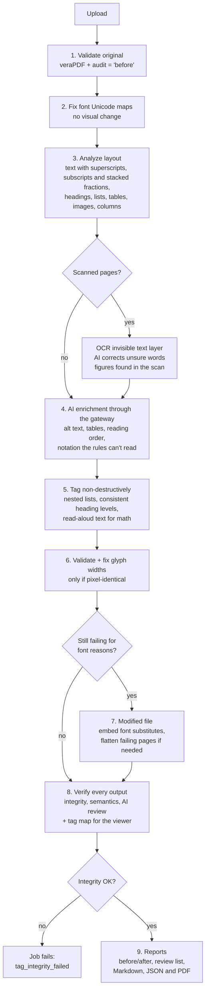

# The engine pipeline

[Architecture](README.md) › The engine pipeline

What happens to one document inside the engine, step by step, and the rules each step follows.

## Contents

- [Overview](#overview)
- [The steps](#the-steps)
- [Non-destructive tagging](#non-destructive-tagging)
- [Existing tags](#existing-tags)
- [Math and specialist notation](#math-and-specialist-notation)
- [Fonts, and the two-file case](#fonts-and-the-two-file-case)
- [Scanned pages](#scanned-pages)
- [How AI is used](#how-ai-is-used)

## Overview

## The steps

1. **Validate the original.** veraPDF and an internal audit record the "before" state.
2. **Fix font Unicode maps.** Fonts whose glyphs have no Unicode value (common in LaTeX output) get their map
   completed from glyph names. Rendering is unchanged.
3. **Analyze layout** (PyMuPDF), in visual page space, character by character:
   - **text:** superscripts and subscripts attach to their line. Stacked fractions are found from their drawn bars,
     and math gets read-aloud text ("10 to the power of 4", "fraction, …, over …, end fraction").
   - **tables:** rebuilt from cell geometry.
   - **images and vector drawings;** icons repeated or set beside headings are decorative.
   - **headings:** leveled by style, consistently. The same style gets the same level, section numbers set depth,
     and no level is skipped.
   - **running headers and footers,** including "Page N of M" lines, become artifacts.
   - **list items:** several items on one line are split into separate items.
   - **columns and reading order.**
4. **AI enrichment.** One alt-text call per unique image, table structure for detected tables, reading order for
   complex pages, and readings of notation the rules can't read, through the gateway models of the job's AI level
   (or kind). Every call is validated; a failure falls back to heuristics and is reported.
5. **Tag without changing pixels** (below). Lists nest by label kind and indent ("3." › "(a)" › "(i)"). Existing tags
   are kept, repaired or rebuilt.
6. **Validate and correct font widths**, kept only if the pages stay pixel-identical.
7. **Modified file (only if needed)**, from least to most destructive: embed metric-identical substitutes for
   unembedded fonts; then flatten only the pages that still fail.
8. **Verify** every output in [three layers](verification.md), and write a **tag map** (every tag's role, boxes,
   text and pieces) for the tag viewer. Integrity failures fail the job.
9. **Report.** veraPDF before and after, a comparison, a "Needs human review" list, metrics including AI cost,
   Markdown and JSON reports, and the same report for people as an accessible PDF (PDF/UA-1, written by WeasyPrint
   from semantic HTML and checked with veraPDF; `app/reports/pdf.py`).

## Non-destructive tagging

The tagger walks each content stream, tracking the transformation and text matrices and rectangle clips. It works out
where every text-showing operator, image and painted path lands on the page, then wraps it in `BDC … EMC` with an
MCID, or marks it as an `/Artifact`. **Only marked-content operators are added**, so every page renders
pixel-identical; this is checked on every job (`comparison.visual_fidelity`). A text run that crosses into another tag
is split into two operators with the same glyphs at the same positions.

It produces:

- headings (by font-size rank, with no skipped levels), paragraphs, and nested `Sect` elements grouping each heading
  with the content that follows it, even across page breaks;
- lists (`L/LI/LBody`, with `ListNumbering`), tables (`TR/TH/TD` with `Scope`, spans and summary), and figures with
  `Alt` (or `Formula`);
- `Pagination` artifacts for running headers, footers and page numbers, and `Layout` artifacts for rules, borders
  and backgrounds;
- `Link`, `Form` and `Annot` elements for annotations, with `OBJR`, `StructParent` and `Contents`/`TU`.

The ParentTree is always regenerated. The document also gets `MarkInfo`, `Lang`, a title with `DisplayDocTitle`, the
XMP `pdfuaid:part` and `/Tabs /S`.

## Existing tags

When the input already has a structure tree, each element is audited:

- **retained:** valid as it is.
- **repaired** in place: unknown roles mapped through the RoleMap, missing figure `Alt` filled by the AI, table header
  `Scope` added, heading levels renumbered, dangling references removed.
- **replaced:** the element is removed, and any real content it pointed to is re-tagged from the layout analysis. A
  malformed table, for example, is rebuilt from the detected grid.

Content that's already validly marked is never re-wrapped. If the tree is unusable overall (most references dangling,
or empty), it's discarded and rebuilt, and the report says why.

## Math and specialist notation

The layout rules read common math: powers, subscripts, fractions, separate equations and primes ("F prime"). Blocks
they can't read reliably go to the AI:

- characters with no Unicode meaning;
- sums, integrals and roots; accents (vectors, hats);
- norms, set and logic symbols, and several sub- and superscripts with Greek letters;
- chemical formulas and reactions; dosage and prescription notation; engineering units and symbols.

Fragments of one displayed equation are read together, as one Formula. The AI returns a transcription, LaTeX and the
read-aloud text. The reading is used only if the transcription accounts for the letters and digits on the page (no
solving, no invented characters), and every reading is flagged for review and sent to the AI reviewer.
`AI_NOTATION_ENABLED` and `AI_NOTATION_MAX` (100 regions per document by default) control it, as do the `notation_ai`
job flag and a switch per AI level.

## Fonts, and the two-file case

**Least destructive first.** Glyphs whose declared width disagrees with the embedded font program (PDF/UA 7.21.5) are
corrected, with the spacing compensated in the content stream so the page stays pixel-identical; this happens in the
visually exact output. Unembedded Times, Times New Roman, Arial, Helvetica and Courier fonts get embedded Liberation
substitutes with identical metrics, so text and tags are unchanged and only glyph shapes may differ from what a given
viewer substituted; this goes into the **modified** output.

**Dual output.** If the visually exact file still fails, the engine checks whether the remaining failures are ones
only a visible change can fix: unembedded or Type3 fonts, missing Unicode mappings, or content that can't be tagged in
place. veraPDF attributes those failures to pages, and only those pages are flattened: each becomes a background image
(an artifact) with an invisible text layer in an embedded font, placed glyph by glyph, and its original images and
vector figures are redrawn so they keep their Figure tags. Flattening is skipped if it would drop meaningful structure.
The modified file is validated, and both files are returned only if it's better: `*_compliant_modified.pdf`
(primary) and `*_compliant_visual.pdf` (fallback).

## Scanned pages

A page that's one large image with no text is a scan. The engine:

1. **Reads it with Tesseract** (the command line, installed in the engine image), which reports a confidence for each
   word. Lines are split at wide gaps, so each table cell's text sits over its own cell. "Words" far taller than the
   page's text and read with low confidence are pictures read as letters (a bar chart's bars as "alll") and are left
   out.
2. **Corrects unsure words with AI**, from the line's image (`OCR_AI_*` settings, and a switch per AI level):
   - confident words stay; only their spacing may change ("Toprovide" → "To provide");
   - uncertain words may be corrected, split or merged if the result looks like the original, or dropped if they're
     specks with no letters;
   - lines Tesseract hardly read at all are transcribed afresh, if the result fits the line;
   - every change is flagged for review.
3. **Writes the text as an invisible layer**, visually unchanged. The scan itself becomes an artifact.
4. **Finds figures printed on the scan** (charts, photos, diagrams): ink that OCR didn't read as text, plus the
   pictures it misread as letters. Each region is drawn again from the same scan image, with the same matrix,
   clipped to the region. The clipped drawing is tagged as a Figure and described like any other image; the page
   renders identically. Text inside a region (chart labels) goes with the figure. (`app/pipeline/scan_figures.py`)

Tables in scanned pages aren't detected yet: their text is tagged as paragraphs. Pages scanned sideways aren't
checked for figures yet.

## How AI is used

AI is only called where it adds value: one alt-text call per unique image, one call per table, reading order only for
multi-column or complex pages, notation the rules can't read, and unsure OCR words. All calls go through the AI gateway,
tagged with the job and AI level, so spend is tracked per job. Each provider implements one `_chat()` primitive in
`app/ai/`. If an AI call fails, the job falls back to heuristics, and any gap (such as a figure with no alt text) is
reported rather than filled with placeholder text. A separate review model from a different family checks the writer's
work ([verification](verification.md)).
