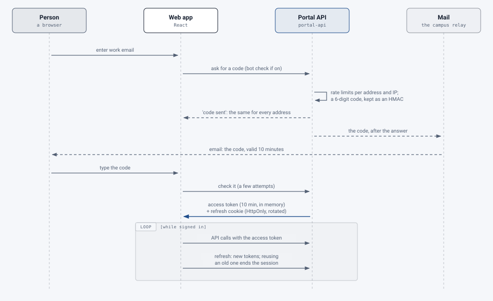

# Security and privacy

[Architecture](README.md) › Security and privacy

## Sign-in and sessions

> **Changed 22 October 2026:** personal API tokens for scripts (#518).

<picture>
  <source media="(prefers-color-scheme: dark)" srcset="../images/diagrams/sign-in-dark.svg">
  
</picture>

- **Emailed one-time codes:** 6 digits, valid 10 minutes, a limited number of attempts, only an HMAC stored. Code
  requests and attempts are rate-limited per address and per IP address. (SAML is designed and planned; see the
  [portal spec](../design/portal-spec.md).)
- **Access tokens** are short-lived JWTs (ES256, 10 minutes, rotatable keys), kept in memory, never in localStorage.
- **Refresh tokens** are random, stored only as a hash, rotated on every use (reusing an old one revokes the
  session), and travel in an `HttpOnly; Secure; SameSite=Strict` cookie scoped to the refresh endpoint.
- Sessions time out when idle and after an absolute limit, both configurable.
- **Roles are checked on every endpoint**, and a resource's group is always taken from the database, never from the
  request.
- A break-glass command issues a sign-in code when email fails; each use is audited, never the code.
- **Asking for a code gives the same answer for every address the service would take** (#359): an existing
  account, a disabled one and a new address in a group's domain all get "code sent", at the same speed, and the
  email (a code, or why the account can't sign in) goes out after the answer. Only the owner of the address learns
  which. An address outside every group's domains and lists gets the configured "not provisioned" message, so
  people with the wrong address learn why nothing arrives; within the rate limits (30 requests per 15 minutes per
  IP address) someone can learn which domains the service takes, not who has an account.
- **An optional bot check** (Cloudflare Turnstile, `portal/security/botcheck.py`) on "Email me a code", so scripts
  can't use it to send mail. Off unless its keys are set; if Cloudflare can't be reached it lets the request through
  by default (`PORTAL_TURNSTILE_FAIL_OPEN`), and the rate limits still apply.
- **Sign out of all devices** revokes every session of a person (`/auth/logout-all`); a super admin can do it for
  anyone (#354).
- **Proxy headers** (the caller's address, for rate limits and the audit log) count only on connections from the
  proxies listed in `PORTAL_TRUSTED_PROXIES`, so nobody can pick a fresh rate-limit bucket by setting a header (#336).
- **Personal API tokens** (#518) let a script send its owner's documents. They're off until super admins and the
  group's admins switch them on; each is tied to one processing service, AI level and kind, may only submit (and, if
  its owner chose, check status and download) the owner's own documents, and is refused everywhere else,
  Administration included, whoever owns it. A token is random, starts `pdfr_` so secret scanners can spot a leaked
  one, is shown once and kept only as an HMAC; it expires (90 days by default, 365 at most), stops after 90 days
  unused, and stops at once when it's revoked or tokens are switched off at any level
  ([API reference](../api/README.md#the-portals-api-for-scripts)).
- The refresh and sign-out endpoints have no rate limit of their own: each costs a hash and one select, so a
  flood of them is amplification only, bounded by the sessions the caller holds.
- **Per-person limits** on what's costly to serve (#357): files downloaded, reports exported and upload requests
  an hour (`PORTAL_RATE_DOWNLOADS_PER_HOUR` 600, `PORTAL_RATE_EXPORTS_PER_HOUR` 120, `PORTAL_RATE_UPLOADS_PER_HOUR`
  200; 0 turns one off). A zip of many documents (#481) is one request against its own limit
  (`PORTAL_RATE_DOCUMENT_EXPORTS_PER_HOUR` 20), holds at most 25 documents (a setting), and holds only the files each
  document's page offers that person; each file from someone else's document is recorded as a download is, so the
  bulk-download alert counts them.

## Network

> **Changed 22 October 2026:** ingress denied by default, the portal's own Redis, no Kubernetes API tokens in pods
> that don't use the API, Pod Security labels, the engine on nodes of its own, and ClamAV behind the egress proxy.

- Only the web app (and the portal API behind it) is public. **The engine and the AI gateway are internal:** only the
  portal calls the engine, with an API key.
- **The engine can't reach the internet** on the cluster: the pods that open uploaded PDFs reach only DNS, Redis,
  veraPDF and the AI gateway, so an engine taken over by a crafted PDF has nowhere to send it. The music and formula
  readers reach only DNS and Redis. Every AI call goes through the gateway, which holds the providers' keys (#361).
  The gateway, the Adobe worker, the portal and (with malware scanning on) ClamAV reach the internet directly, or,
  with `EGRESS_PROXY=enforce`, only through an egress proxy that lets through the hosts this deployment uses and
  nothing else (#453, [deploy/k8s/README.md](../../deploy/k8s/README.md#outbound-traffic-the-egress-proxy)).
- **Ingress is denied by default** (`default-deny-ingress`), and every pod is let in only from its own clients; the
  policies are applied before any workload starts (#453). The engine's queue and the portal's rate limits are in two
  Redis, each with its own password, so neither side can reach the other's (#472).
- **Pods have only what they use** (#466, #470): the namespace enforces Pod Security "baseline" (and warns on
  "restricted"), and only the three pods that call the Kubernetes API have a token for it, each with just the rights
  it needs. With `ENGINE_NODES` the pods that open uploaded PDFs run on nodes of their own, away from the control
  plane and the databases (#471). What a compromised pod would get is set out in the
  [blast-radius review](../evaluation/reviews/2026-10-20-blast-radius.md).
- **Metrics** (`/metrics` on the portal's and the engine's own ports) are outside `/api/`, so neither the web app's
  nginx nor the API-origin Ingress passes them on, and the network policies let only Prometheus in (#397).
  **Grafana** sits behind the web app at `/grafana`: nginx asks the portal on every request whether the caller is
  still a super admin (a short-lived cookie signed by the portal), so there are no Grafana logins to manage.
- **Traffic between the cluster's nodes is encrypted** with WireGuard, in RKE2's network plugin (Canal), rather than
  TLS on each service or a service mesh: it covers every connection inside the cluster (the database, the queue, the
  file store, the engine, the gateway) with no keys to rotate (#452). Traffic between pods on one node never leaves it.
  `scripts/check_cluster_encryption.sh` checks it, read-only, and `deploy.sh` shows the result before every deploy
  (`NODE_ENCRYPTION=require` stops a deploy to a cluster without it). TLS ends at the ingress controller or the
  Cloudflare tunnel.
- The gateway's admin UI belongs behind a VPN or SSO in any deployment.
- The web app sends a strict Content Security Policy (no inline script, `connect-src 'self'`, `frame-ancestors
  'none'`; scripts and frames from Cloudflare's challenge host only, for the optional bot check), and the usual
  security headers.

## Files

> **Changed 22 October 2026:** optional malware scanning of uploads (#455).

- Files live in object storage, **encrypted at rest**, under keys made of IDs (no names or emails in object names).
- They're served only through the API after a permission check. **An admin opening someone else's file is audited.**
- Retention is set by super admins: files are deleted after a set number of days, records after a longer one.
  People can have a document's files removed sooner (after a short hold, so it can be undone), and super admins can
  remove files or delete documents at once; all of it is audited.
- Uploads are checked (PDF signature, size, page count, opening without a password) before anything else touches
  them; the page count runs in a child process with memory, CPU and time limits, so a hostile file fails its own
  upload, not the API (#356). A PDF that opens freely but restricts what can be done with it is accepted, and its
  outputs get the same restrictions back with assistive technology allowed; a signed one waits for its owner's
  confirmation (#339). A dynamic XFA form is refused; a static one's XFA part is removed and its standard form kept
  (#360).
- **Malware scanning** (optional, `MALWARE_SCAN=clamav`): every upload, help-desk attachment and support's
  corrected file is streamed to ClamAV before it's stored. A file it finds malware in is refused and not kept, and
  super admins get a security alert; while the scanner doesn't answer, uploads are refused rather than let through
  ([malware scanning](../operations/malware-scanning.md)).

## Database

On the cluster the portal runs as its own database account, `portal_app` (`deploy/k8s/app-role.sql`, #337): it reads
and writes rows but owns no table, so it can't change one or drop the triggers that keep the audit log and the page
ledger append-only. Migrations run as the owner, `portal`, whose password the portal's pods don't have; the backup's
database dump uses it too. `scripts/deploy.sh` makes the account and grants it the rows of every table on each deploy.
Row-level security (#350, migration 0044) checks group boundaries a second time, in the database:

- It covers documents and everything of theirs (files, versions, drafts, review marks), the page ledger, people,
  help requests and their messages and attachments, saved report views and the audit log.
- For each transaction the API says whose request it is (`portal/rls.py`): the person, their group and the groups
  they administer. A row outside those is not there for the query, and a write can't put one there.
- While someone signs in, only the account with that address is there. A request nobody signed in to sees none.
- People see the super admins' accounts too, as super admins answer help requests.
- Anyone may add to the audit log; reading it is scoped like the rest.
- Super admins, the portal worker, the status check and metrics work across groups, so they bypass the policies.
  The bypass is audited (`rls.bypass`): a super admin's once per sign-in and kind of request (the route, never its
  IDs), the rest once per process. Once per request would fill the log.
- The settings are transaction-local, so a pooled connection carries nothing over to the next request.
- The policies bind `portal_app`. The owner, `portal`, isn't bound (it owns the tables, and FORCE isn't set), so
  the migrations, the backup's dump and a restore see every row.
- KEDA counts the waiting work as `portal_app` through `portal_waiting_work()`, which counts as the owner and returns
  only the number.
- It guards against a missing or wrong group check in the API, not against SQL the API never runs: the API sets the
  bypass itself, so SQL injection could too. The queries are parameterized (Bandit checks it in CI).
- The local Compose stack connects as the owner, so the policies don't bind it there. The tests connect as
  `portal_app`, as on the cluster.

## Audit

> **Changed 22 October 2026:** security alerts from the audit log, and the export to a SIEM (#456).

Sign-ins and code requests, uploads, downloads by others, every quota, limit, grant and service change, settings,
queue actions, help requests and tag edits are recorded, with the group attached so group admins see their own. Report
exports are audited too.

The portal watches the audit log for patterns worth a look (repeated wrong codes, one IP trying many addresses, bulk
downloads of others' documents, a refresh token used twice, a new super admin, an upload refused for malware and
others) and emails super admins ([security alerts](../operations/monitoring.md#security-alerts)). The log can also
go to a campus SIEM, by syslog over TLS, by HTTPS or through a pull API ([the SIEM export](../operations/siem.md)).

## Personal data

What the service keeps about a person: their account (email, name, group, roles), their documents and files (for the
retention period), their help requests, the page ledger and the audit log. Super admins can export all of it for a
records request, and remove a person on request: their files are deleted and their name and email replaced in every
record, while the records stay so totals still add up (#338; [the guide](../user-guide/super-admins/groups-and-people.md#a-persons-data-records-requests)).
Files go when the retention period ends whatever happens; records follow the records period.

## Where documents go

- With the Standard service and a local AI level, **documents stay on the service's own servers.**
- Services and AI levels that use an outside provider are marked **external**; they can show a notice at upload, can
  ask for confirmation before sending, and are **blocked for local-only groups**.
- The kind-of-document classifier sends only the first pages' text (never images), and only uses an outside service
  for groups that aren't local-only.
- Check each provider's data-retention terms before enabling it. Avoid free model endpoints for real documents: they
  may log prompts.

## Accessibility of the portal itself

The portal targets WCAG 2.2 AA: keyboard operation, visible focus, labeled fields, live regions for updates, charts
with an accessible table of every value, and a contrast check on the configurable accent color. The PDF report it
produces passes PDF/UA-1.

`scripts/a11y.sh` checks it (#369): axe-core in a headless browser over the main pages (sign-in, a person's
documents, a document's page and its tag manager, settings, a group's pages and the admin area), as a person, a
group admin and a super admin, in light and dark, against WCAG 2.2 A and AA. The pages show invented people and
documents (`tests/a11y/serve.py`). It runs locally, and in CI only when started by hand (**Accessibility checks**).
Automated checks find only part of what a person using assistive technology would: they're a floor, not a
sign-off.
