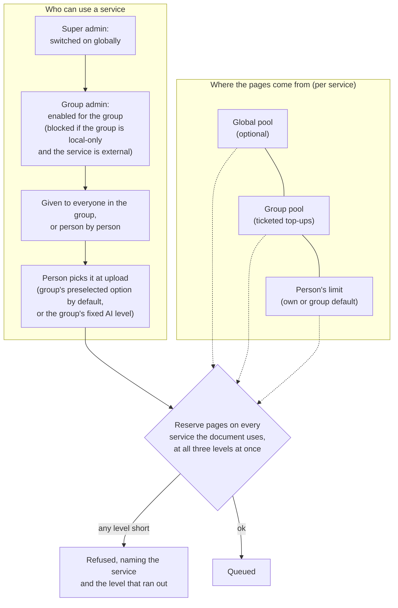
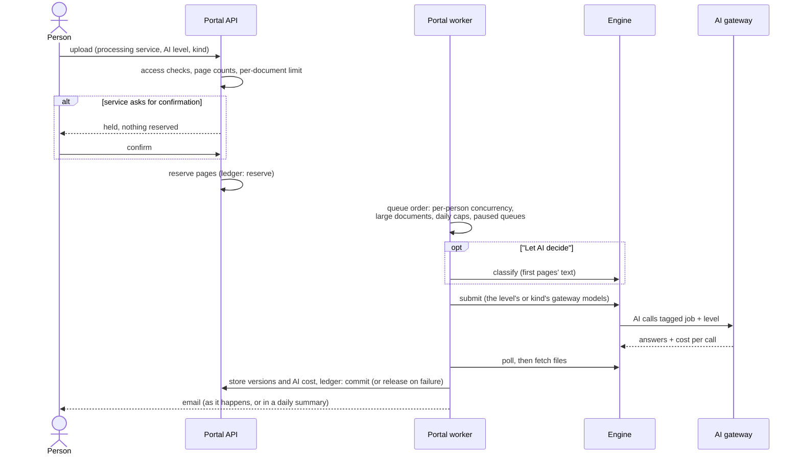

# Services, AI levels and pages

[Architecture](README.md) › Services, AI levels and pages

A **service** is either a way of processing documents ("Standard", "Adobe Autotag") or an **AI level** (a gateway
model such as "Local AI" or "Commercial AI"). Every document uses one processing service and, optionally, one AI
level, and is charged pages on each. An AI level can offer **kinds of document** (General, *Math and science* and so
on), each with its own models; kinds don't change what's charged.

## Who can use a service, and where pages come from

Each service also has optional **cost guards**: most pages per document, most pages sent per day (extra documents
wait in the queue rather than fail), and confirm-before-send. It can show a **notice** at upload, for example where
documents go. Unmetered services count use but never limit it. An AI level also decides what a **Check only** run
costs: free, counted against the level, or made without AI.

## One document's path

Every ledger entry records the service, the scope (global or group), the person, the job, any ticket, override or
reason, and the balances after it. Super admins can also **correct** a person's usage. Every change to pools,
limits, grants and services is in the audit log.

## Queues

The portal worker decides what goes to the engine next, and in what order:

- each person has a limit on documents processed at once, so one person's batch doesn't hold everyone up;
- **large documents** (over a page count) take turns with smaller ones, a few at a time;
- a service with a **daily page limit** holds documents for the next day once it's reached;
- a super admin can **pause** a service's queue; its documents wait and go ahead on resume;
- the engine has a limit on documents in flight at once.

Edits from the tag editor, AI re-reviews and email have their own queues. Sign-in codes are never queued.
