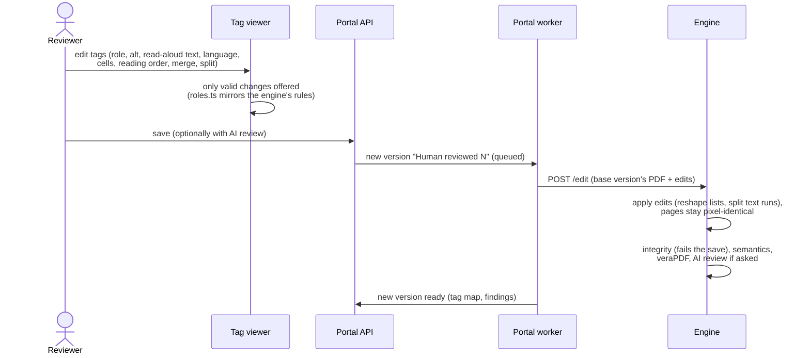

# The tag viewer and editor

[Architecture](README.md) › The tag viewer and editor

People compare versions side by side (`/jobs/{id}/tags`), with overlays, a tag tree and the review findings, and fix
tags in the browser. How to use it: [Checking and fixing tags](../user-guide/people/tag-viewer.md).

- **The viewer** renders pages with pdf.js and draws each tag's boxes from the **tag map** the engine writes for every
  output: each tag's role, page boxes, text and pieces. Nothing is parsed from the PDF in the browser.
- **Valid changes only.** `web/src/viewer/roles.ts` mirrors the engine's role rules (`app/tagging/role_rules.py`), so
  only changes that make a valid structure are offered.
- **Every save is a new version.** Engine outputs are never changed. The edit is applied by the engine
  (`app/tagging/editor.py`), on the base version's PDF, and checked like an original output: integrity (which fails the
  save), the semantic checks, veraPDF, and pixel identity with the base version.
- **Reviews.** A saved version can be reviewed by AI (flagged figures plus a sample, or every figure) when it's saved
  or later, without changing its file. Reviews use the review model of the document's AI level.
- **Support's fixes.** A super admin handling a help request can upload a corrected PDF made in another tool; it
  becomes a "Corrected by support" version, checked the same way, with the visual comparison against the version it
  replaces.
