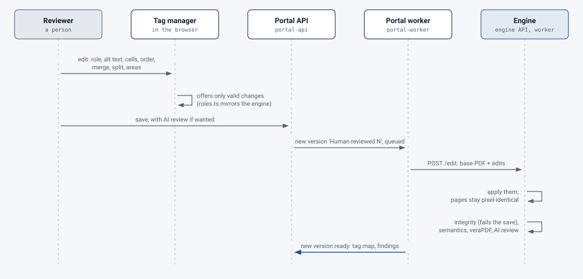

# The tag manager and editor

[Architecture](README.md) › The tag manager and editor

People compare versions side by side (`/jobs/{id}/tags`), with overlays, a tag tree and the review findings, and fix
tags in the browser. How to use it: [The tag manager](../user-guide/people/tag-manager/README.md).

> **Changed 22 October 2026:** pending edits show as the tags they'll make, and those can be chosen before saving
> (#427); a saved version opens before its checks finish (#428); a review item with a page shows its area (#426).

<picture>
  <source media="(prefers-color-scheme: dark)" srcset="../images/diagrams/tag-editor-save-dark.svg">
  
</picture>

- **The viewer** renders pages with pdf.js and draws each tag's boxes from the **tag map** the engine writes for every
  output: each tag's role, page boxes, text and pieces. Nothing is parsed from the PDF in the browser.
- **Valid changes only.** `web/src/viewer/roles.ts` mirrors the engine's role rules (`app/tagging/role_rules.py`), so
  only changes that make a valid structure are offered.
- **Areas.** The tag map also lists each piece of tagged content (`pieces`: page, MCID, box, the tag holding it) and
  each artifact section of a page's stream (`artifacts`, numbered in drawing order, with its box and whether it's nested
  in another). A box drawn on the page (or the whole page, from the keyboard) lists what's inside it:
  - `assign` moves tagged pieces from their tags into the selected one; it must hold content (not a table, row or
    list), and a tag left with nothing is removed. The ParentTree follows.
  - `tag_artifacts` turns whole artifact sections into one new tag (paragraph, heading, figure with alt text…). Only the
    marked-content operator changes (`/Artifact` becomes the tag with a new MCID), so the page draws the same. It's
    placed next to the tag read just before the area, moved up the tree until that type is allowed there. A section
    nested in another, or that extends outside the box, isn't offered.
- **Lists from several tags.** `make_list` turns the named tags into the items of one list where the first was: a
  text tag becomes the `LI` itself (`LI > LBody` holding its content), so later edits that name it find the item; a
  list among them gives its items. `indent` moves an item to the end of the list nested in the body of the item
  before it (made if there is none, inside the `LBody` after its text, as the tagger nests lists); `outdent` moves it
  out after the item it was under and puts the items that followed it under it, so reading order never changes.
  Both look at what the tag is when their turn comes, which lets them follow a `make_list` in the same save. The
  viewer models the same steps (`listPlan` in `web/src/viewer/draft.ts`) to offer only level changes that will work
  and to mark each item's pending level; it doesn't redraw the tree as a list before saving.
- **Building a list from lines.** `build_list` cuts a tag's `/K` items (then those of the tags in `absorb`) into
  rows; each row becomes a tag of its own (`as`: P or a heading) or a list item at a `level`, an item one level
  deeper going into a list nested in the previous item's `LBody`. The results take the tag's place, the tag itself
  becoming the first row. It refuses tags with `/ActualText` or `/Alt`, which stand for all of the content. The
  dialog (`ListBuilder.tsx`, logic in `outline.ts`) groups the tag map's parts into lines by position, guesses rows
  from numbering or bullets and depth from each row's left edge, and keeps levels valid as rows change.
- **Footnote links.** `link_note` sets what a tag points at (`/Ref`) to one note, giving the note an `ID` if it has
  none, or removes it (`note: null`). A note is `Note` or, in a PDF/UA-2 file, `FENote` (`NOTES`, `isNote`); an
  `FENote` also names what points at it in its own `/Ref` (8.2.5.14), and stops naming a tag pointed elsewhere (#633). The tag map lists each tag's `/Ref` targets (`refs`); the menu's Footnote group
  offers the notes on the tag's page and the pages either side (`menu.ts`, `pointsAt`).
- **A cell's headers.** The tag map gives each cell the header cells its `Headers` names (`headers`, element
  indices). `set_headers` sets them, giving each header an `ID` if it has none; `set_cell` keeps a linked table's
  names right (a TH made TD leaves every cell's `Headers` and loses its `ID`; a TD made TH is added to the cells it
  heads by its scope, found from the table's rows and spans). Either rebuilds the `IDTree`. The edit form's checklist
  (`cells.ts`) offers the table's own TH cells, with pending type changes applied. A TH whose scope changes isn't
  relinked.
- **Contents entry targets.** `set_toc_target` sets the heading a `TOCI` goes to (`/Ref`, PDF/UA-2 8.2.5.8), or
  removes it (`target: null`); the target can't be part of a table of contents itself. The menu's Goes to group
  offers the headings with most words in common with the entry first (`menu.ts`, `headingChoices`, `goesTo`). The
  PDF/UA-2 step (`pdfua2.upgrade`) names an entry's target from its link, else from the one heading with the same
  words; verification flags those guesses ("pointed at a heading by its text", carried to reviewed versions as an
  `ai_read` of kind `toc-target` until a person sets that entry) and, in a PDF 2.0 file, each entry with no target
  ("goes nowhere") (#631).
- **Table of contents from a list.** `make_toc` retypes an outermost list in place: `L` to `TOC` (its List
  attributes dropped), `LI` to `TOCI` with its `Lbl` kept, and each `LBody` to a `Reference`. A list nested in a body
  moves out of it to follow that `Reference` in the same entry, as a `TOC`; text after such a list gets a
  `Reference` of its own, so nothing is read in a different order. A paragraph in a body stays; any other block
  is refused. `Lbl` may sit in a `TOCI` as well as an `LI` (both rule copies, `role_rules.py` and `roles.ts`). The
  viewer shows the new types before saving (`overrides` given the tag map).
- **Tables.** The table editor (`TableDialog.tsx`, logic in `tablegrid.ts`, #370) holds a table as a grid: merge and
  split cells, add and remove rows and columns, choose header rows and columns. A removed row or column joins its
  neighbour, so nothing on the page goes untagged. It's saved as one edit: `rebuild_table` gives the whole table row
  by row, each cell naming the old cells whose content it takes (and an optional caption); `build_table` makes text
  tags into a table, each cell taking `/K` items of the tags, every item once. A figure that is really a drawn table
  can be one of them; its alt text goes (#395). A pending table edit shows in the tree and on the page as it will be
  saved (#400).
- **Splitting a figure.** `take_pieces` makes some of a figure's pieces a new tag read right after it; `cut_area`
  does the same for what lies inside a box, cutting through drawings that cross it without reordering the page's
  marked sections. "Describe with AI" writes alt text for an area (the engine's `POST /describe`, one paid call at
  the document's AI level, where the person is allowed it: `portal/ai_describe.py`).
- **Artifacts, links and form fields.** `set_decorative` turns any tag and what's under it into an artifact, as
  layout or as a header, footer or page number (#364). `set_alt` on a `Link` or `Annot` also writes the text to its
  annotations' `/Contents`, what a screen reader announces for the link. `set_field_label` sets a form field's
  tooltip (#341).
- **The document panel.** `set_doc_title` and `set_doc_lang` change the document's title and language; they name no
  tag (`DocumentPanel.tsx`, #363).
- **A formula's readings.** Where a formula's readings disagree (#403), Edit tag shows them side by side with the
  formula drawn from its MathML (`ReadingPicker.tsx`, `readings.ts`); the one picked goes into the read-aloud text,
  and the edit carries the choice (`reading` on `set_alt` or `set_actual_text`) for the edit job's report.
- **Undo and redo.** Every change to the pending edits can be undone and redone in order, with Ctrl+Z and
  Ctrl+Shift+Z or the heading's buttons, up to 200 steps (`history.ts`, #365). Loading a draft or saving starts afresh.
- **One page, and reading order in the tree's place.** The viewer can show one page at a time (`Pane`'s
  `onlyPage`; the tree is filtered with `tagsOnPage`). The tree pane can list the tags in reading order instead.
  Every view draws from the same pending edits (`pageOrder`, `draftTree`), so a move made in one shows in all;
  `undoMoves` takes back one tag's moves.
- **Original tags.** **Changed 23 October 2026:** When a document's tags were kept (`tags_kept` in the job's
  result), the portal marks the tags that were in the uploaded file (`portal/tagmarks.py`): a tag that holds a
  piece of content the original's tags held (same page and number, same place, same words), or the same form field
  or link, and any group holding one. It's worked out from the original version's tag map once, when a version's
  tag map is stored (the engine's outputs, and each saved version), and written into that file, which starts with
  `{"orig_marked":true,` so the viewer's request can serve it as it is without reading it (#580). Tag maps stored
  before this are marked as they're read, as before.
- **Read aloud** (`web/src/viewer/speech.ts`, `Reader.tsx`) turns the tag map into what a screen reader would say,
  in reading order with pending edits applied, and speaks it with the browser's Web Speech API (no service, no cost).
  Each tag's own text is in the tag map in full (`say`, where it differs from the shortened `text`). The wording is
  tested with Node's test runner (`npm test` in `web/`).
- **Pending tags.** Tags that pending edits make or reshape (a new tag from an area, a split, a list or table built)
  show at once, in the tree and on the page, as they'll be saved (`pending.ts`, `PendingTag.tsx`, #427); a new one
  can be chosen before it's saved, and its type or alt text changed, which changes the pending edit.
- **Review items on the page.** Every review item that has a page has **Show**, which opens that page with the area
  it's about highlighted (`SpotLayer.tsx`, #426).
- **Every save is a new version.** Engine outputs are never changed. The edit is applied by the engine
  (`app/tagging/editor/`), on the base version's PDF, and checked like an original output: integrity (which fails the
  save), the semantic checks, veraPDF, and pixel identity with the base version. The new version opens as soon as its
  file and tag map are final, while its checks still run (the engine's `partial` answer, #428), marked as still
  being checked.
- **Reviews.** A saved version can be reviewed by AI (flagged figures plus a sample, or every figure) when it's saved
  or later, without changing its file. Reviews use the review model of the document's AI level.
- **Support's fixes.** A super admin handling a help request can upload a corrected PDF made in another tool; it
  becomes a "Corrected by support" version, checked the same way, with the visual comparison against the version it
  replaces.
