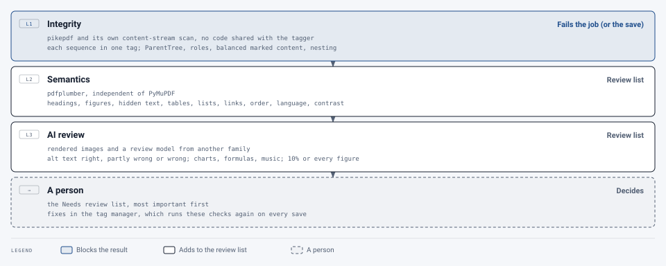

# Verification

[Architecture](README.md) › Verification

Every output is checked after remediation, and after every edit, in three layers. Results appear under
`reports.tag_verification`, in the document's **Needs review** list, and at the top of the reports.

| Layer | Reads the PDF with | Checks | Effect |
|---|---|---|---|
| 1. Integrity | pikepdf + its own content-stream scan (no shared code with the writer; the tag map's list of artifact sections, in the same package, does reuse the writer's content walk, as it must number them the way the editor does) | Every tagged sequence belongs to exactly one tag; ParentTree and annotation links are consistent; no nested or unbalanced marked content; roles are standard; nesting | **Fails the job (or the save)** |
| 2. Semantics | pdfplumber (independent of PyMuPDF) | Headings that look like body text, figures over nothing, file-name alt text, hidden text, table text, list numbering, link text, reading order against an independent ordering, language | Review list |
| 3. AI review | Rendered images + a review model from a different family | Alt text accurate, partly wrong or wrong (with a suggested rewrite); checklists for charts, formulas, handwriting, sheet music | Review list |

<picture>
  <source media="(prefers-color-scheme: dark)" srcset="../images/diagrams/verification-layers-dark.svg">
  
</picture>

## Layer 1: integrity

`app/verification/integrity.py` reads the finished PDF back with its own tree walk and content-stream scan, sharing no
code with the tagger, and checks that:

- every tagged content sequence belongs to exactly one tag, and every tag points at content that exists;
- the ParentTree, `StructParents` and annotation `StructParent` entries are consistent;
- parent pointers are correct and there are no cycles;
- every role resolves to a standard structure type (elements in the MathML namespace, a document's own MathML under
  a Formula, say what they are by their namespace and pass, #403);
- marked content is balanced and not nested;
- PDF 2.0 nesting rules hold (reported as warnings).

**Any integrity error fails the job** (`error: tag_integrity_failed`, with the failures listed); the outputs are kept
for inspection. Tests break good files in ten specific ways and assert each defect is caught.

## Layer 2: semantics

`app/verification/semantic.py` reads page content through pdfplumber, a parser independent of PyMuPDF, and compares
each tag with what it covers:

- headings that look like body text, and large short paragraphs that look like missed headings;
- figures over no visible content, alt text that's a file name, and one alt text shared by different images;
- large images or body text hidden as artifacts;
- table cells that don't match the table on the page, and data tables without header cells;
- single-item lists and non-sequential numbering;
- generic link text;
- form fields whose tooltip is missing or only an internal name ("Text1"), #341;
- tags at the wrong level, as PAC checks them and veraPDF's PDF/UA-1 profile doesn't (#437, #438): a figure or
  formula on one page without its bounding box (high), a figure standing as a block without `/Placement /Block`,
  inline tags (Span, Link, Note…) straight in a grouping tag, a P in a P, a Document inside the tree. One finding
  per kind, with how many and on which pages;
- tag order that disagrees with an independent layout ordering;
- passages in another language than their tag;
- pages mostly in a right-to-left script (Arabic, Hebrew), whose columns were read from the right: one finding naming
  them, to check the order (#368);
- text with low contrast (`app/verification/contrast.py`, #367; WCAG 1.4.3): text below 4.5:1 against what it's
  drawn on, or 3:1 for large text (18 pt, or 14 pt bold), one finding per page with the colors and ratios. The
  text's color is the one it's painted with; the background is the commonest color behind it on the rendered page,
  with the glyphs set aside. Invisible text (an OCR layer) is skipped, and so is text over a photograph or gradient,
  where no single background color can be read. The check reports only: colors are the source document's, and
  changing them would change how the pages look. `VERIFY_CONTRAST=false` turns it off.

These findings never block a job.

## Layer 3: AI review

`app/verification/ai_review.py`. A **review model**, from a different family than the writer, checks alt text against
the image, with a checklist per content type: charts must state the trend and correct values, formulas must read
correctly in words. It reviews everything Layer 2 flagged plus a reproducible 10% sample; the `full_review` flag
("Review every figure") reviews every figure and formula. Its findings are review items with a suggested alt text,
never automatic fixes.

The reviewer can also look at a page with numbered boxes drawn in tag order, to judge reading order. This is **off by
default** (`VERIFY_AI_READING_ORDER=false`): in testing, two local models called correctly ordered pages wrong most of
the time, while the Layer 2 check judged them correctly. Enable it only with a reviewer validated on labeled pages.

When a document has two output files, a figure or formula that appears in both is reviewed once.

Formulas whose readings disagree (the AI's against MathCAT's reading by rule, or against the formula reader's
reading of the picture) are review items too, "two readings of a formula disagree", with each reading and the MathML
for Edit tag to offer the choice ([math](engine-pipeline.md#math-and-specialist-notation), #403).

Settings: `VERIFY_*` in `.env.example`; `VERIFY_ROUTES` sends specific content types to specific reviewers. See
[Operations → AI models](../operations/ai-models.md#verification-settings).

## A pass is not full accessibility

veraPDF checks the machine-verifiable rules of PDF/UA-1 (PDF/UA-2 for a PDF 2.0 file, #409). It can't tell whether
alt text is accurate, whether headings are the right ones, or whether the reading order makes sense. That's why
Layers 2 and 3 and the review list exist. The same applies to the output of any other remediation tool.
