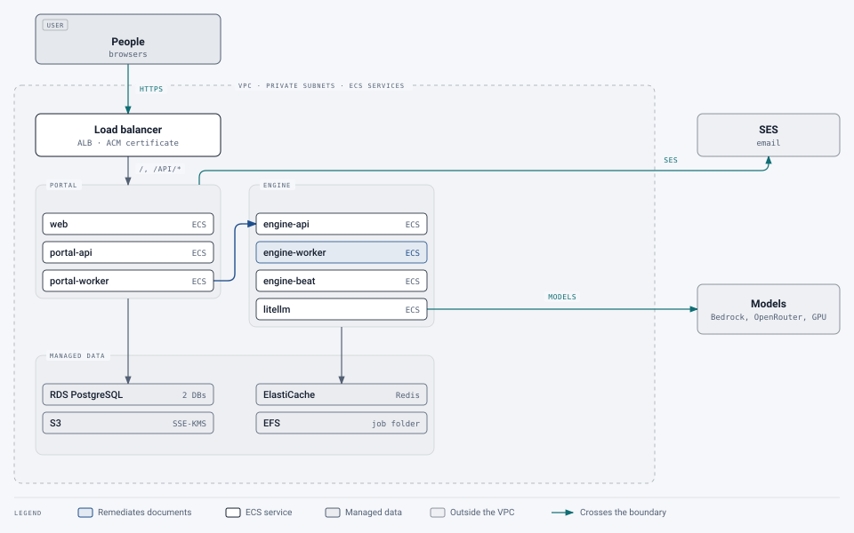

# AWS

[Deployment](README.md) › AWS

Running the service on AWS managed services: containers on **ECS with Fargate**, **RDS** for PostgreSQL,
**ElastiCache** for Redis, **S3** for files, **EFS** for the engine's shared job folder, **SES** for email, and an
**Application Load Balancer** in front.

> [!WARNING]
> Not yet tested end to end. The images and settings are the same as everywhere else; the AWS wiring below is a
> careful plan, not a recipe that's been run. (On EKS, use the [Kubernetes guide](kubernetes.md) instead, with EBS
> and EFS storage classes.)

<picture>
  <source media="(prefers-color-scheme: dark)" srcset="../images/diagrams/aws-plan-dark.svg">
  
</picture>

## Pieces

> **Changed 22 October 2026:** a note on keeping the portal's Redis apart from the engine's, as on Kubernetes.

| Part | AWS service | Notes |
|---|---|---|
| Web app | ECS service from `pdfrem-web`, behind the ALB | Or S3 + CloudFront for the static files |
| Portal API and worker | Two ECS services from `pdfrem-portal` | The ALB routes `/api/*` to the API; the worker needs no inbound traffic |
| Engine API, workers, scheduler | Three ECS services from `pdfrem-engine` | Internal only. Workers: 2 vCPU / 8 GB each to start; the scheduler exactly one task |
| AI gateway | ECS service from `ghcr.io/berriai/litellm` | `config/litellm.yaml` from S3 or baked into a small derived image |
| veraPDF | ECS service from `verapdf/rest`, with `deploy/verapdf/validator.xml` | Internal only; the engine's `VERAPDF_URL`. Without it, each check runs from the command line inside the worker |
| Databases | RDS for PostgreSQL 16 | Two databases (portal and gateway) on one instance; Multi-AZ for production |
| Queue and rate limits | ElastiCache for Redis | Engine on db 0, portal on db 1. The Kubernetes deployment gives the portal a Redis of its own with its own password (#472), so a compromised engine can't reach the portal's rate limits; two small ElastiCache clusters, or a user for each with ElastiCache's access control, do the same here |
| Files | S3 | Private bucket, SSE-KMS, versioning off (so deletion is real); a lifecycle rule as a retention backstop |
| Job folder | EFS | Mounted at `/data` in every engine task; an access point with UID/GID 10001 |
| Email | SES (`PORTAL_MAIL_BACKEND=ses`) | Verify the domain, set up DKIM, and leave the SES sandbox |
| Secrets | Secrets Manager | Injected into tasks as environment variables |
| Images | ECR (or GHCR) | Build with `scripts/build.sh` (set `REGISTRY` to the ECR repository) |

## Settings that change

```
# portal
PORTAL_DATABASE_URL=postgresql+psycopg://portal_app:…@<rds-endpoint>:5432/portal   # rows only (below)
PORTAL_REDIS_URL=rediss://<elasticache-endpoint>:6379/1
PORTAL_S3_ENDPOINT_URL=                     # empty: AWS S3, with the task role's credentials
PORTAL_S3_BUCKET=<bucket>
PORTAL_ENGINE_URL=http://engine-api.<namespace>.local:8000   # ECS Service Connect or Cloud Map
PORTAL_MAIL_BACKEND=ses
PORTAL_SES_REGION=<region>
PORTAL_APP_URL=https://pdf.example.org
PORTAL_COOKIE_SECURE=true
PORTAL_TRUST_PROXY_HEADERS=true             # the caller's address from the ALB's X-Forwarded-For
PORTAL_CLIENT_IP_HEADER=x-forwarded-for     # read from the end: the ALB adds the address it saw last

# engine
REDIS_URL=rediss://<elasticache-endpoint>:6379/0
DATA_DIR=/data                              # the EFS mount
GATEWAY_BASE_URL=http://litellm.<namespace>.local:4000/v1
SERVICE_API_KEY=…                           # and the same value as PORTAL_ENGINE_API_KEY
VERAPDF_URL=http://verapdf.<namespace>.local:8080
AI_GATEWAY_ONLY=true                        # no AI provider but the gateway
```

**Two database accounts:** run migrations as the database's owner, and the portal's services as an account that
can read and write rows but owns no table, as the Kubernetes deployment does (`deploy/k8s/app-role.sql`: run it
after each migration). That account can't alter a table or drop the triggers that keep the audit log and the page
ledger append-only.

**The engine's egress:** the engine opens uploaded PDFs, so let its tasks reach only Redis, EFS, veraPDF and the
gateway (no NAT), and set `AI_GATEWAY_ONLY=true` so every AI call goes through the gateway
([details](../../deploy/k8s/README.md#network-policies-and-the-redis-password)).

With `PORTAL_S3_ACCESS_KEY` and `PORTAL_S3_SECRET_KEY` empty, the portal's S3 client uses the task role's credentials:
give the portal tasks' role access to the bucket (and the KMS key).

**Keep the caller's address:** have the ALB send `/api/*` straight to the portal API, and everything else to the web
app. Or send everything to the web app and set its `TRUSTED_PROXIES` to the ALB's subnets (the VPC's CIDR range):
it then passes on the address the ALB reports. Without that, the web app reports its own peer, the ALB.

## AI models on AWS

- **Amazon Bedrock:** add Bedrock models to `config/litellm.yaml` (LiteLLM supports Bedrock), with the gateway task's
  role allowed to invoke them. Documents stay in your AWS account.
- **A GPU instance** (for example a g6 instance) running vLLM or LocalAI with the same open models as the reference
  deployment, reached privately by the gateway.
- **OpenRouter** or another provider, through the gateway, for groups that allow external services.

## Order of work

1. VPC with private subnets, NAT (for model providers and package downloads), security groups that let only the ALB reach
   the web app and only the portal reach the engine.
2. RDS, ElastiCache, the S3 bucket, EFS with an access point, SES domain verification, secrets.
3. Push the images; create the task definitions and services; the ALB with an ACM certificate.
4. Run migrations as a one-off task, as the database's owner: `python -m portal.cli migrate` with the portal's
   settings and an owner's `PORTAL_DATABASE_URL`. Then grant the portal's own account the tables
   (`deploy/k8s/app-role.sql`).
5. Sign in with a bootstrap super admin and follow [First-time setup](../user-guide/super-admins/first-time-setup.md).

## Backups

RDS automated backups and snapshots cover the databases; S3 versioning is off by design, so back files up with
`scripts/backup.sh --files` (with `PORTAL_DB_EXEC` and `PORTAL_CLI` set for your environment) or AWS Backup.
