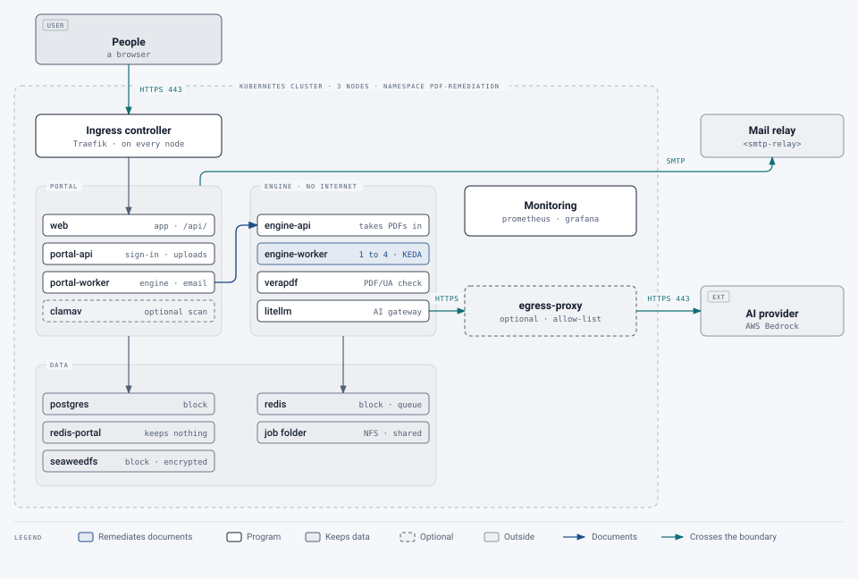
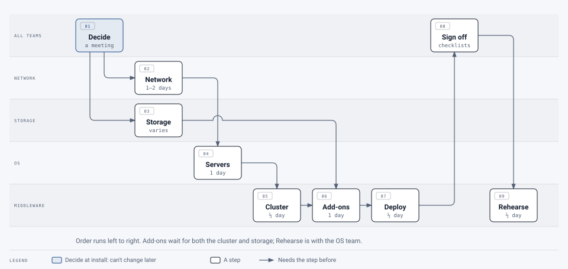

# A first Kubernetes cluster: start here

[Deployment](../README.md) › First cluster

This guide is for a campus putting the service on **its first Kubernetes cluster**. It's written for the teams who
build and run it, none of whom need to know Kubernetes already:

| Page | For | What's in it |
|---|---|---|
| **This page** | Everyone, and the service owner | What Kubernetes is, what this service runs, who does what and in what order |
| [Networking](network.md) | The network team | Addresses, DNS, firewall rules, load balancing, certificates, outbound access |
| [Servers](os.md) | The OS team | The servers to build, the OS settings, what runs as root, shutting down safely, patching without downtime |
| [Storage](storage.md) | The storage and OS teams | The two kinds of storage and why no disk is shared between servers, where block storage can come from, the NFS-only case, backups |
| [Cluster and service](middleware.md) | The middleware team | Installing the cluster and its add-ons, deploying the service, day to day |
| [Root access](root-access.md) | The OS and middleware teams | When the middleware team has no root: each command it runs with `sudo` on the servers, what it does and why, and a `sudoers` rule |
| [Checklists](checklist.md) | Everyone | Each team's checklist and the go-live checklist, with how to check each item |
| [From POC to production](production.md) | The service owner, everyone | What makes the proof of concept a service people can rely on |
| [Scaling](scaling.md) | The middleware team, the service owner | How to handle more documents and more people |
| [Resilience](resilience.md) | Everyone | What keeps working when something fails, and how to do better |
| [More applications](more-applications.md) | The middleware team, architects | Putting other applications on the same cluster later |

The [glossary](#glossary) at the end of this page explains every term these pages use.

> [!IMPORTANT]
> **Build the proof of concept as if it's production.** Proofs of concept here tend to become the production service
> without being rebuilt. Some choices can't easily be changed after the cluster is installed (its address ranges,
> its number of control-plane servers, where its data is stored, its certificates). Make those properly from day one,
> even for a trial. Each page marks them: **Decide at install.**

## Kubernetes in one page

**Kubernetes** runs programs packaged as **containers** across a group of servers, and keeps them running. You tell
it what should be running ("two copies of the portal, one database, the web front end"), and it starts them, restarts
them when they fail, and moves them when a server goes down. That description is kept as text files called
**manifests**; this service's are in [`deploy/k8s/manifests`](../../../deploy/k8s/manifests).

The words you'll meet, with what they mean for this service:

- A **cluster** is the whole group of servers. Ours is three servers.
- A **node** is one server in the cluster. Each of ours is both a **server node** (it runs the cluster's own
  control software and its database, **etcd**) and an **agent node** (it runs the service's programs). Three is
  the smallest number that keeps working when one node is down.
- A **container** is a packaged program with everything it needs: the portal, the PDF engine, the database. Each
  is built from an **image**, kept in a **registry**.
- A **pod** is one running copy of a container (sometimes a few that work together). "The portal runs as two pods"
  means two copies, usually on different nodes.
- A **deployment** keeps a set number of identical pods running, and replaces them one at a time on an update.
- A **namespace** is a named area of the cluster. Everything this service runs is in the namespace
  `pdf-remediation`, kept apart from anything else on the cluster.
- A **service** gives a set of pods one stable internal name and address, for example `postgres` for the database.
- An **ingress** is how web traffic gets in: the **ingress controller** receives HTTPS for the service's name and
  passes it to the right pods.
- A **volume** is storage a pod keeps across restarts. It comes from a **storage class**, which the storage team
  provides: the databases need block storage, and the PDF engine a shared folder.
- A **secret** holds a password or key, given only to the pods that need it.
- A **network policy** says which pods may talk to which. The service ships one for every component.
- **kubectl** is the command-line tool for looking at and changing the cluster. **RKE2** is the Kubernetes
  distribution we install: SUSE's, built for security-conscious and government use, with the network and ingress
  pieces included.

## What the service runs

> **Changed 22 October 2026:** the portal's own Redis (`redis-portal`), the optional malware scanner and the egress
> proxy are drawn.

<picture>
  <source media="(prefers-color-scheme: dark)" srcset="../../images/diagrams/service-overview-dark.svg">
  
</picture>

- **web** serves the web app and passes `/api/` to **portal-api**, which handles sign-in, uploads, groups and
  reports. **portal-worker** sends documents to the engine and email.
- **engine-api** takes documents in; **engine-worker** pods remediate them, more of them when the queue is long
  (KEDA starts and stops them). **verapdf** checks the results against PDF/UA.
- **litellm** is the AI gateway: the only part that talks to the AI provider.
- **postgres** (the database), **redis** (the engine's queue) and **seaweedfs** (stored documents, encrypted) keep
  the data. **redis-portal** holds the portal's rate limits, apart from the engine's queue, and keeps nothing.
- Optional: **clamav** scans every upload for malware, and **egress-proxy** is the only way out to the internet for
  the parts that need it, limited to the hosts the service uses.
- **prometheus** and **grafana** watch it all; alerts go to the service's super admins by email.

The engine, which opens uploaded PDFs, can't reach the internet at all. Every component can talk only to the ones it
needs ([network policies](../../../deploy/k8s/README.md#network-policies-and-the-redis-password)).

## Who does what, in order

<picture>
  <source media="(prefers-color-scheme: dark)" srcset="../../images/diagrams/install-order-dark.svg">
  
</picture>

| # | Step | Team | Needs first | About |
|---|---|---|---|---|
| 1 | Decide the values marked **Decide at install** (address ranges, names, certificate issuer, storage) | All, with the service owner | – | A meeting |
| 2 | Addresses, DNS names, firewall rules ([networking](network.md)) | Network | 1 | 1–2 days |
| 3 | Storage: a block storage class and a shared one, and a backup share ([storage](storage.md)) | Storage | 1 | Depends on the storage team |
| 4 | Three servers built and prepared ([servers](os.md)) | OS | 2 | 1 day |
| 5 | The cluster installed: RKE2 on the three servers ([cluster](middleware.md#install-the-cluster)) | Middleware | 4 | Half a day |
| 6 | Cluster add-ons: floating address, certificates, scaling, storage drivers ([add-ons](middleware.md#cluster-add-ons)) | Middleware, with storage | 3, 5 | 1 day |
| 7 | The service deployed ([deploy](middleware.md#deploy-the-service)) | Middleware | 6 | Half a day |
| 8 | The checklists worked through and signed ([checklists](checklist.md)) | All | 7 | Half a day |
| 9 | A test restore and a test of a node going down ([resilience](resilience.md)) | Middleware, OS | 8 | Half a day |

Values each campus fills in are written `<like-this>` and listed at the top of each page.

## Glossary

> **Changed 22 October 2026:** the ingress controller is Traefik on new clusters (#460).

| Term | Meaning |
|---|---|
| Agent node | A node that runs the service's pods. Ours are also server nodes. |
| Block storage | A disk for one pod at a time (ReadWriteOnce), with the guarantees a database needs, attached to one server at a time and moved by the cluster. iSCSI, Fibre Channel, a SAN's or a hypervisor's volumes, or Longhorn on each server's own disk. |
| Canal | The network plugin RKE2 uses by default: it gives each pod an address, enforces network policies, and here encrypts traffic between nodes with WireGuard. |
| cert-manager | An add-on that requests and renews HTTPS certificates. |
| Cluster | The whole group of nodes run by one Kubernetes control plane. |
| ClusterIssuer | cert-manager's name for where certificates come from (a campus CA, an ACME service such as InCommon or Let's Encrypt). |
| CNI | The network plugin (Container Network Interface). Canal here. |
| Container, image, registry | A packaged program; the file it's started from; where images are kept (GitHub's registry, or a campus mirror). |
| Control plane | The software that runs the cluster: the API server, scheduler, controllers and etcd. On our server nodes. |
| CronJob | A pod started on a schedule, like cron. The nightly backup is one. |
| Deployment | Keeps a set number of identical pods running. |
| Drain | Moving the pods off a node so it can be patched or rebooted (`kubectl drain`). |
| etcd | The cluster's own database of what should be running. On the server nodes; needs a majority of them up. |
| Graceful node shutdown | A kubelet setting: a server shutting down holds the shutdown briefly while it stops its pods properly. |
| Helm | A package manager for Kubernetes add-ons. Used to install cert-manager and KEDA. |
| Ingress, ingress controller | The rule that sends HTTPS for a name to a service; the program (Traefik, or ingress-nginx) that carries it out. |
| KEDA | An add-on that starts more engine workers when documents are waiting, and stops them when the queue is empty. |
| kube-vip | An add-on that gives the cluster floating IP addresses, moved to a healthy node when one fails. |
| kubeconfig | The file holding a cluster's address and an administrator's credentials, used by `kubectl`. |
| kubectl | The command-line tool for Kubernetes. |
| kubelet | The program on each node that starts and watches its pods. |
| Longhorn | SUSE's storage system for RKE2: block volumes kept on the servers' own disks, copied across them. |
| Manifest | A text file (YAML) describing what should run. |
| Namespace | A named area of the cluster; this service uses `pdf-remediation`. |
| Network policy | A rule for which pods may talk to which. |
| Node | One server in the cluster. |
| Pod | One running copy of a container, the unit Kubernetes starts and stops. |
| Pod and service ranges | Private address ranges inside the cluster for pods and services. Must not overlap campus networks. |
| PodDisruptionBudget | A rule that stops a drain from taking down too many copies of something at once. |
| Reclaim policy | What happens to a volume's disk when its claim is deleted: **Retain** keeps it (and its data), **Delete** destroys it. Databases want Retain. |
| RKE2 | The Kubernetes distribution we install (SUSE's "RKE Government"). |
| Secret | A password or key stored in the cluster, given only to the pods that need it. Encrypted in etcd. |
| Server node | A node that runs the control plane and etcd. |
| Service | A stable internal name and address for a set of pods. |
| Shared storage | A folder several pods use at once (ReadWriteMany), over NFS or similar. The engine's job folder. |
| StatefulSet | Like a deployment, for pods that keep data (the database). |
| Storage class | A kind of storage the cluster can create volumes from, set up with the storage team. |
| Taint | A mark on a node that keeps pods off it unless they're allowed there. Used to give a workload its own nodes. |
| Volume | Storage a pod keeps across restarts. |
| WireGuard | The encryption Canal uses for traffic between nodes. |