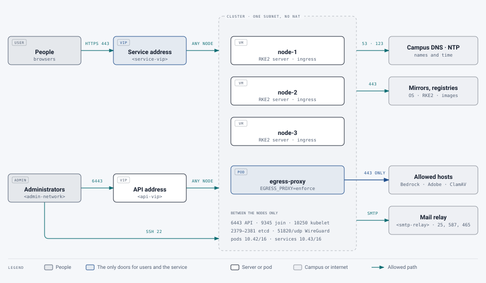

# Networking

[Deployment](../README.md) › [First cluster](README.md) › Networking

For the network team. What the cluster needs from the campus network: addresses, names, firewall rules, a way in for
users, and outbound access. New to Kubernetes? The [start page](README.md#kubernetes-in-one-page) explains the terms
in a page.

**Values to fill in:**

| Value | Example | Used for |
|---|---|---|
| `<node-1-ip>`, `<node-2-ip>`, `<node-3-ip>` | 192.0.2.11–13 | The three servers |
| `<api-vip>` | 192.0.2.10 | The cluster's control address (administrators, the nodes themselves) |
| `<service-vip>` | 192.0.2.20 | Where users' HTTPS arrives (or the campus load balancer's address) |
| `<service-name>` | `pdf.example.edu` | The service's web address |
| `<api-name>` | `k8s-pdf.example.edu` | The cluster's control address, by name |
| `<pod-range>`, `<service-range>` | 10.42.0.0/16, 10.43.0.0/16 | Private ranges inside the cluster |
| `<admin-network>` | 198.51.100.0/24 | Where administrators work from |
| `<smtp-relay>` | smtp.example.edu:25 | Sign-in codes and notices |

## The picture

<picture>
  <source media="(prefers-color-scheme: dark)" srcset="../../images/diagrams/network-paths-dark.svg">
  
</picture>

Each is explained below.

## Addresses

- **Three node addresses** on one subnet (static, or DHCP reservations). The nodes must reach each other directly, with
  no NAT between them.
- **A floating address for the cluster's control API, `<api-vip>`.** It moves to a healthy server node if one fails,
  so administrators and the nodes always reach the API at one address. It's provided either by **kube-vip** inside the
  cluster (it answers ARP for the address, so it must be on the nodes' subnet and unused), or by the campus load
  balancer (ports 6443 and 9345 to all three nodes). **Decide at install:** the address is written into the cluster's
  certificates when it's installed.
- **A floating address for the service, `<service-vip>`**, where users' HTTPS arrives. The ingress controller listens
  on ports 80 and 443 on every node, so this can again be kube-vip (a second address on the nodes' subnet) or the
  campus load balancer (ports 80 and 443 to all three nodes, with a TCP health check on 443).
- **On a three-node cluster where every node is a server, one address can do both**: with kube-vip, the address sits on
  one node at a time, and both the API and the ingress controller answer on every node. Give it both DNS names. Use
  two addresses (or the load balancer) when you want users' traffic and administration kept apart, for example with
  different firewall rules for each.
  With a load balancer, ask for it to pass the client's address on (the PROXY protocol, or `X-Forwarded-For` if it
  ends TLS itself): the service's audit log and rate limits use it.

> [!IMPORTANT]
> **Decide at install: the pod and service ranges.** Inside the cluster, pods and services get addresses from two
> private ranges, by default `10.42.0.0/16` (pods) and `10.43.0.0/16` (services). They **must not overlap** any campus
> network, VPN pool or route the nodes might need to reach, or traffic to those networks breaks in confusing ways.
> They **can't be changed** without rebuilding the cluster.
>
> They also set how far the cluster can grow: each node gets a /24 of the pod range (up to 110 pods on it), so a /16
> allows 256 nodes. That's far more than this service needs, but if the cluster may later host other applications,
> choose a range that leaves room. Tell the middleware team the ranges you choose (`cluster-cidr` and `service-cidr`
> in RKE2's settings).

## DNS

| Name | Points to | Notes |
|---|---|---|
| `<service-name>` | `<service-vip>` | What users type. Needs a certificate (below) |
| `<api-name>` | `<api-vip>` | For administrators and `kubectl`. Not for users |
| Each node's name | Its address | Forward and reverse. Node names must be unique; they become the nodes' names in the cluster |

The nodes use the campus DNS servers for everything outside the cluster; names inside the cluster are answered by the
cluster itself.

## Firewall

Kubernetes needs these between the nodes. Every port below is between the three nodes only, unless it says otherwise.

| Port | Protocol | Used for | Between |
|---|---|---|---|
| 6443 | TCP | The Kubernetes API | All nodes; and from `<admin-network>` |
| 9345 | TCP | RKE2: nodes joining and getting their settings | All nodes |
| 10250 | TCP | The kubelet on each node (logs, `exec`, metrics) | All nodes |
| 2379, 2380 | TCP | etcd, the cluster's own database (client and peer) | Server nodes (all three here) |
| 2381 | TCP | etcd's metrics | The node itself |
| 51820 | UDP | WireGuard: Canal's encrypted traffic between nodes ([below](#encryption-between-nodes)) | All nodes |
| 51821 | UDP | WireGuard over IPv6, only if the cluster uses IPv6 | All nodes |
| 9099 | TCP | Canal's health check | The node itself |
| 80, 443 | TCP | Users' web traffic to the ingress controller | From users (or the load balancer) to all nodes |
| 30000–32767 | TCP | NodePort services; this service uses none | Not needed; leave closed |
| 22 | TCP | SSH | From `<admin-network>` only |

From **users**: only 443 (and 80, which redirects to 443) to `<service-vip>`. From **administrators**: 6443 to
`<api-vip>` and SSH to the nodes, from `<admin-network>` only. Nothing else into the cluster.

> [!NOTE]
> RKE2's documentation recommends turning off the hosts' own firewall (firewalld or ufw), because it interferes with
> the network plugin. Enforce the rules above on the network instead, and leave pod-to-pod rules to the service's
> network policies. If campus policy requires a host firewall, the [servers page](os.md#host-firewall) lists what it
> must allow.

## Encryption between nodes

Traffic between pods on different nodes is encrypted with **WireGuard**, set in Canal's settings at install
([cluster page](middleware.md#install-the-cluster)). It needs UDP 51820 open between the nodes. Each node makes its
own keys and exchanges them with the others automatically; there's nothing to rotate. Traffic between pods on the
same node never leaves the node.

## Outbound access

### From the nodes

| Destination | Port | Why |
|---|---|---|
| The campus DNS and NTP servers | 53, 123 | Names and time; certificates fail when clocks drift |
| The OS's package mirrors | 443 | Patching |
| `get.rke2.io`, `github.com` (RKE2's releases) | 443 | Installing and upgrading RKE2, unless installed from files ([air-gapped](middleware.md#online-or-air-gapped)) |
| `docker.io` (`registry-1.docker.io`, `auth.docker.io`, `production.cloudflare.docker.com`) | 443 | RKE2's own images, and the database, queue, file store, checker and monitoring images |
| `ghcr.io` (and `pkg-containers.githubusercontent.com`) | 443 | The service's own images, and the AI gateway's |
| `registry.k8s.io`, `quay.io` | 443 | kube-state-metrics, cert-manager |
| `ghcr.io/kedacore`, `charts.jetstack.io`, `kedacore.github.io` | 443 | KEDA and cert-manager, and their install charts |

> [!TIP]
> **A campus registry mirror is better for production.** Docker Hub limits how often anonymous clients can pull, and
> an outage there stops pods starting on a new node. A campus registry (Harbor, or a pull-through cache) in front of
> these, and RKE2 told to use it (`registries.yaml`), removes both problems. Then only the mirror needs this outbound
> access.

### From the service

Only these parts of the service reach outside the cluster:

| Part | Destination | Port | When |
|---|---|---|---|
| AI gateway | `bedrock-runtime.<region>.amazonaws.com` (and `bedrock-mantle.<region>.api.aws`) | 443 | AI levels on |
| Adobe worker | `pdf-services-ue1.adobe.io` (or `-ew1`), Adobe's sign-in and storage hosts | 443 | Adobe auto-tag turned on |
| Portal | `<smtp-relay>` | 25, 587 or 465 | Always: sign-in codes and notices |
| Portal | `challenges.cloudflare.com` | 443 | Only if the bot check is turned on |
| ClamAV | `database.clamav.net` | 443 | Only with malware scanning on (`MALWARE_SCAN=clamav`): signature updates every 2 hours |

The pods that open uploaded documents (the engine, the music and formula readers) can reach nothing outside the
cluster. The parts above go through the service's **egress proxy** with `EGRESS_PROXY=enforce`, which lets through
only these hosts ([how it's rolled out](../../../deploy/k8s/README.md#outbound-traffic-the-egress-proxy)); the proxy
itself is then the only pod reaching the internet over HTTPS, and the portal reaches only its SMTP relay's port
directly. The cluster's outbound traffic still leaves from the node addresses, so the campus firewall can add its
own rules.

## Mail

The portal sends sign-in codes and notices through `<smtp-relay>`. Allow the three node addresses to relay, for the
service's sender address (for example `pdf-remediation@example.edu`), and add the relay to that domain's SPF record if
needed. Settings: [email](../../operations/email-and-branding.md#email).

## The certificate

`<service-name>` needs a certificate trusted by browsers. Choose one:

- **cert-manager with the campus's ACME service** (InCommon, or Let's Encrypt where allowed): requested and renewed
  automatically. Needs the ACME service reachable from the cluster, and either `<service-name>` reachable from it on
  port 80 (HTTP-01) or the cluster able to set DNS records (DNS-01).
- **A certificate you supply** (the campus CA, or one bought), stored in the cluster as a secret and replaced before
  it expires. Note the renewal date in the team's calendar.

**Decide at install**, with the middleware team ([HTTPS for the service](middleware.md#https-for-the-service)).

## Backups

If the nightly backup goes to an NFS share (`BACKUPS=cronjob`), the share must allow NFS from the three node addresses
(TCP 2049; NFSv4.1). If the storage team's own snapshots cover the cluster's volumes instead, nothing is needed here
([backups](../../operations/backups-and-migrations.md)).

## Checklist

The network team's checklist is on the [checklists page](checklist.md#network).
