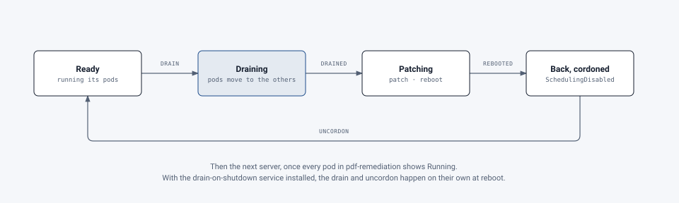

# Servers

[Deployment](../README.md) › [First cluster](README.md) › Servers

For the OS team: the three servers to build, how to prepare them, and how to patch them without taking the service
down. New to Kubernetes? The [start page](README.md#kubernetes-in-one-page) explains the terms in a page.

**Values to fill in:** the three hostnames and addresses (from the [network team](network.md#addresses)), and the
OS you choose.

## The servers

Three servers, all the same. Virtual machines are fine.

| | Each server | Why |
|---|---|---|
| CPU | **8 vCPU** (x86-64) | Each document being remediated keeps about one CPU busy; up to 8 run at once |
| Memory | **16 GB** with scheduled maintenance; **32 GB** to ride out an unplanned failure at a busy time | [Below](#how-much-memory) |
| System disk | **~150 GB, SSD-backed** | The OS, RKE2, container images (several are 1–3 GB), logs, and the cluster's own database (etcd), which needs fast writes |
| Network | One interface on the nodes' subnet; a second for storage if the storage team wants one | |
| Architecture | x86-64 (amd64) | The service's images are built for amd64 |

The service's data (database, stored documents, job folder) is **not** on these disks: it's on volumes from the
storage team ([storage](storage.md)). With Longhorn, each server also gets a second disk for it.

### How much memory

> **Changed 22 October 2026:** the 57 GB figure is said to be every pod's limit added up (the scaling page doesn't
> give it), and malware scanning's share is named.

Each server keeps about 2–3 GB for the OS, RKE2 and the cluster's database, so three 16 GB servers leave about 39 GB
for the service. A busy hour for 100 people takes about 30–40 GB; every part at its upper memory limit at once, about
57 GB, doesn't happen in practice. Malware scanning (`MALWARE_SCAN=clamav`) adds about 1.5 GB, up to 2.5 GB.

- **16 GB** suits a campus that patches in **scheduled maintenance windows**: with one server out, the other two have
  about 26 GB, enough at a quiet time but not at a peak. Keep the engine's workers at the default (4 at most, 4 GB
  each) and the optional music and formula readers off unless a group needs them.
- **32 GB** keeps the service running at full speed when a server fails **unexpectedly** at a busy time. With 16 GB,
  documents wait, or a large one fails and is run again, until the server is back.

**Not a decide-at-install choice:** memory can be added later, one server at a time (drain, add memory, reboot,
uncordon). Signs it's needed: pods restarted for running out of memory (`OOMKilled` in `kubectl describe pod`), or
pods left `Pending`.

**Decide at install: three servers, not one.** The cluster's control software keeps its database (etcd) on every
server node and needs a majority of them up. One server can't survive any failure, and two can't survive one either.
Changing from one to three later means rebuilding.

## The OS

Any OS RKE2 supports. Check [RKE2's requirements](https://docs.rke2.io/install/requirements) (and SUSE's support
matrix it links to) for the RKE2 version the middleware team will install; at the time of writing that includes:

- **Rocky Linux, AlmaLinux or RHEL 8 and 9**;
- **Ubuntu 22.04 and 24.04 LTS**;
- SUSE Linux Enterprise 15.

Use the campus standard. Install a minimal server, with no desktop and no container runtime (no Docker or Podman):
RKE2 brings its own.

## Preparing each server

Do these on all three, then run the [checks](#check-each-server).

1. **A unique hostname and machine ID.** VMs cloned from a template share `/etc/machine-id`, which confuses the
   cluster. Make a new one on each clone:

   ```bash
   sudo rm -f /etc/machine-id && sudo systemd-machine-id-setup
   ```

2. **Time sync** with the campus NTP servers (chrony). Certificates and etcd both fail when clocks drift.
3. **Swap off.** Kubernetes won't start with swap on by default. Turn it off now and in `/etc/fstab`:

   ```bash
   sudo swapoff -a
   ```

4. **WireGuard available in the kernel.** Traffic between nodes is encrypted with it. Any current kernel has it; check:

   ```bash
   sudo modprobe wireguard && echo "wireguard: ok"
   ```

5. **NetworkManager told to leave the cluster's network interfaces alone** (on systems that use it). Otherwise it can
   take over the interfaces the network plugin makes. Create `/etc/NetworkManager/conf.d/rke2-canal.conf`:

   ```ini
   [keyfile]
   unmanaged-devices=interface-name:cali*;interface-name:flannel*
   ```

   Then `sudo systemctl reload NetworkManager`. On RHEL-family systems, also turn off `nm-cloud-setup` if it's
   installed (`sudo systemctl disable --now nm-cloud-setup.service nm-cloud-setup.timer`) and reboot.
6. **The host firewall:** off, with the rules enforced on the network ([networking](network.md#firewall)); see
   [host firewall](#host-firewall) if campus policy requires one.
7. **SELinux stays enforcing** on RHEL-family systems. RKE2 installs its own SELinux policy (`rke2-selinux`) when it's
   installed from its RPMs. Don't turn SELinux off.
8. **Security software exclusions.** Real-time scanning of container files slows every pod start and can break the
   cluster's database. Exclude these paths from on-access scanning (and from `fapolicyd`, where it's used: RKE2's
   documentation lists the rules):
   - `/var/lib/rancher`, `/var/lib/kubelet`, `/etc/rancher`;
   - `/run/k3s`, `/run/containerd`, `/var/log/pods`, `/var/log/containers`;
   - `/opt/cni`, `/var/lib/cni`.
9. **Storage clients**, as the storage team asks: `nfs-utils` (or `nfs-common`) for the shared folder, and
   `iscsi-initiator-utils` (or `open-iscsi`) with the initiator name the storage team registers, if they provide iSCSI.
10. **Disk layout.** `/var/lib/rancher` holds the images and the cluster's database: give it most of the disk, on its
    own filesystem if your standard allows. Keep `/var/log` from filling the root filesystem. With Longhorn
    ([storage](storage.md#where-block-storage-can-come-from)), a second disk on each server, left unformatted or
    mounted where the middleware team says.
11. **Drain on shutdown** ([below](#drain-on-shutdown)): the service that moves pods off before a shutdown.

### Host firewall

If campus policy requires the host firewall on, it must allow everything in the
[networking table](network.md#firewall), and it must also let the network plugin's own traffic through: the pod
range (`10.42.0.0/16` by default) and service range (`10.43.0.0/16`) as trusted sources, and the interfaces
`cali*`, `flannel*` and `flannel-wg` as trusted. This is the most common cause of a cluster that installs but whose
pods can't reach each other. Test it before going further.

## Check each server

```bash
hostnamectl --static; cat /etc/machine-id
```

Each server should show its own name and a different ID.

```bash
swapon --show; timedatectl | grep synchronized
```

No swap listed, and `System clock synchronized: yes`.

```bash
lsmod | grep -E 'wireguard|br_netfilter|overlay'
```

`wireguard` should be listed after the `modprobe` above. (RKE2 loads the other two itself when it starts.)

```bash
getenforce
```

`Enforcing` on RHEL-family systems.

## Hardening

RKE2 has a **CIS profile** that applies the CIS Kubernetes Benchmark's settings. If the campus wants it, the OS team
adds an `etcd` user and RKE2's kernel settings before install, and the middleware team turns the profile on. The steps
are in [RKE2's CIS hardening guide](https://docs.rke2.io/security/hardening_guide). **Decide at install**: turning it on
later means changing a running cluster.

## What runs as root

Like any Kubernetes cluster, and like a hypervisor's own agents, the node software runs as root:

- **RKE2** (the `rke2-server` service): the kubelet, which starts and stops containers, and the container runtime. They
  mount filesystems, set each container's limits and isolation, and set up networking.
- **The network plugin** (Canal), which sets up pod networking and WireGuard.
- **The storage driver's part on each server**, which logs in to the storage, formats a new disk and mounts it, and
  unmounts it when the pod moves. That's what lets the cluster move a disk between servers. Attaching the disk at the
  storage system itself is done through the storage's API, with an account limited to that.

The **service's own pods** run as ordinary users (the engine as user 10001) with every extra privilege dropped; most
can't write to their own files; none can mount anything. They're handed their volumes already mounted. SELinux stays
enforcing, with RKE2's policy. Privileged containers belong only in the system namespaces (RKE2's and the storage
driver's): the service's namespace refuses them (its Pod Security "baseline" label, enforced by Kubernetes;
[details](../../../deploy/k8s/README.md#pod-security)).

## Shutting down safely

**A plain `shutdown` or `reboot` doesn't lose data.** The databases stop cleanly, or recover as from a power cut,
which they're built for. But the cluster isn't told in advance: it notices the server is gone after about 40 seconds,
and only moves that server's pods to the others after **about 5 minutes**. Anything that lived only there is
unavailable until then (if it was the database, the service is down for those minutes), and documents being remediated
there are cut off (they're run again when the queue gives them up, after about 75 minutes).

So **drain first** ([patching](#patching)): pods move off in order and documents in progress finish. Two settings make a
forgotten drain, or a hypervisor shutting VMs down, safe too:

- **Graceful node shutdown** in RKE2's settings (the middleware team sets it,
  [install](middleware.md#1-the-settings-on-the-first-server)): the kubelet holds a shutdown for up to two minutes
  while it stops its pods properly.
- **Drain on shutdown** (next): a small service that drains the server whenever it shuts down.

### Drain on shutdown

A systemd service, from the service's repository (`deploy/node/`), on each server:

```bash
install -m 0755 rke2-drain.sh /usr/local/sbin/rke2-drain.sh
```

```bash
install -m 0644 rke2-drain.service /etc/systemd/system/rke2-drain.service
```

```bash
systemctl daemon-reload && systemctl enable --now rke2-drain.service
```

What it does:

- **At shutdown**, before RKE2 stops, it drains the server, giving documents in progress up to 10 minutes. It
  **skips the drain** when another server is already down or drained (two out of three would leave the service nowhere
  to run), and when the cluster can't be reached. It never stops the shutdown.
- **After boot**, once the server is `Ready`, it lets pods back on (uncordon), **only if it drained the server
  itself**: one an administrator drained on purpose stays drained.
- It uses the administrator's kubeconfig that RKE2 keeps on server nodes. On agent-only servers added later, give it
  an account limited to draining (evicting pods and cordoning the node) instead.

**Check the hypervisor's shutdown timeout** is at least 15 minutes for these VMs, or it powers them off mid-drain. Its
log: `journalctl -u rke2-drain`.

### Shutting down the whole cluster

For maintenance on all three servers at once (a hypervisor or storage outage):

1. Tell people, and pause new work: Administration › Queues, pause each service.
2. Wait for documents in progress to finish (Administration › Queues shows none running).
3. Shut the servers down **one at a time**. The drain service skips draining the second and third (the first is
   already out), which is what you want: there's nowhere left to move to.
4. To start again, **power on all three**. The cluster needs two of three up before it works; give it a few minutes
   after the last one is up, then check `kubectl get nodes` (all `Ready`) and `kubectl get pods -n pdf-remediation`.
5. Resume the queues.

## Patching

<picture>
  <source media="(prefers-color-scheme: dark)" srcset="../../images/diagrams/patching-cycle-dark.svg">
  
</picture>

Patch and reboot **one server at a time**. The middleware team runs the `kubectl` steps (or gives the OS team an
account that can):

1. **Drain the node:** its pods move to the other two.

   ```bash
   kubectl drain <node-name> --ignore-daemonsets --delete-emptydir-data --timeout=10m
   ```

   It waits for documents being remediated on that node to finish, up to the timeout. It says `drained` when done.
2. **Patch and reboot** as usual.
3. **Check it's back:**

   ```bash
   kubectl get nodes
   ```

   The node should say `Ready` (and `SchedulingDisabled`).
4. **Let pods run on it again:**

   ```bash
   kubectl uncordon <node-name>
   ```

5. Wait until `kubectl get pods -n pdf-remediation` shows everything `Running`, then do the next server.

With the [drain-on-shutdown service](#drain-on-shutdown) installed, steps 1 and 4 happen by themselves when the server
reboots; running them by hand first does no harm.

Kernel updates need the reboot; most others don't. RKE2 itself is upgraded by the middleware team, not with the OS
packages ([upgrades](middleware.md#upgrading-rke2)).

## What not to do

- **Don't reboot two servers at once.** The cluster's database needs two of three servers up. With only one, the
  cluster stops accepting changes and the service may stop.
- **Don't change a node's IP address or hostname** after install. etcd and the cluster's certificates use them.
  Treat them as permanent; a node that must change is removed and added again by the middleware team.
- **Don't delete or clean up files under `/var/lib/rancher`, `/var/lib/kubelet` or `/run/k3s`.** They are the cluster.
- **Don't install Docker or Podman** on the nodes, or change the kernel's network settings, without the middleware team.
- **Don't treat VM snapshots of a running node as its backup.** The cluster's own backups are covered in
  [resilience](resilience.md#backups); snapshots of the storage volumes are the storage team's.

## Checklist

The OS team's checklist is on the [checklists page](checklist.md#servers).
