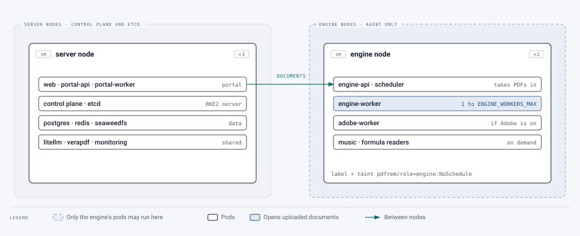

# Scaling

[Deployment](../README.md) › [First cluster](README.md) › Scaling

How to handle more documents and more people, in the order to reach for each step. Settings are in
`deploy/k8s/deploy.env`; change one and run `scripts/deploy.sh` again. Every setting is explained in
[`deploy/k8s/README.md`](../../../deploy/k8s/README.md#scaling-with-the-queue).

## How to tell it's needed

- **Documents wait before they start.** Administration › Queues shows how many are waiting and for how long; Grafana
  shows it over time. A few minutes' wait at the busiest hour is normal; a growing one isn't.
- **Workers are always at their maximum** (`kubectl get pods -n pdf-remediation` shows `ENGINE_WORKERS_MAX` engine
  workers for long stretches).
- **Nodes are short of memory or CPU** (`kubectl top nodes`, or Administration › System), or pods stay `Pending`
  because nothing has room for them.

## How much it handles

Documents processed at once = engine worker pods × documents per pod: **4 × 2 = 8 by default**. Each document keeps
about one CPU busy. A typical document of under 30 pages takes a few minutes, with AI; one of several hundred pages,
tens of minutes.

A rough guide, **to be replaced with the pilot's own figures** (Grafana: documents a day and time per document):

| | 100 users | 1,000 users | 5,000 users |
|---|---|---|---|
| Documents a day (assuming a third of people send three each) | ~100 | ~1,000 | ~5,000 |
| In progress at once, at the busiest hour (5 minutes each, most sent in 8 hours, peaks at three times the average) | ~3 | ~30 | ~150 |
| `ENGINE_WORKERS_MAX` × `WORKER_CONCURRENCY` | 4 × 2 (default) | 12 × 2 | 40 × 2, and queueing at the peak |
| Nodes | 3 × 8 vCPU, 16 GB (scheduled maintenance) or 32 GB | 5–6 × 8 vCPU, 32 GB, or 3 × 16 vCPU, 64 GB plus agents | 8–10 × 16 vCPU, 64 GB |
| Also | – | `VERAPDF_MAX` 6, `LITELLM_MAX` 3 | The AI provider's rate limits and Adobe's quota become the limit; the database on faster storage |

At higher numbers a queue at the peak is usually acceptable: people get an email when their document is done.

## The steps

### 1. More documents at once

```text
ENGINE_WORKERS_MAX=8      # most worker pods (KEDA starts them as documents wait)
WORKER_CONCURRENCY=2      # documents per pod
VERAPDF_MAX=4             # the checker, alongside
LITELLM_MAX=3             # the AI gateway, alongside
```

Cost: up to 3 CPUs and `WORKER_MEMORY_LIMIT` (4 GB by default) per worker pod, only while documents are waiting:
KEDA removes idle workers after `SCALE_DOWN_SECONDS`. Check the nodes have room for the maximum.

### 2. Larger documents

```text
WORKER_MEMORY_LIMIT=6Gi   # very large or image-heavy documents
```

Long documents already share their page work over several processes (`PAGE_WORKERS`, from 50 pages).

### 3. More nodes

When pods no longer fit, add **agent nodes**: servers that run pods but not the cluster's control software. Build
them like the others ([servers](os.md)), then on each:

```yaml
# /etc/rancher/rke2/config.yaml
server: https://<api-vip>:9345
token: <cluster-token>
```

```bash
curl -sfL https://get.rke2.io | INSTALL_RKE2_VERSION=<rke2-version> INSTALL_RKE2_TYPE=agent sh -
```

```bash
systemctl enable --now rke2-agent.service
```

It shows up in `kubectl get nodes` within a few minutes, and new pods use it straight away. Nothing else changes. The
three server nodes stay three: they're enough for hundreds of nodes. (Five for very large clusters; always an odd
number.)

### 4. The PDF engine on its own nodes

So heavy, or hostile, documents never share a machine with the portal, the databases or the cluster's own control
software, give the pods that read uploaded documents nodes of their own. These are **agent nodes**
([step 3](#3-more-nodes)), at least one, two to keep working when one is down. Each gets a **label** (lets those pods
find it) and a **taint** (keeps every other pod off):

```bash
kubectl label node <node-name> pdfrem/role=engine
```

```bash
kubectl taint node <node-name> pdfrem/role=engine:NoSchedule
```

Then set **`ENGINE_NODES=pdfrem/role=engine`** in `deploy.env` and deploy. The engine's API, workers, scheduler and
Adobe worker, and the music and formula readers, get that node selector and tolerate the taint; nothing else does.
`deploy.sh` stops if no node has the label, rather than leave those pods unable to start.

<picture>
  <source media="(prefers-color-scheme: dark)" srcset="../../images/diagrams/engine-nodes-dark.svg">
  
</picture>

**Recommended for production.** On a three-node cluster every node also runs the control plane (etcd, the API server,
the administrator's credentials). A crafted PDF that broke out of the engine's container would land beside them;
on a node of its own it finds only other documents being processed.

### 5. What adding pods doesn't scale

The database (Postgres), the queue (Redis) and the file store (SeaweedFS) run as one copy each. They're light for this
service, so they rarely limit it; give them more memory or faster storage first. Running more copies of them is about
[resilience](resilience.md), not speed.

## How big a cluster can get

Kubernetes's documented limits are 5,000 nodes, 150,000 pods and 110 pods a node by default; RKE2 follows them. The
limit met first is usually the **pod address range**: each node gets a /24 of it, so a /16 allows 256 nodes. It's
chosen at install ([networking](network.md#addresses)) and can't easily be changed. Campus clusters usually run 3–20
nodes; this service needs 3 for 100 users and well under 20 for several thousand.
