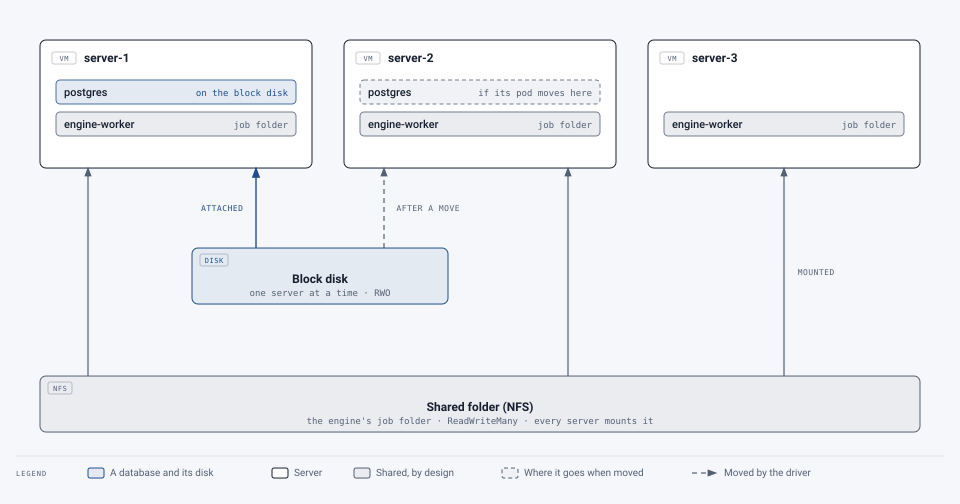

# Storage

[Deployment](../README.md) › [First cluster](README.md) › Storage

For the storage and OS teams: what the service keeps where, what kind of storage each part needs, and the options when
only some kinds are on offer. New to Kubernetes? The [start page](README.md#kubernetes-in-one-page) explains the terms
in a page.

## Two kinds of storage, and neither shares a disk between servers

<picture>
  <source media="(prefers-color-scheme: dark)" srcset="../../images/diagrams/storage-kinds-dark.svg">
  
</picture>

| | The databases | The engine's job folder |
|---|---|---|
| What | **Postgres** (people, groups, records), **Redis** (the queue), **SeaweedFS** (the stored documents, encrypted), and Prometheus and Grafana (monitoring history) | Documents being remediated, for up to 24 hours |
| Kind | **Block storage**: one disk (volume) for each | **Shared storage**: one folder, over NFS or similar |
| Used by | **One server at a time** (Kubernetes calls it ReadWriteOnce) | Several pods on several servers at once (ReadWriteMany) |
| When a pod moves to another server | The cluster's storage driver **detaches the disk from the old server and attaches it to the new one** | Nothing changes: every server mounts the folder |
| Size to start | Postgres 10 GB, Redis 1 GB, documents 50 GB, monitoring 20 GB | 50 GB |

> [!NOTE]
> **No disk is ever mounted by two servers at once.** The hard part of shared storage, one SAN volume used by several
> servers together (which needs a cluster filesystem such as GFS2 or OCFS2, and fencing), isn't needed here. Each
> database disk belongs to one server at a time, and the storage driver moves it. The one folder that is shared is
> plain NFS, which is built for sharing.

**Retain.** The block storage class should keep a disk when its claim in Kubernetes is deleted (a **Retain** reclaim
policy). With **Delete**, the default for many storage classes, deleting the claim also destroys the disk and its data,
whether by mistake, a wrong `kubectl delete`, or the whole namespace removed. With Retain the disk stays and can be
attached again. The job folder doesn't need it: it holds only work in progress.

**Block storage, not NFS, for databases.** Postgres and the others rely on writes reaching the disk when they say so
(`fsync`). NFS can acknowledge writes it hasn't made durable, and a database on it can be corrupted by a network or
server failure.

## Where block storage can come from

In order of preference:

1. **A storage driver for what the campus already runs.** Most hypervisors and SANs have a Kubernetes (CSI) driver:
   vSphere, Proxmox, NetApp, Pure, Dell, iSCSI arrays. It creates a disk for each volume on request and attaches it to
   whichever server needs it. The storage team installs it and names the storage class.
2. **No shared storage at all: Longhorn.** SUSE's storage system for RKE2 uses a plain **second virtual disk on each of
   the three servers** (for example 100–200 GB each) and keeps a copy of every volume on two or three of them, so a
   volume follows its pod to another server and survives one being lost. The OS team adds the disks; the middleware
   team installs Longhorn ([longhorn.io](https://longhorn.io)). Good when there's no driver for the campus's storage.
3. **The database outside the cluster** (below), when neither suits.

Avoid **a server's local disk on its own** (a "local path" class): a volume then can't move, so if that server is down,
whatever's on it is down until it's back.

## When only NFS is on offer

| Part | What to do |
|---|---|
| **Postgres** | Outside the cluster: a campus PostgreSQL service, or a Postgres VM the OS team runs (with its backups). The deployment doesn't support this yet: to-do #465 |
| **The stored documents** | Campus S3-compatible object storage (StorageGRID, ECS, MinIO and the like): the service talks plain S3 to any address. Also to-do #465 |
| **Redis** (the queue) | Can live on NFS, or keep no files at all: if the queue is lost, the portal sends the documents again |
| **Monitoring** (Prometheus) | Prometheus doesn't support NFS. Keep no history across restarts, or turn monitoring off |
| **The job folder** | NFS, as planned |

What an outside PostgreSQL needs to provide: PostgreSQL 16; two databases (`portal` and `litellm`); three logins
(`portal`, which owns the tables and runs the updates at each deploy; `portal_app`, the service's everyday login,
limited to rows; `litellm`); access from the three servers on port 5432, with TLS; and backups by whoever runs it.
About 10 GB to start.

## The shared folder (NFS)

- An export the three servers (or their storage network's addresses, if there's a separate one) can mount, NFSv4.1.
- The engine runs as user **10001**: the export must let it write. A share that maps every user to one account
  (all-squash to an owner that can write), or a folder owned by 10001, both work. The service checks when it starts
  and says so if it can't write.
- An NFS provisioner in the cluster (csi-driver-nfs, or nfs-subdir-external-provisioner) makes a folder on it for the
  service.

## Backups

Two choices ([backups](../../operations/backups-and-migrations.md)):

- **The storage team's snapshots** of the volumes (`BACKUPS=external`): **snapshots, not file copies** (a file-by-file
  copy of a running database may not restore), covering the database volumes, not only the servers' system disks.
- **The service's nightly backup** to an NFS share (`BACKUPS=cronjob`): a dump of the databases and the stored files.
  If the storage team's backups take that folder, keep two or three nights there (`BACKUP_KEEP_DAILY=3`,
  `BACKUP_KEEP_WEEKLY=0`): their backups hold the history.

Either way, keep the file store's encryption key in the password manager: restored documents can't be read without it.

## Who runs what as root

Like any Kubernetes cluster, the node software runs as root: RKE2 itself (the kubelet and container runtime), the
network plugin, and the storage driver's part on each server, which logs in to the storage, formats a new disk and
mounts it. That's what lets the cluster move disks between servers. Attaching a disk at the storage system is done by
the driver's controller through the storage's API, with an account limited to that.

The service's own pods run as ordinary users with every extra privilege dropped, can't mount anything, and are handed
volumes already mounted. Privileged pods belong only in the system namespaces (RKE2's and the storage driver's): the
service's namespace refuses them (Pod Security "baseline", enforced). More on the
[servers page](os.md#what-runs-as-root).

## Checklist

The storage checklist is on the [checklists page](checklist.md#storage).
