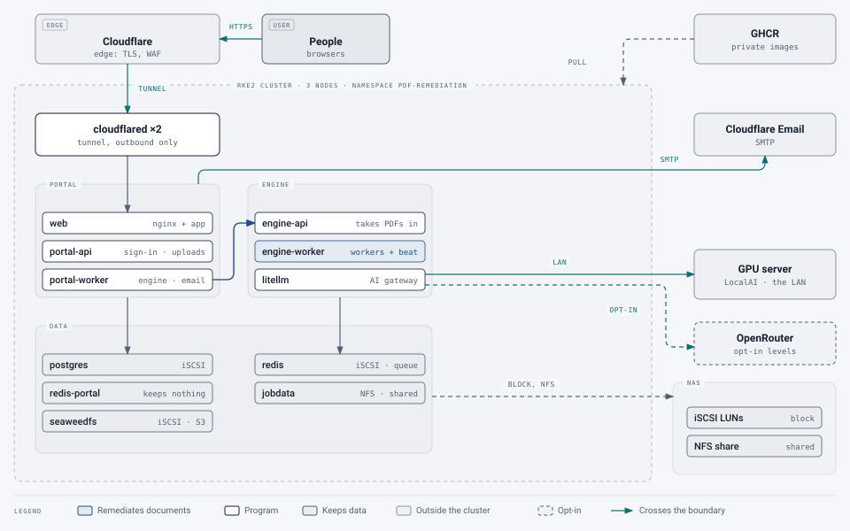

# Reference deployment: an on-premises RKE2 cluster

[Deployment](README.md) › Reference deployment

How the proof of concept runs: a small three-node Kubernetes cluster on premises, storage on a NAS, local AI on a
separate GPU server, and a Cloudflare Tunnel as the only way in. Everything here is done by the scripts in
[`scripts/`](../../scripts) and the manifests in [`deploy/k8s`](../../deploy/k8s); this page shows how the pieces fit.

> [!NOTE]
> Tested. This is the setup the service runs on today.

> **Changed 22 October 2026:** the portal's rate limits are in a Redis of their own (#472), drawn as `redis-portal`.

<picture>
  <source media="(prefers-color-scheme: dark)" srcset="../images/diagrams/reference-rke2-dark.svg">
  
</picture>

## The pieces

| Piece | Choice | Why |
|---|---|---|
| Cluster | RKE2 (three combined control-plane and worker nodes, 4 CPUs and 16 GB each), managed with Rancher | Highly available control plane on modest hardware |
| Block storage | The Synology CSI driver, iSCSI LUNs on the NAS (`synology-iscsi`, Retain) | Databases need block storage with proper fsync semantics; Retain keeps a database's volume if its claim is deleted |
| Shared storage | nfs-subdir-external-provisioner on an NFS share of the NAS (`synology-nfs`, ReadWriteMany) | The engine's API and workers share one job folder. The share maps all users to admin, so the engine's UID 10001 can write |
| Encryption between nodes | WireGuard in Canal (`flannel.backend: wireguard`, set with a HelmChartConfig) | Every connection inside the cluster encrypted with no keys to manage; checked by `scripts/check_cluster_encryption.sh` and on each deploy |
| Storage network | The nodes reach the NAS on a dedicated storage network (a second NIC) | Keeps storage traffic off the service network. NFS exports and iSCSI must allow the storage network's addresses, not the nodes' cluster addresses |
| Way in | A Cloudflare Tunnel, run as `cloudflared` in the namespace (token-managed in Cloudflare Zero Trust) | No inbound ports or public IP; TLS and edge protection from Cloudflare |
| Images | Private on GHCR, pushed by `scripts/build.sh`, pulled with a secret made by `scripts/deploy.sh` | Nothing to host; tagged by commit |
| AI | LocalAI on a separate GPU server (an RTX 3090 and an RTX 4060 Ti) on the LAN, behind the in-cluster gateway; cloud levels through OpenRouter for groups that allow them | Local models keep documents on premises; GPUs stay outside the cluster |
| Email | Cloudflare Email Service over SMTP (port 465, TLS) | Attachments and sender names work over SMTP; SPF, DKIM and DMARC pass |
| Scaling | KEDA and metrics-server, installed with the cluster's own configuration (`AUTOSCALE=auto`) | Workers follow the queue; the music and formula readers run only while there's something to read |
| Monitoring | The bundled Prometheus and Grafana (`MONITORING=on`) | Alerts reach super admins by email; no Alertmanager to run |
| Backups | The nightly CronJob onto an NFS share of the NAS (`BACKUPS=cronjob`), plus the dump `deploy.sh` makes before each migration | Off the cluster's own volumes |

## How it was set up

1. **Storage classes** (outside this repository, in the cluster's own configuration): the iSCSI initiator on each
   node and the Synology CSI driver for block storage; an NFS share exported to the storage network and the NFS
   provisioner for the shared class. Each was checked with a test claim before going further.
2. **The tunnel:** a tunnel created in Cloudflare Zero Trust, with the public hostname routed to
   `http://web.pdf-remediation.svc.cluster.local:8080`, and its token in `deploy/k8s/tunnel.env`. `scripts/deploy.sh`
   runs `cloudflared` when that file exists.
3. **Settings:** `scripts/deploy.sh init`, then in `deploy/k8s/deploy.env` the hostname and storage classes
   (`STORAGE_CLASS=synology-iscsi`, `SHARED_STORAGE_CLASS=synology-nfs`), and in `portal.env` the mail settings.
4. **Images and rollout:** `scripts/build.sh`, then `scripts/deploy.sh`.

The commands and every setting are in [`deploy/k8s/README.md`](../../deploy/k8s/README.md).

## Sizing in practice

The service's pods request about 4.6 GB of memory with monitoring on; each engine worker pod may use up to 4 GB
and 3 CPUs on large documents. With 4 CPUs a node, CPU is the limit before memory: up to 4 worker pods of two
documents each (`ENGINE_WORKERS_MAX=4`, about 8 documents at once) fit beside everything else.

## Lessons from setting it up

- **The storage network matters.** The NAS sees the nodes by their storage-network addresses, so exports and the CSI
  driver's access rules must use those.
- **A NAS's CSI driver may not grant NFS access the way you expect.** Here the Synology CSI driver granted NFS access to
  the nodes' cluster addresses only, so its NFS volumes never mounted. A plain NFS provisioner on a share exported to
  the storage network worked.
- **Email needs `Date` and `Message-ID`.** Providers that sign the `Date` header even when it's missing break DKIM when
  the receiving server adds one; the portal now always sets both.
