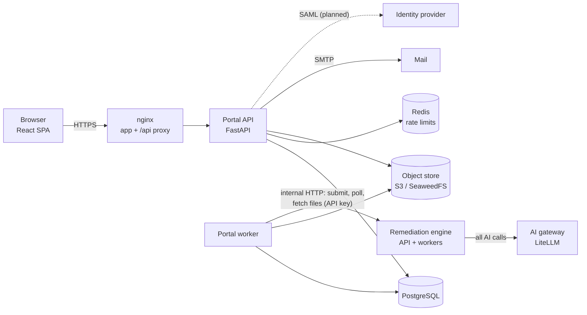

# Portal specification

[Design notes](README.md) › Portal specification

The portal's original design, agreed before it was built. Where it was built differently, the
[build log](build-log.md) says so; the [architecture](../architecture/README.md) describes the service as it is.

## Contents

- [1. Goals and non-goals](#1-goals-and-non-goals)
- [2. Architecture](#2-architecture)
- [3. Roles and permissions](#3-roles-and-permissions)
- [4. Sign-in and account provisioning](#4-sign-in-and-account-provisioning)
- [5. Quotas](#5-quotas)
- [6. Jobs and files](#6-jobs-and-files)
- [7. Screens](#7-screens)
- [8. Data model (main tables)](#8-data-model-main-tables)
- [9. Security requirements](#9-security-requirements)
- [10. Deployment](#10-deployment)
- [11. Suggested additions](#11-suggested-additions)
- [12. Build phases](#12-build-phases)
- [13. Decisions on the earlier open questions](#13-decisions-on-the-earlier-open-questions)

The portal is the user-facing side of the remediation service. It covers sign-in, groups, page
quotas, uploads, results, reports and file retention. The existing remediation engine stays headless
and internal; the portal is the only thing exposed to users.

Status: agreed for build. Decisions are recorded in each section, and the answers to the earlier
open questions are in section 13.

## 1. Goals and non-goals

**Goals**
- Three roles: super admin, group admin and user, with page quotas per group and per user.
- Two sign-in methods: SAML federation, and an emailed one-time code matched to a group by email
  domain.
- Files kept in S3-compatible storage, organized by group and user, and deleted after a global
  retention period.
- Usage and access reports with CSV export.
- **Security first.** The backend can be self-hosted or cloud-hosted. The front end runs on Cloudflare
  Workers, in a Docker container, or on AWS.
- The portal itself meets WCAG 2.2 AA, since it's an accessibility product.

**Not in v1**
- Integration with the ticketing system's API. Ticket numbers are recorded, not checked.
- A user belonging to more than one group.

(Editing tags in the browser, first planned as out of scope, was built: see the tag viewer in section 14.)

## 2. Architecture

As built (the original design had presigned downloads and an engine webhook; see "Known gaps"):



Downloads stream through the portal API after a permission check, so files never need public URLs.

| Component | Choice | Hosting options |
|---|---|---|
| Front end | React + Vite static SPA. Runtime settings (API URL, branding) come from `/config.json`, so one build deploys anywhere | Cloudflare Workers static assets; nginx container; S3 + CloudFront |
| Portal API | Python 3.12, FastAPI, SQLAlchemy 2 + Alembic. Same language as the engine | Container: Docker Compose, ECS/Fargate, Kubernetes |
| Database | PostgreSQL 16 | Container, or managed (RDS, Cloud SQL) |
| Cache and rate limits | Redis (already used by the engine) | Container or ElastiCache |
| Object store | S3 API only. SeaweedFS for the demo, AWS S3 in production | Either |
| Mail | SMTP, configurable. Mailpit for the demo; SES, Postmark or your organization's relay in production | Either |
| Engine | The existing service, reachable **only on the internal network** | Unchanged |

The portal API owns all users, permissions, quotas and storage paths. The engine is told which S3
key to read and where to write. It knows nothing about users and is never exposed to the internet.

### Changes needed in the engine
1. Read input from an S3 key and write outputs to an S3 prefix, behind a storage interface. The local
   folder remains the default for the harness.
2. Accept a callback URL. When a job finishes, POST a signed (HMAC-SHA256) webhook with the job
   result. The portal also polls as a fallback.
3. Require a service credential on every call, through `SERVICE_API_KEY` or mTLS.
4. When run under the portal, turn off the engine's own retention cleanup; the portal owns retention.

## 3. Roles and permissions

| Action | User | Group admin (own group) | Super admin |
|---|---|---|---|
| Submit PDFs, see own jobs and downloads | ✅ | ✅ | ✅ |
| See own remaining pages | ✅ | ✅ | ✅ |
| Create, rename or disable groups; set email domains and SAML mappings | | | ✅ |
| Make a user a group admin, or remove admin rights | | | ✅ |
| Add pages to a group's pool (top-up) | | | ✅ |
| Set a user's page cap; set the group's default cap | | ✅ | ✅ |
| View group jobs and open group files (every opening is logged) | | ✅ | ✅ |
| Usage reports and CSV export | | own group | all groups |
| Access (sign-in) reports | | own group | all |
| Global settings: retention days, messages, sign-in methods | | | ✅ |
| Audit log | | own group | all |

- A group can have several admins.
- Admins and super admins are also ordinary users.
- Super admins start from a bootstrap list (`BOOTSTRAP_SUPER_ADMINS`, a list of email addresses).
  After that they're managed in the UI. The last super admin can't be removed.
- **Authorization is enforced in the API on every request.** The group is always taken from the
  stored resource, never from client input. Postgres row-level security is a second line of
  defence.

## 4. Sign-in and account provisioning

Every user ends up in exactly one group, determined at first sign-in.

### 4.1 Emailed one-time code (lighter option)
1. The user enters their email address.
2. The domain is matched against the domains on each group. Domains are unique across groups; a
   subdomain only matches if it is listed. With no match, the configurable "not provisioned"
   message is shown, set globally or per domain pattern, and no email is sent.
3. With a match, a 6-digit code is emailed. It expires in 10 minutes and allows 5 attempts. Only an
   HMAC of the code is stored. Requests are rate-limited per email address and per IP address.
4. A correct code signs the user in. The account is created on first sign-in (just-in-time) and
   assigned to the matched group.

Codes are used rather than magic links because many organizations' mail scanners open links before the
person does, which uses up a magic link.

### 4.2 SAML (production option)
- The portal acts as a service provider (SP), using python3-saml or pysaml2, and supports one or
  more identity providers through metadata URLs.
- Sign-in starts from the portal (SP-initiated). Responses must be signed; signed assertions and
  encryption are optional.
- **Group mapping** is configured by the super admin. Any attribute can be used, for example
  `memberOf`, a department or site code, or in academic federations `eduPersonScopedAffiliation`. Its value is mapped to a group, and
  mappings are checked in order.
- If no mapping matches, the "not provisioned" message is shown.
- The group is set when the account is first created and doesn't change at later sign-ins.
  Accounts are per email address, so someone who works at two organizations or sites has two accounts, one per
  address. A super admin can move a user by hand; past usage stays with the old group.

### 4.3 Sessions (both methods)
- **Access token:** a JWT signed with ES256, valid for 10 minutes. Keys carry a `kid` so they can be
  rotated. The token stays in memory and is never put in localStorage.
- **Refresh token:** random and opaque, stored only as a hash. It is rotated on every use, and
  reusing an old one revokes the whole session. It travels in an `HttpOnly; Secure; SameSite=Strict`
  cookie scoped to `/auth/refresh`.
- Sessions time out after 8 hours idle and 7 days absolute; both are configurable.
- Users and admins can sign out of all devices.
- The SAML sign-in redirects back to the SPA with a single-use 30-second code, which the SPA exchanges
  for tokens. Tokens never appear in a URL.
- Front end and API must share a registrable domain (e.g. `pdf.example.edu` and
  `api.pdf.example.edu`) so the refresh cookie works. CORS is an explicit allowlist, and the refresh
  endpoint checks the `Origin` header.

### 4.4 Disabling users
Admins can disable users in their group, and super admins can disable anyone. Disabling revokes all
sessions. If the person can still sign in through SAML or email, the disabled flag still wins.

## 5. Quotas

Decisions:
- **Fixed pool, manual top-up.** A group's pool lasts until it is used up. Only super admins add
  pages.
- **Reserve on submit, refund on failure.** Pages are counted from the input PDF's page count when
  it is uploaded.
- **User shares are caps.** Caps may add up to more than the pool. A job is refused if it would
  exceed the user's cap or the group's remaining pages. Users without their own cap get the group's
  default cap. A cap can also be set to unlimited, in which case only the pool limits them.
- **Over quota means blocked**, with a configurable message (global, overridable per group) that can
  point to the ticketing system.

### Accounting
Everything goes through an append-only **quota ledger**. Balances are derived from it and cached on
the group and user rows, updated in the same transaction. Rows are locked (`SELECT … FOR UPDATE`) so
that parallel uploads can't overspend.

| Entry | When | Effect |
|---|---|---|
| `topup` | Super admin adds pages | Group pool + N |
| `reserve` | Upload accepted (not for report-only runs, which use no quota) | Group and user reserved + pages |
| `commit` | Job completes | Reserved → used |
| `release` | Job fails or the user cancels before processing | Reserved − pages |
| `adjust` | Super admin correction (comment required) | Either direction |

Remaining pages for a group = pool − used − reserved. For a user = cap − used − reserved, and never
more than the group's remaining pages.

### Top-ups and the ticketing system
- A **ticket number is required**, plus an optional link and comment.
- **Override:** the super admin can top up without a ticket by ticking "override" and entering a
  required comment. Overrides are **flagged** in the ledger, in reports and in the group's history.
- Each entry records who made it, when, from which IP address, and the before and after balances.

## 6. Jobs and files

### Flow
1. The user uploads one or more PDFs. The SPA streams them to the portal API.
2. The API checks each file:
   - it is a PDF, by its file signature
   - it is within the size limit and the page limit
   - it is not password-protected
   - its page count (read with pikepdf in a sandboxed worker process)
3. It reserves the pages in one transaction. If that fails, the over-quota message is shown and
   nothing is stored.
4. It stores the input and submits the job to the engine with the S3 keys and a callback URL.
5. The SPA shows progress. Polling is enough for v1; server-sent events can come later.
6. When the webhook arrives, the pages are committed or released, the result summary is saved to
   Postgres, and the user is emailed that the job is **done** or has **failed**, with a link. The
   email contains no document content.

### Storage layout
```
s3://{bucket}/groups/{group_id}/users/{user_id}/jobs/{job_id}/
    input/{original-name}.pdf
    output/{name}_remediated.pdf | _compliant_visual.pdf | _compliant_modified.pdf
    reports/{name}_remediation_report.json | .md | verapdf_*.xml
```
- Keys use IDs, not email addresses, so no personal data appears in object names.
- The original filename is kept in the database and restored on download.
- The bucket is private, with server-side encryption. Versioning is off, so deletion is real.

### Downloads
- The API checks permission, then returns a presigned GET URL valid for 60 seconds, with
  `Content-Disposition: attachment`.
- **Every download by someone other than the owner is logged** in the audit log, with the role and
  the reason (optional free text).

### Retention
- The super admin sets a global retention period in days.
- A daily job deletes the files of jobs older than that period and marks the jobs `expired`.
- A bucket lifecycle rule set to the retention period plus 2 days acts as a backstop.
- **Usage records, ledger entries and audit events are kept** after the files are deleted, until
  the separate records purge cycle the super admin configures.
- Users see the expiry date on each job.

## 7. Screens

**Everyone**
- **Sign in:** the email field leads to the code entry screen. "Sign in with [institution]" buttons
  appear for each configured identity provider.
- **Not provisioned:** shows the configured message.

**User**
- **Home:**
  - pages remaining (personal and group)
  - upload drop zone; dropping several files at once works
  - recent jobs
- **Job:**
  - status and progress
  - result: passes or fails PDF/UA-1, failed checks before and after, and the single-file or
    two-file outcome with an explanation
  - the "Needs human review" list
  - downloads
  - expiry date
- **History:** all of the user's jobs, filterable.

**Group admin** (adds)
- **Group overview:**
  - pool, used, reserved and remaining
  - use over time
  - top-up history
- **Users:**
  - list with usage against cap
  - set or clear a cap, set the default cap
  - disable a user
  - make a CSV of usage
- **Jobs:** all group jobs, with file access (logged).
- **Reports:** usage by user over a date range, the group's running total, sign-ins; CSV export.
- **Audit:** the group's admin actions and file accesses.

**Super admin** (adds)
- **Groups:**
  - create, edit and disable groups
  - email domains, SAML mappings, default cap, over-quota message
  - group admins
- **Top-up:** pages, ticket number (or override plus comment).
- **Users:** search across groups, roles, move between groups, disable.
- **Reports:**
  - all groups: usage, top-ups (overrides flagged), sign-ins, failed sign-ins
  - CSV export
- **Settings:**
  - retention days
  - global messages
  - sign-in methods and identity providers
  - mail
  - upload limits
- **Audit log:** everything.

Every report export is itself logged.

## 8. Data model (main tables)

| Table | Key columns |
|---|---|
| `groups` | id, name, slug, status, pool_pages, used_pages, reserved_pages, default_user_cap, over_quota_message |
| `group_domains` | domain (unique), group_id |
| `saml_providers` | id, name, metadata_url, entity_id, attribute, status |
| `saml_group_mappings` | provider_id, attribute_value, group_id, priority |
| `users` | id, email (unique, lower-case), name, group_id, auth_method, status, cap_pages (null = default), used_pages, reserved_pages, last_login_at |
| `role_assignments` | user_id, role (`super_admin`, `group_admin`), group_id (null for super admin) |
| `otp_challenges` | id, email, code_hmac, expires_at, attempts, ip |
| `sessions` | id, user_id, refresh_hash, created_at, last_used_at, expires_at, revoked_at, user_agent, ip |
| `jobs` | id, user_id, group_id, filename, pages, status, engine_job_id, result_summary (jsonb), created/finished/expires_at |
| `job_files` | job_id, kind, s3_key, size, sha256 |
| `quota_ledger` | id, group_id, user_id, job_id, kind, pages, ticket_ref, override, comment, actor_id, ip, created_at, balances after |
| `audit_events` | id, actor_id, action, target_type, target_id, group_id, ip, user_agent, details (jsonb), created_at |
| `settings` | key, value (jsonb), updated_by, updated_at |
| `email_outbox` | id, to, template, payload, status, attempts |

## 9. Security requirements

Security is the top priority, so these are requirements rather than suggestions.

- **Target:** OWASP ASVS 4.0 Level 2 for the portal API.
- **Network:**
  - Only the SPA and the portal API are public.
  - The engine, Postgres, Redis and the object store sit on a private network.
  - Engine workers only get outbound access to the AI host.
- **Transport:** TLS everywhere, with HSTS. Internal calls use mTLS or signed requests.
- **Authorization:**
  - A deny-by-default dependency on every route, scoped to the role and the group.
  - Group checks come from the database record.
  - Postgres row-level security as a second line of defence.
  - Automated tests for every role × endpoint pair.
- **Input:**
  - PDF upload checks as in section 6.
  - Uploaded PDFs are parsed only in worker containers, which run as non-root with a read-only
    filesystem, resource limits and a seccomp profile.
- **Sign-in protection:**
  - Rate limits on code requests, code attempts and SAML endpoints.
  - Code requests always return the same response time.
  - No user enumeration beyond the configured domain message.
- **Secrets:**
  - Secrets come from environment variables or a secrets manager (AWS Secrets Manager, or Docker
    secrets).
  - JWT keys rotate, and old keys keep validating until their tokens expire.
- **Front end:**
  - Strict CSP: no inline script, `connect-src` limited to the API and storage.
  - `frame-ancestors 'none'`.
  - No tokens in localStorage.
- **Webhooks:** HMAC-signed, with a timestamp. Replays older than 5 minutes are rejected.
- **Logging:**
  - Structured logs, with no document content or codes.
  - Audit events for every admin action, sign-in, file access by others, top-up, override and
    export.
- **Supply chain:**
  - Pinned dependencies.
  - CI dependency audit (pip-audit, npm audit).
  - Image scanning (Trivy).
  - Static analysis (Bandit, Semgrep).
- **Privacy:**
  - Admin file access is logged and visible to super admins.
  - Per-group AI provider policy (section 11) keeps sensitive groups on local models.

## 10. Deployment

| Target | Front end | Back end |
|---|---|---|
| Demo / self-hosted | nginx container | Docker Compose: portal-api, engine api and workers, Postgres, Redis, SeaweedFS, Mailpit |
| Cloudflare + self-hosted API | Workers static assets (`wrangler deploy`) | Compose or Kubernetes behind a Cloudflare Tunnel |
| AWS | S3 + CloudFront | ECS Fargate (portal-api, engine), RDS Postgres, ElastiCache, S3, SES |

Everything is configured by environment variables, as in the engine. The SPA reads `/config.json`
at start-up, so the same build works on every target.

## 11. Suggested additions

These weren't in the brief; each is small.
- **AI policy per group:** the super admin chooses, per group, whether local models only or cloud
  models are allowed. This is useful where groups handle personal, student, patient or personnel records.
- **Job email preferences:** users can turn off completion emails.
- **Max pages per document** and **max concurrent jobs per user**, so one user can't fill the queue.
- **Low-balance warnings:** email group admins when the pool falls below a configurable threshold.

## 12. Build phases

1. **Portal API foundation:**
   - Postgres schema and migrations
   - emailed-code sign-in and sessions
   - groups, domains and roles
   - audit log
   - role × endpoint authorization tests
2. **Jobs, storage and quota:**
   - S3 storage layout
   - upload checks
   - quota ledger with reserve, commit and release
   - engine changes (S3, webhook, service authentication)
   - retention sweeper
   - emails
3. **User screens** in the SPA: sign-in, home and upload, job view, history. Includes an
   accessibility check of the SPA itself.
4. **Admin and super-admin screens:** groups, users and caps, top-ups with ticket or override,
   reports and CSV, settings, audit log.
5. **SAML:** identity provider configuration, attribute-to-group mapping, test against an organization's IdP or
   a test IdP such as Keycloak.
6. **Hardening and deployment:**
   - CSP and headers
   - rate limits
   - scans
   - the three front-end targets
   - a demo Compose file with SeaweedFS and Mailpit

## 13. Decisions on the earlier open questions

| # | Question | Decision |
|---|---|---|
| 1 | Do report-only (audit) runs use quota? | **No.** They are logged and reported, but don't reserve or charge pages |
| 2 | Free rerun of the same file? | **No.** Every submission is charged |
| 3 | What happens when someone's affiliation changes? | **Accounts are per email address.** Someone who works at two organizations or sites has a separate address, and so a separate account, for each. A user's group is set when the account is created and doesn't change at later sign-ins; a super admin can move a user by hand |
| 4 | Who manages email domains? | **Super admins only** |
| 5 | How long are records kept? | **A purge cycle the super admin configures.** Usage, ledger, sign-in and audit records older than the set number of days are deleted by a scheduled job. Each purge is itself logged |
| 6 | Second factor for admins? | **No** |
| 7 | Tell users when an admin opened their file? | **No.** It is still recorded in the audit log |
| 8 | Size and page limits | **Configurable** by the super admin: maximum file size, pages per document, files per upload and jobs running at once per user |
