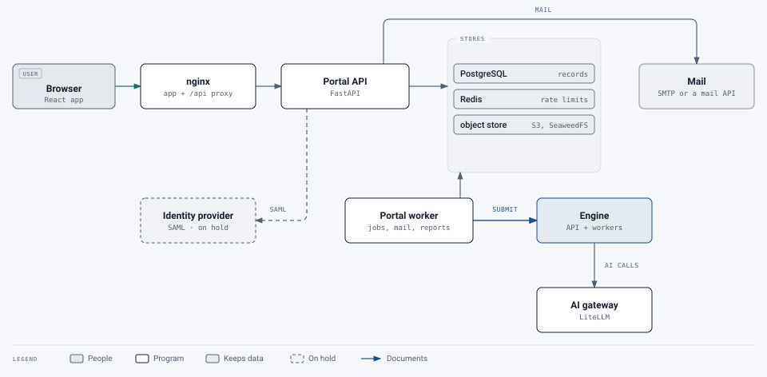

# Portal specification

[Design notes](README.md) › Portal specification

The portal's design, agreed before it was built and kept up to date since. Where the code deliberately differs
from the first plan, the section says what was built ("As built"). The [build log](build-log.md) has the details,
and the [architecture](../architecture/README.md) describes the service as it is.

## Contents

- [1. Goals and non-goals](#1-goals-and-non-goals)
- [2. Architecture](#2-architecture)
- [3. Roles and permissions](#3-roles-and-permissions)
- [4. Sign-in and account provisioning](#4-sign-in-and-account-provisioning)
- [5. Quotas](#5-quotas)
- [6. Jobs and files](#6-jobs-and-files)
- [7. Screens](#7-screens)
- [8. Data model (main tables)](#8-data-model-main-tables)
- [9. Security requirements](#9-security-requirements)
- [10. Deployment](#10-deployment)
- [11. Suggested additions](#11-suggested-additions)
- [12. Build phases](#12-build-phases)
- [13. Decisions on the earlier open questions](#13-decisions-on-the-earlier-open-questions)

The portal is the user-facing side of the remediation service. It covers sign-in, groups, page
quotas, uploads, results, reports and file retention. The existing remediation engine stays headless
and internal; the portal is the only thing exposed to users.

Status: built, except SAML (on hold) and the parts marked as not built. Decisions are recorded in each section, and
the answers to the earlier open questions are in section 13.

## 1. Goals and non-goals

**Goals**
- Three roles: super admin, group admin and user, with page quotas per group and per user.
- Two sign-in methods: SAML federation, and an emailed one-time code matched to a group by email
  domain. *As built:* only the emailed code. SAML is on hold (section 4.2).
- Files kept in S3-compatible storage, organized by group and user, and deleted after a global
  retention period.
- Usage and access reports with CSV export.
- **Security first.** The backend can be self-hosted or cloud-hosted. The front end runs on Cloudflare
  Workers, in a Docker container, or on AWS.
- The portal itself meets WCAG 2.2 AA, since it's an accessibility product.

**Not in v1**
- Integration with the ticketing system's API. Ticket numbers are recorded, not checked.
- A user belonging to more than one group.

(Editing tags in the browser, first planned as out of scope, was built: see the
[tag editor](../architecture/tag-editor.md).)

## 2. Architecture

As built (the original design had presigned downloads and an engine webhook; see "Changes needed in the engine"):

<picture>
  <source media="(prefers-color-scheme: dark)" srcset="../images/diagrams/portal-architecture-dark.svg">
  
</picture>

Downloads stream through the portal API after a permission check, so files never need public URLs.

| Component | Choice | Hosting options |
|---|---|---|
| Front end | React + Vite static SPA. Runtime settings (API URL, branding defaults) come from `/config.json`, so one build deploys anywhere | Cloudflare Workers static assets; nginx container; S3 + CloudFront |
| Portal API | Python 3.12, FastAPI, SQLAlchemy 2 + Alembic. Same language as the engine | Container: Docker Compose, ECS/Fargate, Kubernetes |
| Database | PostgreSQL 16 | Container, or managed (RDS, Cloud SQL) |
| Cache and rate limits | Redis (already used by the engine) | Container or ElastiCache |
| Object store | S3 API only. SeaweedFS for the demo, AWS S3 in production | Either |
| Mail | SMTP, Amazon SES, Plunk or Cloudflare's Email Service. Mailpit for the demo | Either |
| Engine | The existing service, reachable **only on the internal network** | Unchanged |
| Monitoring (optional) | Prometheus and Grafana, with the portal's and engine's metrics (#397) | In the Kubernetes deployment |

The portal API owns all users, permissions, quotas and storage paths. The engine knows nothing about users and is
never exposed to the internet.

### Changes needed in the engine
1. Read input from an S3 key and write outputs to an S3 prefix, behind a storage interface. The local
   folder remains the default for the harness. *Not built:* the portal worker sends the file over internal HTTP
   and fetches the outputs, so each file moves twice.
2. Accept a callback URL. When a job finishes, POST a signed (HMAC-SHA256) webhook with the job
   result. The portal also polls as a fallback. *Not built:* the worker polls the engine.
3. Require a service credential on every call. *Built:* `SERVICE_API_KEY`, sent as `X-API-Key`.
4. When run under the portal, turn off the engine's own retention cleanup; the portal owns retention. *As built:*
   the engine keeps its job folders for `JOB_TTL_HOURS` (24 by default) and the portal keeps its own copies.

## 3. Roles and permissions

> **Changed 23 October 2026:** the service admin role, between group admin and super admin (#564). Each route asks
> for a named permission (`portal/permissions.py`); super admins have them all.

| Action | User | Group admin (own group) | Service admin | Super admin |
|---|---|---|---|---|
| Submit PDFs, see own jobs and downloads | ✅ | ✅ | ✅ | ✅ |
| See own remaining pages | ✅ | ✅ | ✅ | ✅ |
| Create or rename groups; set email domains and single addresses | | | ✅ | ✅ |
| Disable or enable a group | | | | ✅ |
| Make a user a group admin, or remove admin rights | | | ✅ | ✅ |
| Make or remove super admins and service admins | | | | ✅ |
| Add pages to a group's pool (top-up, override, correction), correct a person's usage | | | ✅ | ✅ |
| Add pages to a service's global pool | | | | ✅ |
| Ask for more pages ("Request pages", which opens the support link) | | ✅ | | |
| Set a user's page cap; set the group's default cap | | ✅ | ✅ | ✅ |
| Give the group's services to everyone or person by person | | ✅ | ✅ | ✅ |
| Approve or decline new members | | ✅ | ✅ | ✅ |
| Disable a user (not a super admin or service admin, unless you're a super admin) | | ✅ | ✅ | ✅ |
| Move a user to another group; sign anyone out of all devices | | | ✅ | ✅ |
| View group jobs and open group files (every opening is logged) | | ✅ | all groups | all groups |
| See dollar costs and the engine's own reports | | | ✅ | ✅ |
| Usage reports and CSV export | | own group | all groups | all groups |
| Access (sign-in) reports | | own group | all | all |
| Help requests: take part | own | own group | all | all |
| Help requests: change status, resolve, refund pages, internal notes | | | ✅ | ✅ |
| Queues: view, act on single items; re-run a document; remove files or delete documents at once | | | ✅ | ✅ |
| Queues: pause and resume | | | | ✅ |
| Needs attention across groups and services; System (not Grafana) | | | ✅ | ✅ |
| Grafana | | | | ✅ |
| Export or remove a person's data | | | | ✅ |
| Global settings: retention days, messages, limits, email, branding; services and AI levels | | | | ✅ |
| Audit log | | own group | all | all |

- A group can have several admins.
- Admins, service admins and super admins are also ordinary users. Service admins, like super admins, needn't
  belong to a group.
- Super admins start from a bootstrap list (`PORTAL_BOOTSTRAP_SUPER_ADMINS`, a list of email addresses).
  After that they're managed in the UI. The last super admin can't be removed. Service admins are made by super
  admins in the UI; each one made raises a security alert.
- **Authorization is enforced in the API on every request.** The group is always taken from the
  stored resource, never from client input. Postgres row-level security is a second line of defence (#350). On
  the cluster the portal connects as a database account that owns no table (#337), and the policies bind it.

## 4. Sign-in and account provisioning

Every user ends up in exactly one group, determined at first sign-in.

### 4.1 Emailed one-time code
1. The user enters their email address. A Cloudflare Turnstile bot check can be switched on for this step.
2. The address is matched to a group: an address listed on a group comes first, then the address's domain.
   Domains and listed addresses are unique across groups; a subdomain only matches if it is listed. With no
   match, the configurable "not provisioned" message is shown (one message, set globally), and no email is sent.
3. With a match, a 6-digit code is emailed. It expires in 10 minutes and allows 5 attempts; only the newest
   code works. Only an HMAC of the code is stored. Requests are rate-limited per email address and per IP
   address.
4. Every address the service would take gets the same answer, at the same speed (#359). The email goes out after
   answering: a code, or for a disabled account an email saying why it can't sign in.
5. A correct code signs the user in. The account is created on first sign-in (just-in-time) and
   assigned to the matched group.

Codes are used rather than magic links because many organizations' mail scanners open links before the
person does, which uses up a magic link. When email fails, a super admin can issue a code from the command line
(break-glass); each use is audited.

### 4.2 SAML (on hold, not built)
The design, kept for when the work resumes:
- The portal acts as a service provider (SP), using python3-saml or pysaml2, and supports one or
  more identity providers through metadata URLs.
- Sign-in starts from the portal (SP-initiated). Responses must be signed; signed assertions and
  encryption are optional.
- **Group mapping** is configured by the super admin. Any attribute can be used, for example
  `memberOf`, a department or site code, or in academic federations `eduPersonScopedAffiliation`. Its value is
  mapped to a group, and mappings are checked in order.
- If no mapping matches, the "not provisioned" message is shown.
- The group is set when the account is first created and doesn't change at later sign-ins.
  Accounts are per email address, so someone who works at two organizations or sites has two accounts, one per
  address. A super admin can move a user by hand; past usage stays with the old group.
- SAML sign-ins go through the same provisioning, so member approval applies to them too.

### 4.3 Sessions
- **Access token:** a JWT signed with ES256, valid for 10 minutes. Keys carry a `kid` so they can be
  rotated. The token stays in memory and is never put in localStorage.
- **Refresh token:** random and opaque, stored only as a hash. It is rotated on every use, and
  reusing an old one (after a 20-second grace period) revokes the whole session. It travels in an
  `HttpOnly; Secure; SameSite=Strict` cookie scoped to the sign-in endpoints (`/api/v1/auth`).
- Sessions time out after 8 hours idle and 7 days absolute; both are configurable.
- People can sign out of all devices from their Settings page, and super admins can do it for anyone (#354).
- (SAML, when built) The SAML sign-in redirects back to the SPA with a single-use 30-second code, which the SPA
  exchanges for tokens. Tokens never appear in a URL.
- Front end and API must share a registrable domain (e.g. `pdf.example.edu` and
  `api.pdf.example.edu`) so the refresh cookie works; the nginx and Cloudflare front ends serve the API under
  `/api/` on the same host. CORS is an explicit allowlist, and the cookie endpoints check the `Origin` header.

### 4.4 Disabling users
Admins can disable users in their group, and super admins can disable anyone. Disabling revokes all
sessions. The disabled flag wins over any later sign-in.

### 4.5 Member approval (added)
A group can require new members to be approved by a group admin before they can submit anything (on by default
for new groups). People waiting can sign in and look around; uploads, tag edits and reviews are refused.

## 5. Quotas

Decisions:
- **Fixed pool, manual top-up.** A group's pool lasts until it is used up. Only super admins add
  pages.
- **Reserve on submit, refund on failure.** Pages are counted from the input PDF's page count when
  it is uploaded.
- **User shares are caps.** Caps may add up to more than the pool. A job is refused if it would
  exceed the user's cap or the group's remaining pages. Users without their own cap get the group's
  default cap. The default cap can be left unlimited, in which case only the pool limits them.
- **Over quota means blocked**, with a configurable message (global, overridable per group) that can
  point to the ticketing system. The refusal says which level ran out.

*As built:* pages are counted **per service** (Standard, Adobe Autotag, and each AI level), at three levels: an
optional global pool per service, each group's pool for it, and a cap per person. A document reserves its pages at
every level of every service it uses at once, or is refused. Services also have cost guards (most pages per
document, most pages a day, confirm before send). See [services and quotas](../architecture/services-and-quotas.md).

### Accounting
Everything goes through an append-only **quota ledger**. Balances are derived from it and cached on
the service, group and user rows, updated in the same transaction. Rows are locked (`SELECT … FOR UPDATE`) so
that parallel uploads can't overspend.

| Entry | When | Effect |
|---|---|---|
| `topup` | Super admin adds pages | Pool + N |
| `reserve` | Upload accepted (not for report-only runs, unless the AI level charges for them) | Reserved + pages |
| `commit` | Job completes | Reserved → used |
| `release` | Job fails or the user cancels before processing | Reserved − pages |
| `adjust` | Super admin correction of a pool (comment required) | Either direction |
| `correct` | Super admin correction of one person's usage (reason required), or a help request's refund | Either direction |

Each entry records the service and the scope (global or group). Remaining pages for a group = pool − used −
reserved. For a user = cap − used − reserved, and never more than the group's remaining pages.

### Subgroups (added 26 October 2026)
A group can have subgroups, one level deep (#431). A subgroup draws on its parent's pool, per service, with an
optional cap of its own and no pool; its documents reserve pages on the parent's pool and the subgroup's cap at
once. The parent's admins manage it (it may also have admins of its own, who see only it); super admins and the
parent's admins create subgroups. A person is in one group only, the parent or a subgroup. The parent's lists,
counts and reports include its subgroups', with a Group column and filter. A subgroup's settings (AI for uploads,
local-only, approval, Describe with AI, show external, the over-quota message) follow the parent's until it sets its
own; local-only can't be loosened. At sign-in, an address or domain listed on a subgroup is matched before the
parent's domain. The parent's admins move people between the parent and its subgroups.

### Top-ups and the ticketing system
- A **ticket number is required**, plus an optional link and comment.
- **Override:** the super admin can top up without a ticket by ticking "override" and entering a
  required comment. Overrides are **flagged** in the ledger, in reports and in the group's history.
- Each entry records who made it, when, from which IP address, and the pool, used and reserved balances after it.
- Group admins are emailed once when their group's pool runs low (#358).

## 6. Jobs and files

### Flow
1. The user uploads one or more PDFs. The SPA streams them to the portal API.
2. The API checks each file:
   - it is a PDF, by its file signature
   - it is within the size limit and the page limit
   - it opens without a password (a PDF that only restricts what can be done is accepted, and a signed one is
     held until its owner confirms)
   - it is not a dynamic XFA form
   - its page count, read with pikepdf in a child process with memory, CPU and time limits (#356)
3. It reserves the pages in one transaction. If that fails, the over-quota message is shown and
   nothing is stored.
4. It stores the input. *As built:* the portal worker picks queued jobs (with per-person, per-service and
   large-document limits), sends each file to the engine, and polls it. There's no callback URL.
5. The SPA shows progress. Polling is enough for v1; server-sent events can come later.
6. When the engine is done, the worker copies the outputs into storage, commits or releases the pages, saves the
   result summary to Postgres, and emails the user that the job is **done** or has **failed**, with a link. The
   email contains no document content. People choose how they get these emails (each, a daily summary, or off),
   and an email isn't sent about something they already saw in the portal.

### Storage layout
```
s3://{bucket}/groups/{group_id}/users/{user_id}/jobs/{job_id}/
    input/{original-name}.pdf
    output/{name}_remediated.pdf | _compliant_visual.pdf | _compliant_modified.pdf | the report as a PDF
    reports/{name}_remediation_report.json | .md | verapdf_*.xml
```
- Keys use IDs, not email addresses, so no personal data appears in object names.
- The original filename is kept in the database and restored on download.
- The bucket is private, with server-side encryption. Versioning is off, so deletion is real.
- Saved versions from the tag manager and help-request attachments are stored alongside, also under IDs.

### Downloads
- *As built:* the API checks permission, then streams the file itself, with `Content-Disposition: attachment`
  (the plan was a presigned GET URL valid for 60 seconds). Downloads are rate-limited per person (#357).
- **Every download by someone other than the owner is logged** in the audit log, with the role and
  the reason (optional free text).

### Retention
- The super admin sets a global retention period in days.
- The worker's sweep deletes the files of jobs older than that period and records when they went.
- Not built: a bucket lifecycle rule as a backstop.
- People can mark a document done, and its files go after a short hold (24 hours by default) so it can be undone.
  Super admins can remove files or delete documents at once.
- **Usage records, ledger entries and audit events are kept** after the files are deleted, until
  the separate records purge cycle the super admin configures.
- Users see when each job's files will be removed.

## 7. Screens

As built, the app has two areas: **My documents** for everyone and **Administration** for admins, plus a
**Settings** page for each person.

**Everyone**
- **Sign in:** the email field leads to the code entry screen. (Planned with SAML: "Sign in with [institution]"
  buttons for each configured identity provider.)
- **Not provisioned:** shows the configured message.

**User**
- **My documents:**
  - pages remaining, per service
  - upload form: drag-and-drop or a file picker, several files at once, a choice of service and AI level
    (per file if needed), and Check only or Remediate
  - the person's documents, a page at a time, with search, filters and sorting
- **Document page:**
  - status and progress
  - result: passes or fails PDF/UA, failed checks before and after, and the single-file or
    two-file outcome with an explanation
  - tabs for Needs review, the report (also as an accessible PDF), the accessibility check and versions
  - downloads, and a help request with support
  - when the files will be removed
  - Previous and Next, in the order and with the filters of the list it was opened from (kept in its address as
    `?from=`); the API gives the neighbours from the list's own query (`/documents/neighbours/{id}`,
    `/groups/{id}/documents/neighbours/{id}`, `/reports/documents/neighbours/{id}`)
- **Tag manager:** the tags beside the page, with editing that saves a new reviewed version.
- **Settings:** email notifications, email reports, scheduled report views (admins) and sign out of all devices.

**Group admin** (adds, under Administration)
- **Attention:** what needs doing in their groups.
- **A group's workspace:** Overview (pools, use, the ledger), Services and pages, People (caps, access,
  approval, disabling), Help requests, Documents (with file access, logged), Reports (live reports with CSV
  export; the audit log is one of them) and Group settings.
- **Offer a service to a group:** a guided set-up.

**Super admin** (adds)
- **Groups:** create, edit and disable groups; email domains and single addresses; group admins; top-ups with a
  ticket number (or override plus comment).
- **Help requests:** the support queue.
- **Services and AI levels:** each service's settings, pages, cost guards, model and kinds of document.
- **People (all groups):** search, roles, move between groups, disable, correct usage, export or remove a person's
  data.
- **Queues:** pause and resume, retry, cancel or expedite single items.
- **System:** every workload's pods, from Prometheus, when monitoring is deployed (#398).
- **Reports:** all groups: usage, ledger (overrides flagged), sign-ins, quality, failures, cost, the email log and
  the audit log; CSV export and scheduled emails of a saved view.
- **Settings:** branding, help and messages, email, uploads and limits, sign-in and data (retention, sessions,
  alerts).

Every report export is itself logged.

## 8. Data model (main tables)

As built (the plan had pools on `groups` and `saml_*` tables; SAML isn't built):

| Table | Key columns |
|---|---|
| `groups` | id, name, status, over_quota_message, local_only, require_approval, ai_mode, ai_level, ai_kind |
| `group_domains` | domain (unique), group_id |
| `group_emails` | email (unique), group_id: one person let in without their whole domain |
| `users` | id, email (unique, lower-case), name, group_id, auth_method, status, approval, notify_prefs, last_login_at, removed_at |
| `services` | key, kind (`processing` or `ai_tier`), external, metered, global pool, cost guards, gateway models |
| `group_services` | group_id, service_key, enabled, all_users, pool_pages, used_pages, reserved_pages, default_user_cap |
| `user_services` | user_id, service_key, granted, cap_pages (null = the group default), used_pages, reserved_pages |
| `ai_kinds` | service_key, key, label, gateway model, review model, enabled |
| `role_assignments` | user_id, role (`super_admin`, `group_admin`), group_id (null for super admin) |
| `otp_challenges` | id, email, code_hmac, expires_at, attempts, consumed_at, ip |
| `sessions` | id, user_id, refresh_hash, previous_hash, created_at, last_used_at, expires_at, revoked_at, user_agent, ip |
| `jobs` | id, user_id, group_id, filename, pages, status, processing, ai_tier, ai_kind, engine_job_id, result_summary (jsonb), created/finished_at, files_deleted_at |
| `job_files` | job_id, kind, name, s3_key, size_bytes, content_type |
| `document_versions` | job_id, number, kind, label, status, edits: the original, engine outputs and reviewed versions |
| `quota_ledger` | id, group_id, user_id, job_id, service_key, scope, kind, pages, ticket_ref, override, comment, actor, ip, created_at, balances after |
| `audit_events` | id, actor_id, action, outcome, target_type, target_id, group_id, ip, user_agent, details (jsonb), created_at |
| `settings` | key, value (jsonb), updated_by, updated_at |
| `mail_outbox` | queued and sent email: to, kind, status, attempts, about |
| `help_requests`, `help_messages`, `help_attachments` | help requests and their threads |

Other tables hold unsaved tag edits, signed-off review items, queue pauses, scheduled reports, presence, worker
heartbeats and alerts.

## 9. Security requirements

Security is the top priority, so these are requirements rather than suggestions. Where it was built differently,
[security and privacy](../architecture/security-and-privacy.md) describes what is in place.

- **Target:** OWASP ASVS 4.0 Level 2 for the portal API.
- **Network:**
  - Only the SPA and the portal API are public.
  - The engine, Postgres, Redis and the object store sit on a private network.
  - Engine workers only get outbound access to the AI host. *As built:* on the cluster, network policies let the
    engine reach only DNS, Redis, veraPDF and the AI gateway (#361).
- **Transport:** TLS everywhere, with HSTS. Internal calls use mTLS or signed requests. *As built:* the portal
  calls the engine with an API key on the private network.
- **Authorization:**
  - A deny-by-default dependency on every route, scoped to the role and the group.
  - Group checks come from the database record.
  - Postgres row-level security as a second line of defence (#350; see
    [security and privacy](../architecture/security-and-privacy.md#database)).
  - Automated tests for every role × endpoint pair.
- **Input:**
  - PDF upload checks as in section 6.
  - Uploaded PDFs are parsed only in worker containers, which run as non-root with a read-only
    filesystem, resource limits and a seccomp profile. *As built:* that holds for the engine's pods on the
    cluster (the runtime's default seccomp profile). The API also opens each upload to count its pages, in a
    child process with its own limits.
- **Sign-in protection:**
  - Rate limits on code requests, code attempts and SAML endpoints.
  - Code requests always return the same response time.
  - No user enumeration beyond the configured domain message.
- **Secrets:**
  - Secrets come from environment variables or a secrets manager (AWS Secrets Manager, or Docker
    secrets). On Kubernetes each pod gets a secret with only what it reads.
  - JWT keys rotate, and old keys keep validating until their tokens expire.
- **Front end:**
  - Strict CSP: no inline script, `connect-src` limited to the API and storage.
  - `frame-ancestors 'none'`.
  - No tokens in localStorage.
- **Webhooks:** HMAC-signed, with a timestamp. Replays older than 5 minutes are rejected. (Not built: there are
  no webhooks.)
- **Logging:**
  - Structured logs, with no document content or codes.
  - Audit events for every admin action, sign-in, file access by others, top-up, override and
    export.
- **Supply chain:**
  - Pinned dependencies, and images pinned to a digest.
  - CI dependency audit (pip-audit, npm audit), weekly as well, and Dependabot.
  - Image scanning (Trivy, in `scripts/build.sh`).
  - Static analysis (Bandit's SQL check in CI; Semgrep isn't used).
- **Privacy:**
  - Admin file access is logged and visible to super admins.
  - Per-group AI provider policy (section 11) keeps sensitive groups on local models.

## 10. Deployment

| Target | Front end | Back end |
|---|---|---|
| Demo / self-hosted | nginx container | Docker Compose: portal-api, engine api and workers, Postgres, Redis, SeaweedFS, Mailpit |
| Kubernetes | nginx container, or Workers static assets | `deploy/k8s` with `scripts/build.sh` and `scripts/deploy.sh`, behind a Cloudflare Tunnel |
| Cloudflare + self-hosted API | Workers static assets (`wrangler deploy`) | Compose or Kubernetes behind a Cloudflare Tunnel |
| AWS | S3 + CloudFront | ECS Fargate (portal-api, engine), RDS Postgres, ElastiCache, S3, SES |

Everything is configured by environment variables, as in the engine. The SPA reads `/config.json`
at start-up, so the same build works on every target. The Kubernetes deployment is the one in use; the AWS
target is a design only. See [deployment](../deployment/README.md).

## 11. Suggested additions

These weren't in the brief; each is small. All four were built.
- **AI policy per group:** the super admin chooses, per group, whether local models only or cloud
  models are allowed. This is useful where groups handle personal, student, patient or personnel records.
  *Built* as local-only groups, which block every external service.
- **Job email preferences:** users can turn off completion emails. *Built* as email notification settings: each,
  a daily summary, or off, per kind of email.
- **Max pages per document** and **max concurrent jobs per user**, so one user can't fill the queue. *Built* as
  settings, with a per-service limit too.
- **Low-balance warnings:** email group admins when the pool falls below a configurable threshold. *Built* (#358).

## 12. Build phases

1. **Portal API foundation:**
   - Postgres schema and migrations
   - emailed-code sign-in and sessions
   - groups, domains and roles
   - audit log
   - role × endpoint authorization tests
2. **Jobs, storage and quota:**
   - S3 storage layout
   - upload checks
   - quota ledger with reserve, commit and release
   - engine changes (S3, webhook, service authentication); only service authentication was built
   - retention sweeper
   - emails
3. **User screens** in the SPA: sign-in, home and upload, job view, history. Includes an
   accessibility check of the SPA itself.
4. **Admin and super-admin screens:** groups, users and caps, top-ups with ticket or override,
   reports and CSV, settings, audit log.
5. **SAML:** identity provider configuration, attribute-to-group mapping, test against an organization's IdP or
   a test IdP such as Keycloak. *On hold.*
6. **Hardening and deployment:**
   - CSP and headers
   - rate limits
   - scans
   - the three front-end targets
   - a demo Compose file with SeaweedFS and Mailpit

Phases 1–4 and 6 are done. Much more was built after them (services, AI levels, help
requests, live reports, queues, the tag manager); the [build log](build-log.md) records it in order.

## 13. Decisions on the earlier open questions

| # | Question | Decision |
|---|---|---|
| 1 | Do report-only (audit) runs use quota? | **No.** They are logged and reported, but don't reserve or charge pages. *As built:* each AI level can instead charge for them on the level's pages, or run them with no AI |
| 2 | Free rerun of the same file? | **No.** Every submission is charged. A super admin can re-run a document as a new one, charging the owner only when asked to |
| 3 | What happens when someone's affiliation changes? | **Accounts are per email address.** Someone who works at two organizations or sites has a separate address, and so a separate account, for each. A user's group is set when the account is created and doesn't change at later sign-ins; a super admin can move a user by hand |
| 4 | Who manages email domains? | **Super admins only** (and the single addresses listed on a group) |
| 5 | How long are records kept? | **A purge cycle the super admin configures.** Usage, ledger, sign-in and audit records older than the set number of days are deleted by a scheduled job. Each purge is itself logged |
| 6 | Second factor for admins? | **No** |
| 7 | Tell users when an admin opened their file? | **No.** It is still recorded in the audit log |
| 8 | Size and page limits | **Configurable** by the super admin: maximum file size, pages per document, files per upload and jobs running at once per user |
