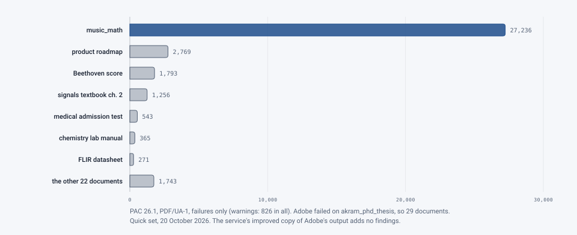

# PAC 2026 on the regression set

**Date:** 20–22 October 2026 · **Code:** the deployed service, from `85c858e` (quick set) to `2ae7809` (full set
re-checked) · **Issue:** #444 · **Documents:** the regression set, 30 documents: the quick set (330 pages) and the
full set (the same documents at full length, 1,931 pages)

## Question

veraPDF's PDF/UA-1 profile passed documents that PAC 2026 still faulted (the Figure errors in #437, the block and
inline warnings in #438). PAC is what many accessibility offices check with. Does the service's output pass PAC,
and where PAC and veraPDF disagree, what is the service missing?

## Setup

- **Checker:** PAC 26.1 (PDF/UA-1), on a Windows VM beside the CI runner, never on the service cluster. PAC exports
  its results only as a PDF report, and its paid REST API was ruled out, so each file was opened in PAC by hand.
- **Documents:** the regression set (`samples/regression/`, kept locally, not in the repository): reports,
  datasheets, textbooks and chapters, exams, forms, scans, and music, chemistry and math documents.
- **Service:** the deployed pilot service, through the portal, as a person would use it.
- **Settings:** Standard processing (the engine), the document's existing tags kept, Local AI, "Review every
  figure with AI" off. The quick set was also run through the Adobe route.

## Method

1. Each document was uploaded, and its main output (the remediated PDF) checked in PAC.
2. Each PAC error and warning was traced to the tags or content that caused it, in the output and the original.
3. Each cause was fixed in the engine, then the document was run again through the deployed service and checked in
   PAC again. A finding counts as fixed only once PAC passes it on the deployed service.

## Results

**Engine route, quick set** (20 October, `85c858e`): 26 of 30 documents passed. The 4 with findings:

| Document | What PAC found | Fix |
|---|---|---|
| `book_348_pages` | An invalid UTF-16 date (`ModDate`): PAC failed, then crashed | #483 |
| `flir_lepton_engineering_datasheet` | A Link pointing to itself, inside a Caption | #484 |
| `infochange` | 11 Sects inside headings (InDesign's anchored objects) | #486 |
| `medical_admission_test_chemistry` | 5 Word pictures tagged as Sect, and content in an inadmissible location | #486 (the pictures are now described Figures) |

All four passed PAC once the fixes were deployed. Two quality problems came up along the way that PAC doesn't
report as errors: blank Word paragraphs holding only a space (#490), and Link tags holding only their annotation, not
their words (#489, including a datasheet's table links). Both were fixed, and the datasheet re-checked clean in PAC.

**Engine route, full set** (21 October, `31980a2`; re-checked 22 October, `2ae7809`): 28 of 30 documents passed. The
2 with findings:

| Document | PAC finding | Cause | Fix |
|---|---|---|---|
| `disease_management_guidelines_2026` (332 pages) | 245 warnings, "Possibly inappropriate use of a Part structure element"; 6 warnings, "Content in a possibly inadmissible location" | A slide deck inside the document: its slides are tagged `Slide`, which the document's own role map makes `Part`, and its `Document` became a `Part`, so 245 Parts in a Part. The 6 were a single space each in a text box, left as content directly in a `Sect`. | #526 |
| `ltc1647_hot_swap_controller_datasheet` | 12 errors, "Characters in a text object cannot be mapped to Unicode" | Non-breaking spaces (WinAnsi 0xA0) in an embedded TrueType font with no Unicode map, on the distributor's cover page | #528 |

Both passed PAC cleanly after the fixes were deployed (`2ae7809`).

**Adobe route, quick set** (20 October): 826 warnings and 35,976 failures in all, and Adobe failed outright on
`akram_phd_thesis`. One document, `music_math`, has three quarters of the failures. They were traced to Adobe's
tagging, not to the service:
- Adobe leaves content out of its structure tree (about half of it real text);
- it gives links no descriptions;
- it doesn't tag form fields;
- fonts it leaves unfixed.

The service's improved copy of Adobe's output adds no PAC findings, and fixes the alt text and the document
identifier.

<picture>
  <source media="(prefers-color-scheme: dark)" srcset="../../images/diagrams/pac-adobe-findings-dark.svg">
  
</picture>

### Per document

**Updated 22 October 2026:** every document's PAC result, as warnings/failures. The engine columns give the first
check, then the result after the fix where there was a finding; the quick set's Adobe column is the Adobe route's
output, before the service's improved copy.

| # | Document | Quick set pages | Engine, quick set | Adobe route, quick set | Full set pages | Engine, full set |
|---|---|---|---|---|---|---|
| 1 | `Advanced_PDF_Form_Sample` | 4 | 0/0 | 12/16 | 4 | 0/0 |
| 2 | `advanced_retrosynthesis_notes` | 7 | 0/0 | 3/77 | 29 | 0/0 |
| 3 | `akram_phd_thesis` | 11 | 0/0 | Adobe failed | 185 | 0/0 |
| 4 | `AWS_Tax_Exempt_Certificate_20260831` | 1 | 0/0 | 2/4 | 1 | 0/0 |
| 5 | `beethoven_moonlight_sonata` | 10 | 0/0 | 0/1793 | 10 | 0/0 |
| 6 | `book_348_pages` | 12 | 0/2 → 0/0 (#483) | 34/111 | 348 | 0/0 |
| 7 | `chemical_enhancements_groundwater` | 20 | 0/0 | 17/123 | 20 | 0/0 |
| 8 | `chemical_equilibria_worksheet` | 3 | 0/0 | 9/59 | 3 | 0/0 |
| 9 | `Customer_Facing_Product_Roadmap_05.01.2025` | 33 | 0/0 | 127/2769 | 33 | 0/0 |
| 10 | `DCP_August2026` | 31 | 0/0 | 66/95 | 31 | 0/0 |
| 11 | `disease_management_guidelines_2026` | 11 | 0/0 | 75/243 | 332 | 251/0 → 0/0 (#526) |
| 12 | `dosage_calculation_level3_worksheet` | 9 | 0/0 | 27/136 | 9 | 0/0 |
| 13 | `dosage_calculations_intro` | 3 | 0/0 | 13/19 | 3 | 0/0 |
| 14 | `electrochemistry_practice_problems` | 13 | 0/0 | 16/106 | 13 | 0/0 |
| 15 | `engineering_chemistry_lab_manual` | 10 | 0/0 | 25/365 | 79 | 0/0 |
| 16 | `flir_lepton_engineering_datasheet` | 10 | 1/0 → 0/0 (#484) | 53/271 | 83 | 0/0 |
| 17 | `green_chemistry` | 7 | 0/0 | 14/103 | 7 | 0/0 |
| 18 | `infochange` | 6 | 11/0 → 0/0 (#486) | 14/231 | 6 | 0/0 |
| 19 | `ltc1647_hot_swap_controller_datasheet` | 7 | 0/0 | 6/230 | 23 | 0/12 → 0/0 (#528) |
| 20 | `math_methods_physics_problem_set` | 2 | 0/0 | 10/7 | 2 | 0/0 |
| 21 | `medical_admission_test_chemistry` | 13 | 10/0 → 0/0 (#486) | 11/543 | 13 | 0/0 |
| 22 | `music_math` | 40 | 0/0 | 35/27236 | 531 | 0/0 |
| 23 | `nobel_chemistry_2026_scientific_background` | 4 | 0/0 | 8/10 | 22 | 0/0 |
| 24 | `nursing_math_practice_packet` | 7 | 0/0 | 8/7 | 24 | 0/0 |
| 25 | `physics_problem_set_units` | 3 | 0/0 | 3/7 | 3 | 0/0 |
| 26 | `signals_systems_homework1_scanned` | 6 | 0/0 | 2/29 | 6 | 0/0 |
| 27 | `signals_systems_textbook_chapter2` | 27 | 0/0 | 75/1256 | 27 | 0/0 |
| 28 | `Sourdough_Discard_Skillet_Pizza_-_Just_the_Recipe` | 1 | 0/0 | 3/6 | 1 | 0/0 |
| 29 | A college's accessibility plan | 18 | 0/0 | 155/110 | 82 | 0/0 |
| 30 | `syllabus_scanned` | 1 | 0/0 | 3/14 | 1 | 0/0 |
| | **Total** | **330** | **22/2 → 0/0** | **826/35976** (29 documents) | **1,931** | **251/12 → 0/0** |

The fixes are the issues; their pull requests are #487 (#486), #488 (#484), #491 (#483, restored after a squash),
#527 (#526) and #529 (#528).

## Where PAC and veraPDF disagree

Both full-set documents passed veraPDF's PDF/UA-1 profile: the service's own report called them compliant. PAC was
the only one to report the findings. (The quick set's veraPDF results weren't recorded.)

- **Structure that PAC judges by its meaning:** Parts nested in Parts, and content standing directly in a grouping
  element. The quick set's Sects inside headings and pictures tagged as sections are the same kind. veraPDF checks
  the standard's machine-checkable rules; PAC adds checks of whether the structure makes sense.
- **Unicode mapping of standard-encoded fonts:** veraPDF accepted a WinAnsi font with no Unicode map that draws a
  non-breaking space, a code the standard's encoding table names only in a footnote; PAC didn't.

Each finding is now covered by the engine's own fixes, with tests.

## What changed because of it

- **Fixes:** #483, #484, #486, #489, #490, #526, #528. The datasheet and guidelines fixes also changed how kept
  tags are repaired in general: no Part outside the Document's top level, no stray spaces left in grouping elements,
  and a Unicode map for every non-symbolic WinAnsi or MacRoman font without one.
- **The full-set documents are now PAC-clean** on the engine route, as well as veraPDF-clean.
- **The comparison stays manual.** The scripts #444 first proposed weren't built: copying outputs to the VM with a
  manifest, reading PAC's PDF reports into JSON, and setting them beside veraPDF and the engine's checks. The manual
  route was enough to find and fix every gap.

## Limits

- **PAC 26.1, PDF/UA-1 only.** PDF/UA-2 isn't covered (#445).
- **One configuration:** existing tags kept, Local AI, no full figure review. "Ignore existing tags", the paid AI
  levels and full review weren't checked in PAC.
- **The Adobe route** was checked on the quick set only.
- **PAC checks structure, not quality.** A document that passes PAC can still have poor alt text or reading order;
  those are the review items the service shows.
- **30 documents.** Other producers will tag in ways this set doesn't have, as the deck inside a document did.

## Reproducing it

1. On the Windows VM, install PAC 2026 (PAC 26.1 here).
2. Upload each document in `samples/regression/full/` (or `quick/`) through the portal with the settings above,
   and download its remediated PDF.
3. Open each in PAC, choose PDF/UA, and save the report next to it.
4. For a document with findings, give PAC's report and the job's engine id (**Run details** on its page) to whoever
   is tracing it.

Raw results stay off the repository with the documents: PAC's reports, and the engine's job folders. The engine
jobs for the two full-set findings were `6829baac` (guidelines) and `29f95112` (datasheet).
