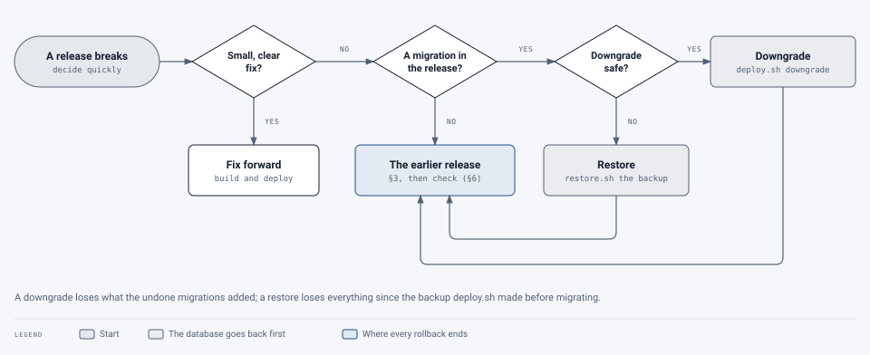

# Rolling back

[Operations](README.md) › Rolling back

How to put the previous release back when a new one breaks something. The other two runbooks are
[incident response](incident-response.md) and [rotating secrets](secret-rotation.md).

Rolling back is quickest when the release had **no database migration**: deploy the earlier images. With a
migration, the database goes back first. Either way, decide quickly whether to roll back or fix forward: a small,
clear fix is often faster to build and deploy than a rollback with a migration.

<picture>
  <source media="(prefers-color-scheme: dark)" srcset="../images/diagrams/rollback-decision-dark.svg">
  
</picture>

## 1. What ran before

Each deploy that finishes adds a line to `deploy/k8s/deploy-history`: when, the image tags, and the database's
migration.

```bash
tail -5 deploy/k8s/deploy-history
```

```text
2026-10-20 09:12:40 -0400 ENGINE_TAG=acc70ee1f2 PORTAL_TAG=acc70ee1f2 WEB_TAG=acc70ee1f2 migration=0044
```

An image's tag is the commit it was built from (`build.sh`), unless it was built with `--tag`. For deploys from before
the history was kept, the running images are in `kubectl -n pdf-remediation get deployments -o wide`, and the
earlier commits in `git log`.

## 2. Did the release have a migration?

Compare the `migration=` of the two lines, or list the migrations between the two commits:

```bash
git diff --stat <earlier commit> <current commit> -- portal/migrations/versions
```

Nothing listed: go to [3](#3-no-migration-deploy-the-earlier-images). Otherwise, [4](#4-with-a-migration).

## 3. No migration: deploy the earlier images

Deploy from the earlier commit, so the manifests, `config/litellm.yaml` and the scripts match its images, with its
tags set in `deploy/k8s/deploy.env` (which win over `.last-build`):

```bash
git switch --detach <earlier commit>
```

In `deploy/k8s/deploy.env`, set `ENGINE_TAG`, `PORTAL_TAG` and `WEB_TAG` (and `MUSIC_TAG`, `FORMULA_TAG` if those
are on) to the earlier line's values. Then:

```bash
scripts/deploy.sh
```

The settings files (`deploy.env`, `engine.env`, `portal.env`) aren't in git, so they stay as they are. If the
release changed a setting the earlier one doesn't know, it's ignored; if it added one the earlier one needs back,
set it.

## 4. With a migration

The earlier portal image doesn't know the later migration, so the database goes back first, with the image that's
running now. Two ways:

| | **Downgrade** | **Restore** |
|---|---|---|
| How | `scripts/deploy.sh downgrade <earlier migration>` | `scripts/restore.sh --k8s --from <the backup deploy.sh made> --db` |
| Loses | What the undone migrations added, and anything written there since ([the table below](#what-a-downgrade-loses)) | **Everything** since the backup: documents, sign-ins, changes, the audit log since |
| When | The usual way, when the table says the downgrade is safe | The downgrade can't be undone, or failed, or the migration damaged data |

**Downgrade:**

```bash
scripts/deploy.sh downgrade 0043
```

It shows the database's migration now and the one it's going back to, asks, backs up the database, then runs the
downgrade as a one-off Job with the portal image that's running. The running portal expects the newer database, so
pause the queues first and deploy the earlier release straight after: deploy the earlier release as in
[3](#3-no-migration-deploy-the-earlier-images); its migration step finds nothing to do.

**Restore:** the backup `deploy.sh` took just before migrating is the newest `backups/backup-<time>` from that
deploy (its `MANIFEST.txt` gives the migration):

```bash
scripts/restore.sh --k8s --from backups/backup-<time> --db
```

Then deploy the earlier release as in [3](#3-no-migration-deploy-the-earlier-images), which also gives the portal's
account the restored tables ([restoring](backups-and-migrations.md#restoring)).

### What a downgrade loses

> **Changed 22 October 2026:** migrations 0045 to 0047 (API tokens, their notices, acknowledged Needs attention
> items) added.

Each migration says what undoing it loses. The recent ones:

| Migration | Undoing it loses | Safe? |
|---|---|---|
| 0047 Acknowledged Needs attention items | Every acknowledgement: those items show again | Yes |
| 0046 API token notices | When token owners were told a token expires soon or stopped unused: they may be told again | Yes |
| 0045 Personal API tokens | **Every API token** (scripts using them get 401), which documents were "sent by script", and each group's tokens switch | Only if nobody uses tokens yet; otherwise people make new ones after going forward again |
| 0044 Row-level security | Nothing: the policies go, the rows stay | Yes |
| 0043 Versions opened while being checked | Nothing that matters: the "still checking" mark | Yes |
| 0042 Tag afresh | Which documents were tagged afresh (the documents stay) | Yes |
| 0041 Review items signed off | **Every sign-off** on review items (checked, fixed, not an issue) | Only if none were made since |
| 0040 People removed on request | Which people were removed, and when; their records stay de-identified | Only if nobody was removed since |
| 0039 Alerts | What super admins were already alerted about (they may be alerted again) | Yes |
| 0038 Re-runs | Which document a re-run re-ran | Yes |
| 0037 Describe with AI | The per-group and per-person "Describe with AI" settings | Yes, then set them again |
| 0036 Saving into a version | The link from a saved version to the one it replaced (the undo for a day) | Yes |
| 0035 Tag drafts | Unsaved tag edits kept between sessions | Yes |
| 0005 Services and quotas | Can't be undone | Restore |

For a migration not listed, read its `downgrade()`: one that drops a table or a column loses what was written there;
one that raises can't be undone. New migrations say in their docstring what undoing them loses.

## 5. The web app

Pages people already have open keep the newer web app until they reload. The first time one opens a part of the app
it hasn't loaded yet, that part's file is gone, and the page reloads itself once, onto the earlier version (#441).
Until then, a page may call something the earlier API doesn't have and show an error; reloading fixes it.

## 6. Check

- `deploy.sh` ends by checking the portal, the engine and the web app answer.
- Sign in with a code.
- One test document through each route that's on: Standard, an AI level, Adobe.
- Administration › Queues: nothing failing; resume anything paused.
- Grafana: errors and queue wait back to normal.

## 7. Forward again

Once fixed: back to the main branch (`git switch main`), **remove the tags you set in `deploy.env`** (or
`.last-build`'s new ones are ignored), then build and deploy as usual.

## Tested on the lab

| Rollback | Tried | Notes |
|---|---|---|
| One release back, no migration, and forward again | Not yet | |
| One release back with a migration (downgrade), and forward again | Not yet | The downgrade of the latest migration and back is run by the tests (`tests/portal/test_downgrade_cli.py`) |
| A restore from the pre-migration backup | Not yet | Restores are tried yearly anyway ([trying a restore](backups-and-migrations.md#trying-a-restore)) |
