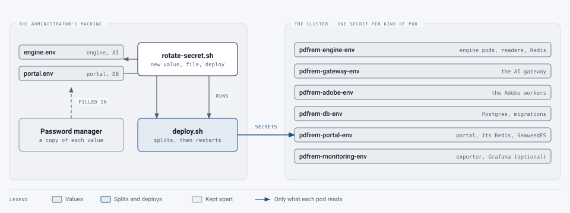

# Rotating secrets

[Operations](README.md) › Rotating secrets

How to give each of the service's passwords and keys a new value: routinely, after a staff change, or because one may
have leaked ([incident response](incident-response.md)). The third runbook is [rolling back](rollback.md).

## How secrets are kept

The values live in three files on the administrator's machine, `deploy/k8s/engine.env`, `portal.env` and
`tunnel.env` (or in the password manager, filled in at deploy time). `scripts/deploy.sh` turns them into Kubernetes
secrets, split so each pod gets only what it reads
([which pod sees which secret](../../deploy/k8s/README.md#which-pod-sees-which-secret)), and restarts the pods whose
settings changed. So a rotation is: **a new value in the file, anything that checks the value itself told first,
then a deploy**. After it, the old value no longer works anywhere.

<picture>
  <source media="(prefers-color-scheme: dark)" srcset="../images/diagrams/secret-flow-dark.svg">
  
</picture>

`scripts/rotate-secret.sh` does those steps where they're mechanical, and never prints a value:

```bash
scripts/rotate-secret.sh REDIS_PASSWORD
```

```bash
scripts/rotate-secret.sh OPENROUTER_API_KEY --typed
```

- With a name it knows (the table below), it makes the new value, sets a database role's password first where there
  is one, writes the file, and runs `scripts/deploy.sh`.
- `--typed` is for a key made somewhere else, such as a provider's: make the new key there, then type it (twice; it
  isn't shown). Works for any key in the three files.
- `--no-deploy` changes the files only, to rotate several and deploy once; `-y` is passed to `deploy.sh`.
- Afterwards, put the new value in the password manager.

**Before** a rotation marked *pause first*: Administration › Queues › Pause on the document queues, and wait for the
active ones to finish. Resume after. **After** every rotation: `deploy.sh` checks the portal and engine answer; then
sign in, and run one test document.

## Every secret

> **Changed 22 October 2026:** the SIEM's tokens are listed, and a new `PORTAL_SECRET_KEY` also stops every
> personal API token.

| Secret | File | Rotate with | Effect | Pause first |
|---|---|---|---|---|
| `PORTAL_DB_PASSWORD`, `LITELLM_DB_PASSWORD`, `POSTGRES_ADMIN_PASSWORD` | engine or portal | `rotate-secret.sh NAME` | [Database passwords](#database-passwords) | No |
| `PORTAL_APP_DB_PASSWORD`, `MONITORING_DB_PASSWORD` | portal | `rotate-secret.sh NAME` | The portal (or the exporter) restarts with it | No |
| `REDIS_PASSWORD` | engine | `rotate-secret.sh REDIS_PASSWORD` | Redis and every engine pod restart; queued work is kept | **Yes** |
| `PORTAL_REDIS_PASSWORD` | portal | `rotate-secret.sh PORTAL_REDIS_PASSWORD` | The portal's Redis restarts; sign-in rate-limit counts start again | No |
| `SERVICE_API_KEY` (the portal's copy: `PORTAL_ENGINE_API_KEY`) | both | `rotate-secret.sh SERVICE_API_KEY` | [The engine's API key](#the-engines-api-key) | **Yes** |
| `GATEWAY_API_KEY` | engine | `rotate-secret.sh GATEWAY_API_KEY` (`deploy.sh --new-gateway-key`) | The gateway makes the engine a new key and revokes the old one | No |
| `LITELLM_MASTER_KEY` | engine | `rotate-secret.sh LITELLM_MASTER_KEY` | [The gateway's keys](#the-ai-gateways-keys) | No |
| `UI_PASSWORD` | engine | `rotate-secret.sh UI_PASSWORD` | The gateway's shared admin sign-in | No |
| `PORTAL_JWT_PRIVATE_KEYS` | portal | `rotate-secret.sh PORTAL_JWT_PRIVATE_KEYS`, then `--finish` | [Session keys](#session-keys) | No |
| `PORTAL_SECRET_KEY` | portal | `rotate-secret.sh PORTAL_SECRET_KEY` | [Everyone signed out, every API token stopped](#session-keys) | No |
| `PORTAL_S3_ACCESS_KEY`, `PORTAL_S3_SECRET_KEY` | portal | `rotate-secret.sh PORTAL_S3_SECRET_KEY` (both together) | [The file store's keys](#the-file-stores-keys) | **Yes** |
| `PORTAL_S3_SSE_KEK` | portal | Not rotated | [The file store's encryption key](#the-file-stores-encryption-key) | – |
| `OPENROUTER_API_KEY`, `AWS_ACCESS_KEY_ID` / `AWS_SECRET_ACCESS_KEY`, `LOCAL_AI_API_KEY` | engine | The provider, then `--typed` | [Providers' keys](#providers-keys) | No |
| `ADOBE_CLIENT_SECRET` | engine | Adobe's developer console, then `--typed` | [Providers' keys](#providers-keys) | **Yes**, the Adobe queue |
| `PORTAL_TURNSTILE_SECRET_KEY` | portal | Cloudflare's dashboard (Turnstile), then `--typed` | [Providers' keys](#providers-keys) | No |
| `PORTAL_SMTP_PASSWORD`, `PORTAL_CLOUDFLARE_API_TOKEN`, `PORTAL_PLUNK_API_KEY` | portal | The mail provider, then `--typed` | [Providers' keys](#providers-keys) | No |
| `PORTAL_SIEM_HTTPS_TOKEN`, `PORTAL_SIEM_PULL_TOKEN` | portal | The SIEM's side first (a new collector token, or the new pull token set in the SIEM), then `--typed` | The portal sends with, or accepts, only the new one ([the SIEM export](siem.md)); events wait meanwhile and none are lost | No |
| `TUNNEL_TOKEN` | tunnel | Cloudflare Zero Trust, then `--typed` | [Providers' keys](#providers-keys) | No |
| The registry pull token | – | GitHub, then deploy | [The registry pull token](#the-registry-pull-token) | No |
| `GRAFANA_ADMIN_PASSWORD`, `GRAFANA_SECRET_KEY` | portal | In Grafana | [Grafana](#grafana) | No |

### Database passwords

`PORTAL_DB_PASSWORD` is the database owner's, used only by migrations and backups; `LITELLM_DB_PASSWORD` is the AI
gateway's; `POSTGRES_ADMIN_PASSWORD` is the superuser's. Postgres keeps its own copy of each, so the script sets the
role's new password first (as the superuser, over the database pod's own socket, with the password sent on standard
input), then writes the file and deploys. If the database refuses, the file keeps the old value. Between the two, for
`LITELLM_DB_PASSWORD`, the gateway can't open new database connections for a minute or so; requests it's already
serving carry on.

`PORTAL_APP_DB_PASSWORD` (the portal's own account) and `MONITORING_DB_PASSWORD` are set on the database by every
deploy, so the new value just needs deploying.

### The engine's API key

The portal sends it with every request to the engine, and the engine accepts only that one value. While the pods
restart, the portal's calls are refused, and a refused call marks the document failed instead of trying again: so
**pause the document queues first**, and resume once `deploy.sh` has finished.

### The AI gateway's keys

- `GATEWAY_API_KEY` is the engine's own key, made by the gateway and limited to the service's models. A new one
  (`scripts/deploy.sh --new-gateway-key`) is made and put in place before the old one is revoked.
- `LITELLM_MASTER_KEY` manages the gateway (its keys, users, spend). Keys it made, the engine's included, stay valid.
  Without `LITELLM_SALT_KEY`, the gateway also encrypts credentials added in its admin UI with it; this deployment's
  models and keys come from `config/litellm.yaml` and the settings file, so nothing is lost, but anything added in the
  UI would have to be added again. The script refuses while the engine still uses the master key itself (a deployment
  from before the engine had a key of its own): deploy once, then rotate.
- `UI_PASSWORD` is the gateway's shared admin sign-in, if it's on (`GATEWAY_SHARED_LOGIN`).

### Session keys

People stay signed in with a refresh cookie (up to the session lifetime in Administration › Settings, 7 days unless
changed) and a 10-minute access token signed with the first of `PORTAL_JWT_PRIVATE_KEYS`.

- **Routine, nobody notices:** `rotate-secret.sh PORTAL_JWT_PRIVATE_KEYS` puts a new key first; the old ones still
  verify. After 10 minutes, `rotate-secret.sh PORTAL_JWT_PRIVATE_KEYS --finish` keeps only the new one. (An open
  page with a token from a dropped key just gets a new token from its cookie, so even dropping at once doesn't sign
  anyone out.)
- `PORTAL_SECRET_KEY` keys the refresh cookies, sign-in codes, the links in emails and personal API tokens. A new
  one **signs everyone out**, voids codes not yet used, breaks the unsubscribe links in report emails already sent,
  and **stops every personal API token** (only a keyed hash of each is kept): their owners make new ones in
  Settings, and scripts fail with 401 until they do. `rotate-secret.sh` says so before it asks, with how many tokens
  are active (#545). There's no
  overlap: do it at a quiet time, or when that's what's wanted.

#### Everyone signed out at once

For an incident, both, and one deploy:

```bash
scripts/rotate-secret.sh PORTAL_SECRET_KEY --no-deploy
```

```bash
scripts/rotate-secret.sh PORTAL_JWT_PRIVATE_KEYS --no-deploy
```

```bash
scripts/rotate-secret.sh PORTAL_JWT_PRIVATE_KEYS --finish
```

Every session ends as the new pods start: refresh cookies no longer match, and access tokens no longer verify. People
sign in again with a code. One person or one group is quicker from Administration (see
[incident response](incident-response.md#2-contain)).

### The file store's keys

`PORTAL_S3_ACCESS_KEY` and `PORTAL_S3_SECRET_KEY` are the portal's identity at SeaweedFS, the stored files. The file
store and the portal both restart with the new pair, so for a minute or two files can't be read or written: **pause
first**. The nightly backup reads them when it runs.

### The file store's encryption key

`PORTAL_S3_SSE_KEK` encrypts every stored file. It **isn't rotated**: SeaweedFS can't re-encrypt in place, and
with a new key the stored files can't be read. The script refuses it. Keep it in the password manager; it's also in
the backups' configuration archive (encrypt that: `--encrypt-config`).

If it may have leaked: on its own it's no use without the stored files, which only SeaweedFS's pod and its volume
hold. If both may have, the files can be moved to a new store with a new key: `python -m portal.cli export-files`
from the old store, a new SeaweedFS volume with the new key, `import-files` into it. That's a planned change with
downtime; it hasn't been tried on the lab yet.

### Providers' keys

For a key made by an outside service: **make the new one there, switch, then revoke the old one**.

1. Make a new key at the provider (most allow two at once: AWS has two access keys per IAM user, OpenRouter and
   Cloudflare any number).
2. `scripts/rotate-secret.sh NAME --typed`, and type it. For AWS, both: `AWS_ACCESS_KEY_ID --typed --no-deploy`,
   then `AWS_SECRET_ACCESS_KEY --typed`.
3. Check: a test document on an AI level (AI keys), on Adobe (Adobe), a sign-in (Turnstile, mail), the site
   loading through the tunnel (tunnel).
4. Revoke the old key at the provider (AWS: deactivate it, then delete it once nothing has failed for a day).

### The registry pull token

The cluster pulls images with `GHCR_PULL_TOKEN` (or `gh auth token`), stored as `pdfrem-ghcr` by each deploy. Make a
new token on GitHub (read:packages only), set it, run `scripts/deploy.sh`, and revoke the old one on GitHub.

### Grafana

Grafana keeps its admin password in its own database after the first start, so changing `GRAFANA_ADMIN_PASSWORD`
does nothing. Change it in Grafana (signed in as admin: the profile's Change password), then record it in
`portal.env` and the password manager. `GRAFANA_SECRET_KEY` encrypts what Grafana stores and isn't rotated.

## Schedule

| When | What |
|---|---|
| Yearly | Every secret the script makes; the session keys (routine way) |
| When the provider requires, or yearly | Providers' keys and the registry pull token |
| Someone with access to the settings files or the password manager leaves | Everything they could read: all but `PORTAL_S3_SSE_KEK` |
| A pod may have been compromised | Every secret that pod holds ([which pod sees which secret](../../deploy/k8s/README.md#which-pod-sees-which-secret)) |
| A key appears somewhere it shouldn't (a ticket, a chat, a repository) | That key, at once |

## Tested on the lab

Each rotation is tried once on the lab cluster, and the steps corrected where they were wrong:

| Secret | Tried | Notes |
|---|---|---|
| Database passwords | Not yet | |
| Redis passwords | Not yet | |
| The engine's API key | Not yet | |
| The gateway's keys | Not yet | The engine's first key was made by a deploy (#457); `--new-gateway-key` not yet tried |
| Session keys | Not yet | |
| The file store's keys | Not yet | |
| A provider's key | Not yet | |
