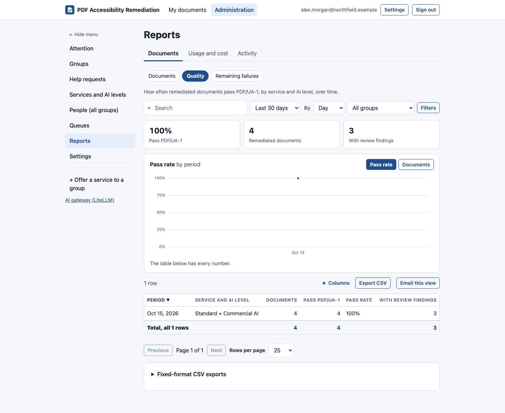

# Reports

[Guide for group admins](README.md) › Reports

**My group → Reports** has live reports for your group: what's in them is always up to date.

## The reports

| Group | Report | What it shows |
|---|---|---|
| **Documents** | Documents | Every document: who, when, pages, options, result, status |
| | Quality | Pass rate, documents, items flagged and pages, per period and option (with a chart) |
| | Remaining failures | The checks documents most often still fail, by rule (with a chart) |
| **Usage** | Usage | Each person's limit and use per service; documents and pages in the period |
| | Page ledger | Every change to the group's pages: top-ups, corrections, charges and refunds |
| | AI usage | What each AI level did for your group's documents: documents, pages, AI calls (and how many failed), tokens, documents the AI wasn't charged for, and the average time, per level and kind of document, over time (with a chart) |
| **Activity** | Sign-ins | Sign-ins, failed attempts, code requests and sign-outs |
| | Email | Every email sent to your group's people: sign-in codes, document and help notifications, summaries; whether it went, when, and any error |
| | Help requests | The group's requests and how long they took |
| | Audit log | Every change to pages, limits, access and services in your group, including changes a super admin made there |

Cost figures (what the AI cost) are for super admins only.

## Working with a report

- **Search** first (people, file names, ticket numbers, reasons, event details), then the **period**: the last 7
  or 30 days, this or last month, this year, all time, or dates.
- **By** (next to the period) groups reports over time by hour, day, week or month. Left alone, it follows the
  period.
- **Filters** opens the rest (status, service, result, outcome…); the ones in use show as chips you can remove.
- Click a column heading to sort; 25 rows per page, or 50, 100 or 200.
- **Columns** hides or shows columns. **Expand** lets a wide table use the full width of the window.
- **Charts:** where there's more than one measure, buttons above the chart switch between them. Hover, or use the
  arrow keys, to read values; the table below has every number.
- Headline numbers and totals cover every matching row, not just the page.
- **Export CSV** downloads exactly what you see. Exports are recorded in the audit log.
- The whole view is in the page's address: bookmark it, or send it to another admin, who sees it within their own
  access.

## Scheduled report views

On any report, **Email this view** saves what you see (filters, search, sort, columns and grouping) to be emailed
**monthly, weekly or daily**, for the period just ended rather than the dates on screen:

- Send it to yourself and others with the same access (for one group: the group's admins).
- Optionally attach every row as a CSV.
- The email has the headline numbers, the first 50 rows with totals, and a link to the same view in the app.

Your [Settings](../people/email-and-settings.md#scheduled-report-views-admins) list the views you set up and the
ones others send you. Recipients who lose access stop getting it; if the person who set it up loses access, it
stops for everyone.

## Email summaries

**Settings → Email reports → Group summary** sends you a summary monthly (the default), weekly or daily: pages
used and left against the pool (with a note when it's low or empty), the most active people, how many documents
pass, open help requests and people waiting for approval. No cost figures.
