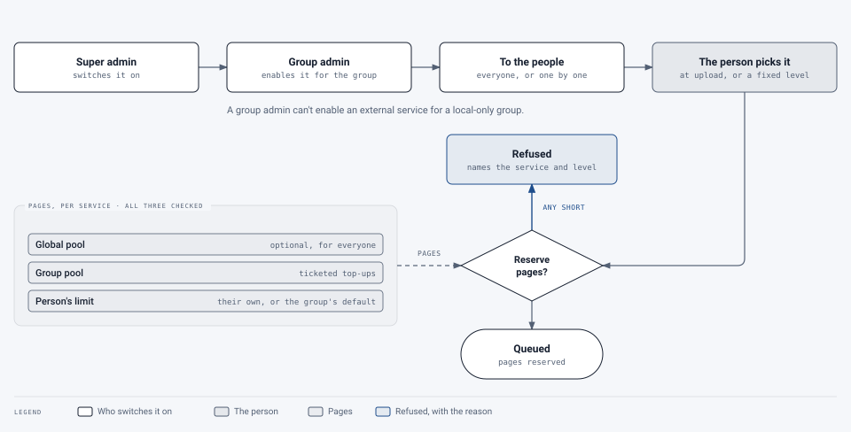

# Services and pages

[Guide for group admins](README.md) › Services and pages

A **service** is a processing option (*Standard*, or *Adobe Autotag* if offered) or an **AI level** (*Local AI*,
*Commercial AI* and so on). Every document uses one processing option and, usually, one AI level, and uses pages
on each.

## Where pages come from

<picture>
  <source media="(prefers-color-scheme: dark)" srcset="../../images/diagrams/service-access-dark.svg">
  
</picture>

For each service, three levels must all have pages for an upload to go ahead:

1. **The service's global pool** (if a super admin set one): shared by every group.
2. **Your group's pool:** topped up by super admins.
3. **Each person's limit:** their own, or your group's default.

When any level is short, the upload is refused with a message saying which service and which level ran out.
Services marked "No limit" count use but never refuse.

## The Services and pages tab

One row per service:

| Column | Meaning |
|---|---|
| **For the group** | On or off for your group. A service a super admin hasn't switched on can't be turned on here |
| **Who has it** | Everyone in the group, or only the people you choose |
| **Group's pages** | The pool: used, in progress and left. An empty pool is highlighted, because everyone then sees 0 left, whatever their limit |
| **Default per person** | The limit for people without their own |
| **Own limits** | How many people have a limit of their own |

> **Changed 22 October 2026:** **Edit** and **Request pages** open in the admin area's standard dialog.

**Edit** on a row opens a dialog that changes:

- whether the service is **on for the group**;
- **who has it**: everyone, or chosen people (then give it to people in the People tab);
- the **default limit per person**;
- whether it's **preselected at upload** (the group's default processing option or AI level).

**Save** applies the changes. Closing the dialog with changes not saved asks first: **Save**, **Keep editing** or
**Discard changes**.

Services that send documents to an outside provider are marked. If your group is **local-only**, they can't be
turned on.

## Getting more pages

Group admins can't add pages to the pool; super admins do, usually against a ticket. **Request pages** on the
service's row opens a short dialog with your service's link for this (**Request pages**) or its help email. Say the
group, the service, how many pages, and why.

Every change to your group's pages (top-ups, corrections, documents charged and refunded) is in the **page
ledger** on the Overview tab and in the **Page ledger** report.

## Offering a service to your group

**+ Offer a service to a group** is a guided set-up that does everything in the order that works:

1. choose the service (and your group);
2. who gets it;
3. pages for the pool (super admins only: group admins skip this and request pages);
4. the default limit per person;
5. **Save all**. It finishes by checking that one of the people can actually use it.
