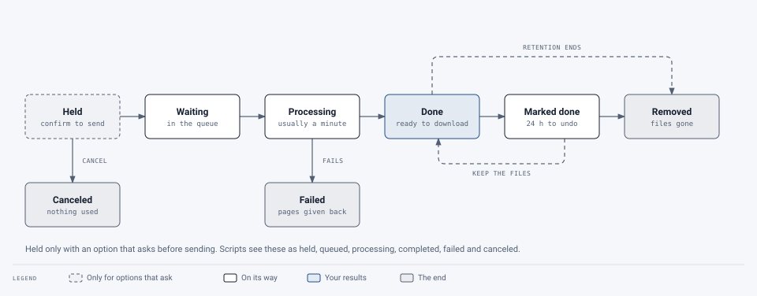

# Guide for people submitting documents

For anyone who needs accessible PDFs. If you only use the service now and then, start with **Your first
document** below: it covers the whole trip in a few minutes. The pages that follow go into each step.

## Contents

1. [Signing in](signing-in.md): the emailed code, joining your group, waiting for approval
2. [Submitting documents](submitting-documents.md): uploading, choosing the AI, Check only, pages
3. [Your results](your-results.md): the document page, which file to use, the report, the review list, removing
   files when you're done
4. [The tag manager](tag-manager/README.md): checking and fixing tags, side by side with the pages
5. [Getting help](getting-help.md): asking support to look at a document
6. [Email and settings](email-and-settings.md): notifications, email reports and API tokens
7. [Scripting](scripting.md): sending documents with an API token, and fetching the results
8. [Troubleshooting](troubleshooting.md): messages you might see, and what to do

See also the [glossary](../glossary.md).

## Your first document

1. **Sign in.** Go to the service's address and enter your work email. A 6-digit code arrives by email
   (check your junk folder the first time); type it in. [More on signing in](signing-in.md).
2. **Upload.** On **My documents**, drag your PDF onto the box, or choose **Choose PDFs**. The line under the
   list shows what will be used: the processing option and the AI level. The defaults are fine for most
   documents. [More on submitting](submitting-documents.md).
3. **Remediate.** Choose **Remediate**. The document appears under **Your documents** as *Waiting*, then
   *Processing*. Most documents take under a minute; long or image-heavy ones take longer. You get an email
   when it's done, so you can close the page.
4. **Open the result.** Click the document's name. The top of the page says whether it passes PDF/UA-1
   ("✓ Passes PDF/UA-1"), with **Download**. [More on your results](your-results.md).
5. **Check the review list.** The **Needs review** tab lists what a machine couldn't be sure about, most
   important first: alt text that may be wrong, a heading that may be body text, a passage in another
   language. Fix what matters in the tag manager ([how](tag-manager/README.md)), or ask for help.
6. **Use the file.** Download it and publish it in place of the original.

### What to expect

<picture>
  <source media="(prefers-color-scheme: dark)" srcset="../../images/diagrams/document-lifecycle-dark.svg">
  
</picture>

- **Your document looks exactly the same.** Tags are hidden structure; nothing on the page moves. The only
  exception is a document that can't pass without a visible change (usually a font problem). Then you get two
  files, and the page explains which to use.
- **Bookmarks follow the headings.** A document with at least two headings gets bookmarks (the outline in a
  PDF reader's side panel), one per heading, nested like the headings. If the document already has bookmarks that
  work, they're kept. When you change headings in the tag manager, bookmarks the tool made follow on the next save.
- **Tables with several levels of headings** ("2025" over "Q1" and "Q2") have each cell linked to all its
  headings, so a screen reader can say "2026, Q2, North" for a number rather than just "Q2". This needs the AI's
  reading of the table: which rows and columns are headings and which headings span.
- **Footnotes are tagged as notes** when the text has a raised mark ("results¹") and the small print at the foot of
  the page starts with the same mark. Small numbered lines nothing points at stay as they were. A note under a table
  that starts with a symbol (*, †) used in the table's cells is tagged the same way, and the cell reads "500
  (footnote asterisk)".
- **The AI writes drafts.** Image descriptions and readings of math or other notation are written by AI and
  marked for checking. Charts, diagrams and formulas are the ones most worth a look.
- **Passing isn't the whole story.** The accessibility check covers the rules a machine can test. A person
  should still check that descriptions are accurate and headings make sense: that's what the review list is for.
