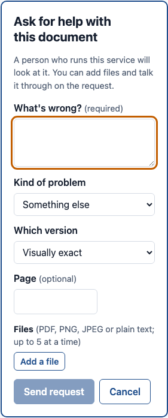

# Getting help

[Guide for people submitting documents](README.md) › Getting help

If something in a finished document isn't right and you can't fix it yourself, ask the people who run the
service to look at it.

## Asking

1. On the document's page, choose **Ask for help** (on the side, or in the slim menu if downloads are hidden).
   In the tag manager, **Report a problem** at the top right does the same for the document, and, with a tag
   selected, **Report a problem here** for that tag.
2. Say **what's wrong** (required). Be specific: the page, what you expected, what you got.
3. Pick the **kind of problem**: alt text, reading order, tables, headings, math, looks different, or something
   else.
4. Pick the **version** it's about and, if you like, the **page**.
5. Attach files if they help: PDF, PNG, JPEG or plain text, up to 10 MB each and 50 MB per request.
6. Send it.

There's one request at a time per document.

## When a document fails

A document that couldn't be processed has no result to point into, so its page shows the reason and a help
panel, nothing else.

- Usually a help request has already been opened for it by the service, so the people who run it look into every
  failure. You'll see it on the document's page: add anything that might help ("it's a scan of a signed form").
- If there isn't one, choose **Ask for help** and say what you know about the document. There's no kind, version
  or page to pick.
- A document that someone stopped on purpose doesn't get a request.

## Following it

- The request shows on the document's page: its status, the conversation, and a box to reply and add files.
- **My documents** shows its status next to the document, and a badge counts replies you haven't read.
- You get an email when someone replies or the status changes. Several replies within a few minutes arrive as one
  email. (If you have the request open in the portal at the time, you can choose to skip those emails: see
  [Email and settings](email-and-settings.md).)
- The conversation refreshes by itself while it's open, so new messages appear without reloading.

## When it's resolved

- The request says **what was done**, links the **fixed version**, and lists any **pages given back**.
- **Compare in the tag manager** shows your version on the left and the fixed one on the right.
- If it's still not right, **Reopen this request** within 14 days of it finishing. After that, ask for help
  again.

## If support is waiting on you

When support asks you something, the request waits for your reply. You get a reminder after 3 days and after
7 days; with no reply by 10 days the request is closed. You can still reopen it within 14 days.
