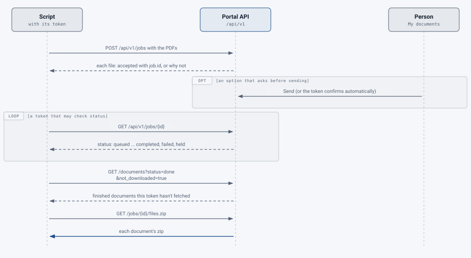

# Scripting: sending documents with an API token

If you have many documents, or documents that arrive on a schedule, a script can send them for you, for example a
nightly job that sends a folder of PDFs. You then review and download the results in the web app as usual, or have
a second script fetch them.

<picture>
  <source media="(prefers-color-scheme: dark)" srcset="../../images/diagrams/scripting-flow-dark.svg">
  
</picture>

## Before you start

- Your group's administrators must have switched **API tokens** on. If they haven't, there's no **API tokens**
  section in **Settings**; ask them.
- In **Settings → API tokens**, choose **Make a token**:
  - **Name:** what it's for, such as "lab scanner".
  - **Processing**, **AI level** and **Kind of document:** every document the token sends uses these, whatever the
    script asks for.
  - **It may:** every token can submit. Tick **Check their status** if the script needs to know when documents are
    done.
  - **Download results:** **No** (the default; download them in the web app), **Everything** (each document's zip)
    or **Chosen files** (for example just the remediated PDF and the report).
  - **Lasts:** how many days, up to the longest your service allows.
- **Copy the token** when it's shown. It's shown once only. Keep it like a password: anyone with it can send
  documents on your pages. If it leaks, revoke it in **Settings** and make a new one.

The examples below use `curl` and two variables: your service's address and your token.

```bash
export PORTAL="https://pdf.example.edu"
export TOKEN="pdfr_…"
```

Every request sends the token in the `Authorization` header.

## Send documents

One request can carry several PDFs (up to your service's **most files per upload**):

```bash
curl -sS -H "Authorization: Bearer $TOKEN" -F "files=@syllabus.pdf" -F "files=@handbook.pdf" "$PORTAL/api/v1/jobs"
```

The answer lists each file:
- `"accepted": true`, with `job.id` (keep it if a script will check on it); or
- `"accepted": false`, with `error.message` saying why, for example too many pages or over your pages.
  **Changed 22 October 2026:** a file already waiting or in progress for you, with the same token, is refused with
  `error.error` `already_in_progress` and uses no pages, so a script that runs again after a timeout doesn't send
  it twice.

A folder, one file at a time:

```bash
for f in ~/to-send/*.pdf; do
  curl -sS -H "Authorization: Bearer $TOKEN" -F "files=@$f" "$PORTAL/api/v1/jobs" | jq -r '.[] | "\(.filename): \(if .accepted then .job.id else .error.message end)"'
done
```

Documents sent this way appear in **My documents**, marked **sent by script**, with the usual emails when they're
done. Under **Filters** you can show only those sent by script.

**Options that ask before sending.** Some processing options and AI levels send documents to an outside service, and
ask before they do. Documents sent to one of those wait as *Waiting for you to confirm* until you send them from
**My documents**, unless the token was made with **Confirm sending automatically**.

## Check on them

With **Check their status**, a script can look a document up by its id:

```bash
curl -sS -H "Authorization: Bearer $TOKEN" "$PORTAL/api/v1/jobs/$JOB_ID" | jq '{filename, status, error_message}'
```

`status` is one of:
- `queued`, `submitted` or `processing`: on its way;
- `completed`: done;
- `failed`: it couldn't be processed; `error_message` says why, and the pages are given back;
- `held`: waiting for you to confirm;
- `canceled`.

Or list them, a page at a time (`page`, `page_size` up to 200), filtered as **My documents** is:

```bash
curl -sS -H "Authorization: Bearer $TOKEN" "$PORTAL/api/v1/documents?status=done&page_size=200" | jq -r '.items[] | "\(.id) \(.filename)"'
```

## Fetch the results

With a token that may download, a separate job can fetch what's finished. `not_downloaded=true` lists only the
finished documents **this token** hasn't downloaded yet, so the job can run as often as you like without fetching
anything twice:

```bash
curl -sS -H "Authorization: Bearer $TOKEN" "$PORTAL/api/v1/documents?status=done&not_downloaded=true&page_size=200" \
  | jq -r '.items[].id' \
  | while read -r id; do
      curl -sS -OJ -H "Authorization: Bearer $TOKEN" "$PORTAL/api/v1/jobs/$id/files.zip"
    done
```

That's for a token with **Everything**: each document's zip, named from its date and file name (for example
`2026-10-21_syllabus.zip`).

A token with **Chosen files** downloads those files one at a time. Their ids are in the document's `files`:

```bash
curl -sS -H "Authorization: Bearer $TOKEN" "$PORTAL/api/v1/jobs/$id" \
  | jq -r '.files[] | select(.kind == "primary" or .kind == "report_pdf") | "\(.id) \(.name)"' \
  | while read -r file name; do
      curl -sS -o "$name" -H "Authorization: Bearer $TOKEN" "$PORTAL/api/v1/jobs/$id/files/$file"
    done
```

`primary` is the remediated PDF (for documents tagged by Adobe, the improved copy is `enhanced`); `report_pdf` is
the report.

## What a token can't do

A token sends, checks and downloads **your own documents**, and nothing else. It can't open someone else's
document, the tag manager, Settings or Administration, even if you're an administrator. Use the web app for those.

## When something goes wrong

| Answer | Meaning |
|---|---|
| 401 | The token isn't valid. It was revoked, it expired, it wasn't used for a long time, your group or the service switched tokens off, or your account was disabled. Make a new one in **Settings**. |
| 403 `token_scope` | The token can't do this, for example check status or download. Make one that can. |
| 403 `token_not_allowed` | That part of the service isn't open to tokens. Use the web app. |
| 403 (other) | The token's processing option or AI level is no longer available to you. |
| 413 | Too many files in one request, or the request is too large. Send fewer at a time. |
| 429 | Too many requests in an hour. Wait, then send the rest. |

A file can also be refused on its own while the others are accepted: the answer's `error.message` for that file says
why (too many pages, too large, not a PDF, over your pages, or too many of your documents already waiting). Where
the service checks uploads for malware, `malware_found` means the file was refused and not kept, and
`scanner_unavailable` that the check isn't working just now: send it again later.

You get an email a week before a token expires, and when one stops because it wasn't used.
