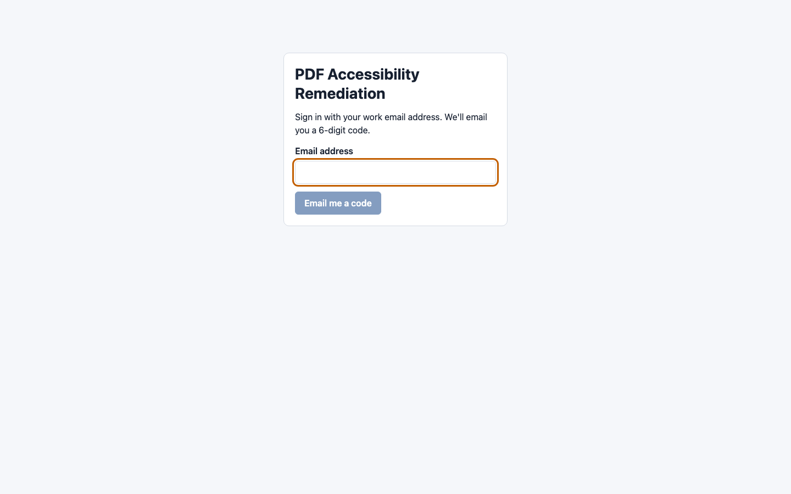

# Signing in

[Guide for people submitting documents](README.md) › Signing in

## With an emailed code

1. Go to the service's address (your administrators will have sent it).
2. Enter your **work email address** and choose **Email me a code**.
3. An email arrives with a **6-digit code**. It works once and expires after 10 minutes. The first time, it may
   land in your junk folder; marking it "not junk" helps next time.
4. Type the code in. You're signed in.

There's no password. Each time you sign in on a new browser, or after a while away, you get a new code. Signing
out (top right) ends the session in this browser.

**Didn't get a code?** Wait a minute and check junk. Choose **Send a new code** if it still hasn't come; only the
newest code works. If codes never arrive, your administrators can help (they have a way to issue one when email
is having problems).

**"Checking that this is a person, not a script…"** under the button: some services run a quick automatic check
before sending a code. It usually finishes on its own in a second or two ("Check complete."); now and then it asks
you to tick a box. If it says it couldn't run, a content blocker may be stopping it: allow
`challenges.cloudflare.com`, or try another browser.

**"Your email address isn't set up for this service":** neither your address nor your email's domain is linked to
a group yet, so the service doesn't know who you are. (Administrators can allow a single address, such as a personal
gmail.com one, without allowing everyone at that domain.) Contact the people who run the service for your
organization. The message usually says who.

**"Too many attempts":** too many codes were asked for, or tried, in a short time. Wait a few minutes and try again.

## Your group

You join your group automatically, by your email address: everyone at the same organization or department ends
up in the same group, with the same choices and pages. You don't pick it, and you can't be in two groups. If
you're in the wrong group, ask your group admin: only a super admin or a service admin can move you, and your group admin can ask
one to.

## Waiting for approval

Some groups approve new people before they can submit documents. If yours does:

- You can sign in, but **My documents** says your account is **waiting for approval**.
- One of your group's administrators approves you. You get an email when they do, and you can start straight
  away. **Check again** on the page refreshes without signing out.
- If they decline, the page says so, with their reason if they gave one, and who to contact. They can still
  approve you later.

## Signing out and sessions

- **Sign out** is at the top right of every page.
- **Sign out of all devices**, in **Settings**, ends every session at once, this one too: for a lost laptop or a
  shared computer you left signed in ([Email and settings](email-and-settings.md#signed-in-devices)).
- A session ends after a period of inactivity (8 hours by default) and after a few days (7 by default) even if
  you're active. You then sign in again with a new code.
- If you've changed something and not saved it, the portal asks before letting you sign out.
