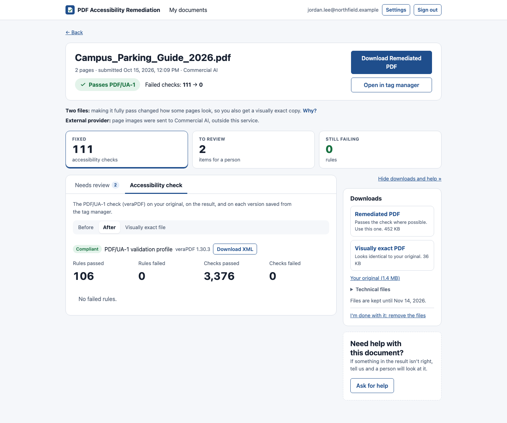

# Your results

[Guide for people submitting documents](README.md) › Your results

## Finding your documents

> **Changed 22 October 2026:** the filters can also show only the documents a script sent, or only those sent in the
> web app.

**Your documents**, at the bottom of **My documents**, lists everything you've submitted, newest first:

- **Search** by file name, and pick a **status** (waiting, in progress, done, failed and so on).
- **Filters** adds more: the result (passes, needs work, items to review, an open help request), processing
  option or AI level, remediated or checked only, how it was sent (by a script with an API token, or in the web app)
  and a date range. Filters in use show as chips you can remove;
  **Clear search and filters** starts afresh.
- Click **Document**, **Submitted**, **Pages** or **Result** to sort. With more than one page, **First**,
  **Previous**, **Next** and **Last** are above and below the list, with where you are ("Page 2 of 13"); choose 25,
  50, 100 or 200 at a time below it. Every list and report in the service pages the same way.
- The list updates by itself while documents are being processed. The view is kept in the page's address, so
  Back from a document, and a bookmark, return to it.

Files are kept for a set time (30 days by default), shown on each document; after that the document's record
stays but its files are removed. You can have them removed sooner: see [When you're done with a
document](#when-youre-done-with-a-document).

### Downloading many at once

Tick the documents you want (the box in the list's heading ticks every one on the page) and use **Download as a
zip** in the bar that appears. First you see what the zip will hold: how many documents and files, and how big. Then it downloads, one
folder per document named from its date and file name (for example `2026-10-21 syllabus`), with the same files
the document's page offers you, and the newest saved version from the tag manager beside them. Documents whose files
have been removed are left out and listed in `README.txt` in the zip. One zip holds at most 25 documents (your
service may set another number).

## The document page

Click a document's name to open its page.

### At the top

> **Changed 22 October 2026:** the line under the name also says when a script sent the document, and a document
> still waiting can be canceled from here.

- The name, page count and when it was submitted, then the AI level, "audit only", "existing tags ignored",
  "PDF/UA-2" or "PDF/UA-1 and PDF/UA-2" (the standard you chose, **New 24 October 2026**) or "sent by script" (with
  the token's name) when they apply.
- **One verdict**, for example **✓ Passes PDF/UA-1**, with "Failed checks: 120 → 0". A PDF 2.0 document (as
  LaTeX's tagging and other recent tools write them) can only be PDF/UA-2, so its verdict says **PDF/UA-2**; so does
  a document you had delivered as PDF/UA-2. With **Both**, the verdict is the PDF/UA-1 file's; the PDF/UA-2 copy's is
  in a note.
- **Download** for the main file and **Open in tag manager**.
- Opened from your list, **Previous** and **Next** (named by the document they open) go to the documents either
  side of it, in the list's order and with its search and filters, on to the list's next page too; "2 of 41" says
  where you are. **Back to My documents** returns to the page of the list that holds the document you're on.
- While it's being processed, a row of steps shows how far it's got: Waiting, Checking the original, Tagging,
  Alt text and tables, Checking the result.
- While it's still waiting its turn, **Cancel** takes it out of the queue; no pages are charged.

### Notes

Short notes, one line each, for anything worth knowing, with **Why?** for the detail. For example: two files
(see below), tagged by Adobe, the AI used *General* instead of the kind you chose, no AI was needed, the kind
picked by *Let AI decide*, or that an outside service was used. **New 24 October 2026:** **PDF 2.0** when you
chose PDF/UA-2 (the file was converted to PDF 2.0) or Both (whether the PDF/UA-2 copy passes its check).

### Three tiles

**Fixed** (accessibility checks), **To review** (items for a person) and **Still failing** (rules). Each opens its
tab. A check only has two: **Failing** and **To review**.

### Tabs

- **Needs review:** what a person should check (below).
- **Report:** the remediation report, in sections (Summary, Changes, Still failing, For review, Details), with
  **Download the report**.
- **Accessibility check:** the PDF/UA-1 check (PDF/UA-2 for a PDF 2.0 document, or one delivered as PDF/UA-2) rule
  by rule, before and after. With **Both**, **PDF/UA-2 copy** is the copy's own check, by PDF/UA-2.
  Each version saved from the tag manager (Human reviewed 1, 2, …) has a tab of its own there too, with the rules it
  still fails. The "failed checks" count beside a version, in the tag manager, Versions and Downloads, links to it.
- **Versions:** your saved edits and corrected files, when there are any.

The chosen tab and section are in the page's address, so a link opens on them.

### On the side

> **Changed 22 October 2026:** the files under **One file at a time** are grouped under **Files**, **Music**, **Math**
> and **Report**, with shorter names (**Formula list**, **Nemeth braille** and so on).

- **Downloads:** **Download everything (zip)** gives every file you can download for the document in one zip, named
  from its date and file name (for example `2026-10-21_syllabus.zip`). **One file at a time**, folded under it, has
  the other files by group (**Files** for the other PDFs, then **Music**, **Math** and **Report**), each with its size
  and a **?** that says what it is, then your original and the technical files. The main file is the big **Download**
  button at the top of the page, so it isn't listed again.
  Once the document has a **human-reviewed** version, that file comes first, marked out: the newest one,
  with a list to pick an earlier one. Every version stays under the **Versions** tab.
  Sheet music also has, under **Music**, **The whole piece (MusicXML)**: the piece as one file, the one to open first.
  A document with music notation, where the music reading service is on, also has **Every line, and the whole piece
  (zip)**: one MusicXML file per music example, as read by software. Open them in notation software (MuseScore
  is free) to see and play each example: the quickest way to check a reading against the page, and what a
  musician who is blind would use in place of the picture.
  A document with formulas has, under **Math**, a **Formula list (web page)** and **MathML files (zip)**, and where
  they could be read by rule, **Nemeth braille (BRF)** and **UEB braille (BRF)**: every formula in braille
  (BRF files, 40 cells to a line, for a braille display or an embosser), under a heading with its page. Open the
  web page in a browser: it shows each formula by page with how the accessible PDF reads it
  aloud, and a screen reader can move through each formula part by part (with NVDA, MathCAT gives the most
  control), which the PDF's read-aloud text can't do. The zip holds one MathML file per formula, for math software,
  equation editors and braille translators. Most formulas were transcribed by AI (a formula the PDF already
  described in MathML keeps its own): check them against the page before relying on them.
  In a PDF 2.0 document (PDF/UA-2) the MathML is also inside the accessible PDF, attached to each formula, for
  readers and screen readers that can use it.
- **Ask for help** ([how](getting-help.md)).

**Hide downloads and help** folds them into a slim menu so the tabs get the whole width; the page remembers your
choice.

## When you're done with a document

Once you've downloaded what you need, you can have a document's files removed early instead of waiting for the end
of the retention period. It keeps your list tidy and keeps fewer copies of your documents around.

- **One document:** on its page, under **Downloads**, choose **I'm done with it: remove the files**.
- **Several:** in **Your documents**, tick the boxes next to them (or the box in the heading for every one shown),
  then **I'm done with these: remove the files**. Documents still waiting or in progress, already removed, or with an
  open help request are skipped, and the message says why.

The files aren't removed at once: there's a short hold (24 hours by default, set by your administrators) so a
mistake can be undone. Until then the document's page says **Marked done** and when the files go, with **Keep the
files** to undo it; the list shows "Files go …" under the name. After the hold, the document stays in your list
with its results, but its files, report and versions are gone, as at the end of the retention period. Pages you
used aren't given back.

## Which file to use

Most documents have **one remediated file**: use it.

Some can't pass without a visible change, usually because a font isn't embedded in the PDF or can't be read as
text. Then you get **two**:

| File | What it is | When to use it |
|---|---|---|
| **…compliant visual** | Looks exactly like your original, with all the tags. May still fail a few checks, usually about fonts | When the look must not change at all |
| **…compliant modified** | Passes more or all checks. Fonts may be swapped for look-alikes with the same spacing, and on rare pages the page is turned into an image with an invisible, tagged text layer | When passing matters more than exact rendering |

The report says exactly what changed in the modified file, and on which pages.

**PDF/UA-1 and PDF/UA-2** (**New 24 October 2026**): with **Both**, the main **Download** is **PDF/UA-1 (PDF 1.7)**,
and **PDF/UA-2 (PDF 2.0)** is among the files. Use PDF/UA-2 where it's asked for and the readers people use handle
PDF 2.0; otherwise PDF/UA-1. They have the same tags and look the same.

**Tagged by Adobe**, with AI alt text (the default): use the **improved copy**, for example *Adobe + AI alt text*. It's
Adobe's file, looking exactly the same, with the alt text and fixes Adobe leaves out. It's the big **Download** button,
and the result at the top, Needs review and the tag manager are all about it. **Adobe tagged PDF**, in the downloads,
is Adobe's file exactly as it came back, if you want to compare; you can also pick it as a version in the tag manager.

## The review list (Needs review)

The machine checks rules; it can't always tell whether something is *right*. The review list is what it wasn't
sure about:

| Severity | Meaning | What to do |
|---|---|---|
| 🔴 **High** | Likely to hide content from screen readers, or to say something wrong | Fix before publishing |
| 🟠 **Review** | Probably wrong; a person should look | Check, then accept or correct |
| 🔵 **Suggestion** | A possible improvement | Optional |

Each item gives the page, the tag, the problem and a suggested action. For alt text, the suggestion includes a
proposed rewrite.

> **Changed 22 October 2026:** every item with a page has **Show**, which highlights the area the item is about in the
> tag manager, and a long list has the same pager as the other lists.

- With more than 8 items: buttons for All, High, Review and Suggestions (with counts), **Still to check**, and a
  search (or a page number). The list shows 25 items at a time, with **First**, **Previous**, **Next** and **Last**
  above and below it.
- **Show** opens the item in the tag manager, where you can fix it: on every item with a page, including ones no tag
  holds (hidden text, a passage too faint to read, an AI reading). The tag manager selects the item's tag when it has
  one, outlines the area the item is about and dims the rest of the page ([more](tag-manager/finding-your-way.md#an-item-from-the-review-list)).
  **Back** there returns to the same item.

**Signing items off.** Each item has a status: **Not looked at**, **Checked** (looked at, and fine), **Fixed** or
**Not an issue**, with an optional note. The list says how many are signed off, and **Still to check** shows only the
rest. The document's owner and their group admins set statuses; everyone who can open the document sees them. A
status stays with its item in later versions, as long as the item is the same (the same problem, on the same page,
about the same tag and text). **Download as CSV** gives the list with each item's status, note, who set it and when,
for a record of the review.

**Typical items:** alt text that may be inaccurate (charts, diagrams), a heading that looks like body text, a
paragraph that looks like a missed heading, link text that's just a web address, a passage in another
language, a reading of math or chemistry written by AI, text corrected or transcribed by AI on a scanned page, text
too faint against its background (with its colors and the contrast ratio; the colors are the original's, so fix them
in the source document if it's hard to read), pages mostly in Arabic or Hebrew, which are read from the right (check
their reading order), and two readings of a formula that disagree (pick one in the
[tag manager](tag-manager/editing-a-tag.md#what-can-be-changed)).

**AI-written alt text is a draft.** The AI checker catches many mistakes but not all. Spot-check figures that
carry meaning: charts, diagrams and formulas.

## The report

The **Report (PDF)** is written for people, and is accessible itself (it passes PDF/UA-1): a summary, what
changed, the check rule by rule before and after, what still fails, the items for a person to check (up to 150;
the rest are in the portal) and details. It carries your service's name and color. The Report and Accessibility
check tabs download it too.

The engine's own files (its Markdown and JSON reports, veraPDF's XML) are for the people who run the service: super
admins find them under **Technical files**. Everyone has what's in them through the **Report** and **Accessibility
check** tabs, and the PDF report. Music and math files, when a document has them, are among the main downloads.

## Scanned documents

Scanned pages are pictures of paper. The service reads their text (OCR) and adds it as an invisible layer, so
it can be read aloud, searched and copied; the page looks the same.

- Where the OCR wasn't sure of a word, the AI corrects it from the image, and lines the OCR couldn't read at all
  are transcribed. Each change is flagged in the review list. Check transcriptions of very poor or handwritten
  lines in particular.
- Charts, photos and diagrams printed on the scan are found and tagged as figures with alt text.
- A scanned form with values typed onto it is read too: the printed form by OCR, the typed values as they are.
- Equations on a scan mostly come out of OCR as a jumble of letters and signs. Where they do, the AI reads them
  from the image (asked once per such page where the equations are), and its reading is what a screen reader says.
  Each one is flagged in the review list; check them, as with any AI reading. A scanned page of ordinary text costs
  no extra AI.
- Tables on scanned pages are tagged as text, not as tables, for now.
