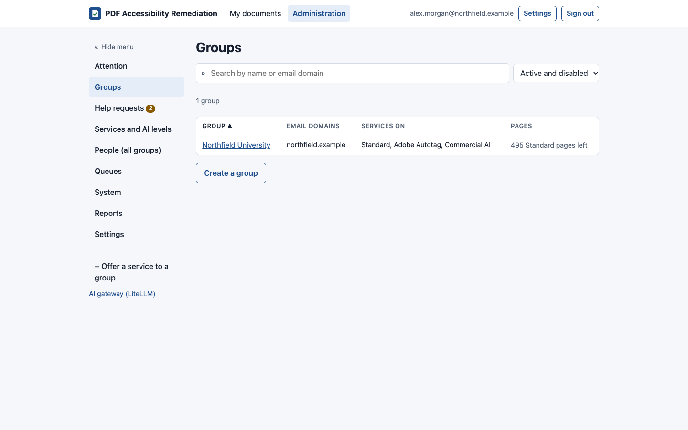

# Groups and people

[Guide for super admins](README.md) › Groups and people

## Groups

> **Changed 22 October 2026:** **Create a group**, and the group's top-ups and pool corrections, open in the admin
> area's standard dialog.

A **group** is who a service is shared with: a department, organization or team. Everyone belongs to exactly one,
decided at their first sign-in by their email address.

**Groups** lists them all, a page at a time, with a search by name or email domain and a status filter. **Create a
group** opens a dialog for its name and email domains; **Create group** makes it. A group's own tabs are the same as a group admin's (see
[the admin area](../group-admins/the-admin-area.md#your-groups-pages)), plus what only super admins can change, on
**Group settings**:

- **Name**, the **default page limit per person**, and the group's own **message when out of pages** (empty uses the
  global message).
- **Email domains:** everyone signing in with an address on one of these domains joins the group. A domain belongs
  to one group only. A subdomain only matches if it's listed. Adding a public email provider (gmail.com,
  outlook.com and so on) asks you to confirm, because anyone with a free account could then join.
- **People allowed by address:** individual email addresses that may sign in and join this group, without their
  domain. Use it for someone with a gmail.com address, a visitor or a contractor. An address here takes precedence
  over the domains, so it can also put one person from partner.edu in a different group from the rest of
  partner.edu. An address is on one group at a time (adding it to another offers to move it). Removing it stops new
  sign-ups only: if they've already signed in, their account keeps working until you disable it in People.
- **Group admins:** add or remove them. A group can have several.
- **Disable group:** its people are signed out and can't sign in until it's enabled again.
- **Correct the pool** (below).

### A group for people without an organization domain

For people who don't share an organization's email domain (individuals with personal addresses, guests), create a
group such as **Individuals** with no email domains, and add each person under **People allowed by address**. It
works like any other group: its own services, page pool, limits and admins.

## Pages and top-ups

Each service has a **pool** per group, and optionally a **global pool** shared by every group (set on the service's
page). Pages are added with a **top-up**:

1. The group's **Services and pages** tab → **Add pages** on the service's row, which opens a dialog.
2. Enter the number of pages and a **ticket number** (and optionally a link and comment), for your records.
3. No ticket? Tick **override** and give a comment. Overrides are flagged in the ledger and reports.

Every top-up records who made it, when, from where, and the balances before and after. **Correct the pool** adds or
removes pages (with a reason) to fix mistakes.

**Reserve, then commit.** When a document is accepted, its pages are reserved on every service it uses, at every
level (global, group, person) at once. They're committed when it's done, and given back if it fails, is canceled,
or the AI it was charged for turned out not to be needed.

## People (all groups)

**People (all groups)** lists everyone, with their group and use, a page at a time. Search by email or name, pick a
group, and under **Filters** a role (super admins, group admins, members) or status (active, disabled, waiting for
approval, declined, data removed); sort by person, group or last sign-in. **Manage** opens a dialog to:

- **move** them to another group (their past use stays with the old group);
- **correct their usage:** give pages back or charge more, per service, with a reason. It's recorded in the ledger
  and the audit log. (Use this when a document didn't come out usable, for example.)
- **disable** their account (it ends their sessions; their documents stay);
- **make them a super admin**, or remove it;
- **Sign out everywhere:** every session in every browser and device ends, for a lost device or an account
  someone else may be using. It's audited; they need a new code to sign in.

Personal limits are set in the group's **People** tab, as a group admin does.

## A person's data (records requests)

In **People (all groups)**, open **Manage** for the person, then **Personal data**:

- **Export records** downloads, as JSON, what the service holds about them: their account, roles and group, their
  documents (names, dates, pages, results), their help requests and messages, their page ledger and the audit entries
  about them. **Export records and files** adds their documents' files that still exist, in a zip (it can be large).
  Each export is recorded in the audit log.
- **Remove this person's data…** is for a request to be forgotten. Type a reason and their email address to confirm.
  It can't be undone, so export first if they asked for a copy.
  - Deleted: their documents' files and help attachments; their sign-in sessions and codes; their saved tag-manager
    drafts, report subscriptions and saved reports; emails queued to them; their address on any group's list.
  - Kept, without them: their documents (as "document-1a2b3c4d.pdf", with their pages and results), the page ledger,
    the audit log, saved versions and their help requests (their own messages emptied). Their name and email become
    "removed person #…" everywhere, including emails the service sent to others about them. So reports, totals and
    billing still add up.
  - Their account is closed, and they're signed out everywhere. You can't remove yourself or the last super admin.
  - What it can't find: words other people wrote about them, such as a staff reply that mentions them by name. Read
    their help requests before removing, if that matters.

The audit log and the page ledger otherwise can't be changed at all. During a removal, and only then, the database
allows their identity columns to change and nothing else.

## Removing documents

To clear out documents before the end of the retention period (test uploads, for example), open the group's
**Documents** tab, tick the documents (or the heading's box for every one shown), give a **reason** (it's recorded
in the audit log), then:

- **Remove files now:** the files, report, versions and help requests about them go at once (as at the end of
  retention); the documents stay in their owners' lists, marked "Files removed".
- **Delete** (**Delete the document** on a single document's page): the files go at once and the documents leave
  every document list, their owners' included. Their records stay, so reports, page usage and the ledger still
  count them; super admins can still open them (from **Reports**), marked as deleted.

Documents still waiting or in progress can't be ticked. Neither can be undone. A single document has the same two
choices on its page, under **Downloads → Super admin: remove**, where you can also **Keep the files** of a document
its owner marked done.

## When a sign-in code doesn't arrive

The sign-in page answers every address the same way, and sends the email afterwards, so it can't tell the person when
sending fails. Look in **Reports › Activity › Email** for the address: a failed sign-in code is listed there with
its error, and the audit log has `login.code_not_sent`. A disabled person gets an email saying their account can't
sign in, not a code.

If email is failing, the person running the servers can issue a code from the command line with
`scripts/sign-in-code.sh` (see
[Operations → Email](../../operations/email-and-branding.md#when-sign-in-codes-dont-arrive)).
It's recorded in the audit log.
