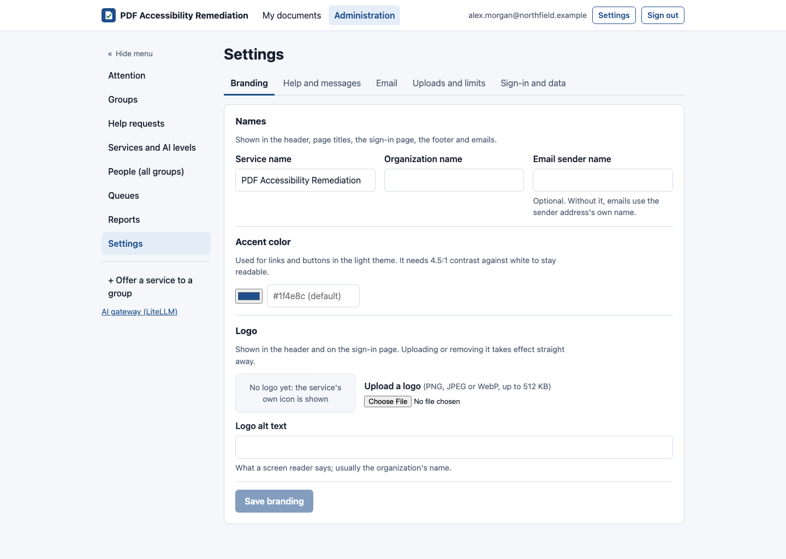

# Settings

[Guide for super admins](README.md) › Settings

**Administration → Settings**, one tab per topic, each with its own **Save**. Every change is recorded in the audit
log.

## Branding

- **Service name** and **organization name:** shown in the header, on the sign-in page, in the footer, in page
  titles, in emails and on the PDF report.
- **Email sender name.**
- **Accent color:** used for links and buttons with white text, so it must have at least 4.5:1 contrast against
  white (WCAG AA). The tab checks it and shows a preview; darker colors pass.
- **Logo:** PNG, JPEG or WebP, up to 512 KB, with its alt text. (SVG isn't accepted, because an SVG served from the
  app could carry script.)

## Help and messages

- The **help email address** and the **link for requesting pages**.
- The messages people see when their email isn't set up for the service, when their account is disabled, and when
  they're out of pages.

## Email

- Which **provider** sends email (set on the server; shown here) and **Send test email**, which shows whether the
  message was accepted. Every test is in the audit log.
- **Notification emails:** the default for people who haven't chosen (as they happen, daily or off), per kind.
- **Scheduled email reports:** on or off for everyone, the **time zone** that decides when they go out and what
  "last month" means, and the **hour** they (and daily summaries) are sent.

## Uploads and limits

- **Each upload:** the largest file, the most pages per document, the most files per upload.
- **Each person's queue:** how many of one person's documents are processed at once, and how many can be waiting
  (uploads beyond that are refused).
- **Large documents:** documents over a page count (200 by default; 0 turns it off) are mixed in, one after every
  few smaller ones (5 by default), with only so many running at once (1 by default). With nothing smaller waiting
  they go one after another. People see "Large document: it's processed in turn with smaller ones".
- **Help requests:** the largest attached file, all files on one request, and how long someone can reopen a
  finished request.
  **Open a help request when a document fails** (on by default) files every failure in the help queue under
  "The document couldn't be processed", with what the person was told, the error's name, and the engine's
  recorded detail as an internal note. Close the ones that are known limitations with a note. Documents
  someone stopped don't get one. With it off, people can still ask for help with a failed document.
- **AI in the tag manager: Describe with AI** (off by default) is the service default for the tag manager's AI alt
  text for a part of a figure: one AI call at the document's AI level each time, recorded on the document's cost
  (`describe_usd`, `describe_calls`). Each group, and each person in a group, can be set otherwise by their group
  admins or a super admin (Groups → the group's settings, and its People).
- **Kind of document: Let AI decide** offers *Let AI decide* among an AI level's kinds:
  - **Use Jev through OpenRouter:** an outside service, about $0.0001 per document, never used for local-only
    groups. It needs the engine's OpenRouter key.
  - **Local model:** a gateway model on your own servers, for local-only groups (and for everyone when Jev is off).
  - **Use the kind when at least … % sure** (60% by default); below that, General is used.
  - **Pages read** (3 by default): the first ones, plus more spread through long documents.
- **PDF/UA validation (veraPDF)**: how the checks run. The results are the same either way.
  - **As a service kept running** (the default): faster. If the service doesn't answer, the engine runs that check
    from the command line instead.
  - **From the command line in the engine:** Java starts for each check, about a second more each time.
  - **Also check PDF/UA-2** (on by default): shown in reports for information; the verdict is PDF/UA-1. Turning it
    off halves the number of checks.

## Sign-in and data

- **Session timeouts:** idle hours and the most days a session lasts.
- **New groups require approval:** whether new groups start with *New members need approval* on (each group can
  change it).
- **Retention:** how long **files** are kept (30 days by default) and how long **records** (usage, ledger, sign-ins,
  audit) are kept before they're purged. **Files marked done** is the hold before the files of a document its owner
  marked done are removed (24 hours by default; 0 removes them at the next cleanup, within the hour).
